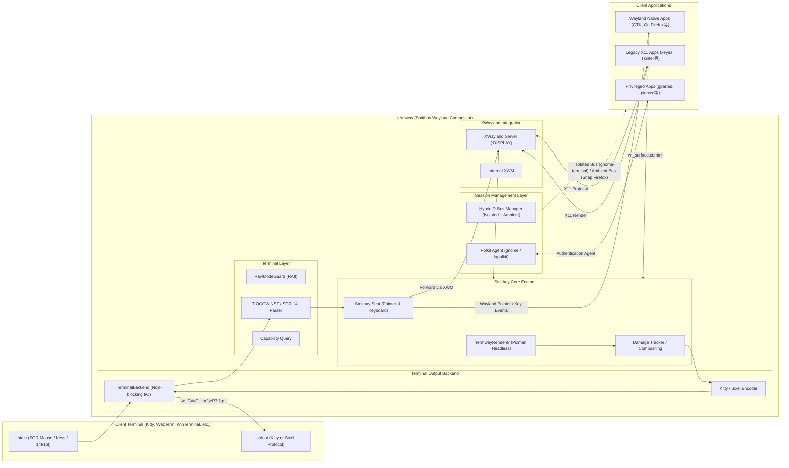

# termway: The Ultimate Terminal GUI Bridge

[English](README.md) | [日本語](README.ja.md)

ターミナル（端末エミュレータ）の画面内に、Wayland および X11 GUI アプリケーションを直接埋め込んで実行・操作できる高速ブリッジツールです。Smithay ベースの自立型ヘッドレスコンポジタと XWayland を内蔵しています。

---

### 主な特徴

- **ターミナル画面内でのGUI実行**:
  - **Kitty Graphics Protocol** および **Sixel Graphics Protocol** を使用し、端末内に高精細な画像としてインライン描画。Windows Terminal や Mac の iTerm2 にも対応！
  - SSH の単一ポート（PTY 1本）のみが通る踏み台環境やクラウド、tmux セッション内でも、追加のポートフォワーディングやクライアント側XサーバーなしでGUIツールが利用可能。
- **フルマウス＆キーボード対話 (ホバー対応)**:
  - **xterm SGR 1006 マウスプロトコル (Any-event 1003h)** により、クリック、ドラッグ、ホイールスクロールに加えてマウスカーソルの移動（ホバー追従）を完全検知。
  - 端末起動時に **SGR 14t（Report text area size in pixels）** を自動送信してターミナルの物理フォントピクセルサイズをミリ秒単位で厳密に取得。Sixel時の1:1アスペクト比描画とピクセルパーフェクトな座標同期（ドリフト防止）を実現！
  - Smithay `Seat` (Pointer / Keyboard) 経由で Wayland および XWayland クライアントへイベントを直接ディスパッチ。
  - 矢印キー、Ctrlキー、Enter/Tab/Backspace 等のキー入力もノンブロッキングで即時転送（1キー遅延なし）。
- **イベント駆動・タイル差分レンダリング (Damage Tracking)**:
  - `wl_surface.commit` やダメージ通知に連動する完全イベント駆動レンダリングにより、省電力・超低遅延化を実現。
- **ハイブリッド D-Bus セッションと Snap アプリ対応 (Firefox / gnome-terminal / gparted 対応)**:
  - **デュアル D-Bus 管理機構**: `gnome-terminal` などの単一インスタンス型アプリに対しては独立した専用 D-Bus セッションバスを起動し、ホスト側の常駐サーバーとの競合を防いで確実に Termway 内で起動。一方で Ubuntu 標準の Snap 版 `firefox` などの厳格なサンドボックス（`snap-confine`）アプリには、cgroup スコープ生成に必要なホストの `systemd --user` セッションバスを自動でルーティング。
  - **Polkit 認証エージェント自動連携**: `policykit-1-gnome` または `lxpolkit` などの認証エージェントを自動検知してセッション内に常駐。`gparted` や `pkexec` などの管理者権限アプリの起動時に、ターミナル画面内にパスワード入力ダイアログが正しく表示されます。
- **組み込みウィンドウマネージャ (Openbox / Fluxbox スタイル)** (`--wm`):
  - 外部 WM プロセス不要で動作する内蔵フローティングウィンドウマネージャ。
  - スリムタイトルバー、1px シャープボーダー、閉じるボタン [×]、右下リサイズハンドル、内蔵 8x8 ビットマップフォントによるタイトル描画。
  - 画面枠クランプ機構により、端末サイズに応じた解像度自動補正とウィンドウはみ出し・右端/下部カットを完全に防止。

---

## アーキテクチャ概要



---

## 必要条件・環境

### 対応ターミナルエミュレータ
 
termway は高速グラフィックスプロトコル（**Kitty** および **Sixel**）の双方に対応しており、端末の応答に応じて自動判別またはオプション指定で描画を行います。
 
| グラフィックス方式 | ターミナルエミュレータ | 対応 OS | 備考 |
| :--- | :--- | :--- | :--- |
| **Kitty Graphics** | **Kitty** | Linux, macOS | 本家リファレンス実装 |
| | **Ghostty** | Linux, macOS | GPU 加速による超高速描画 |
| | **WezTerm** | Windows, Linux, macOS | Kitty グラフィックス完全対応 |
| | **Foot** | Linux (Wayland) | 高速 Wayland ネイティブ端末 |
| **Sixel Graphics** | **Windows Terminal** | Windows | Windows Terminal Preview で対応 (`--sixel`) |
| | **WezTerm** | Windows, Linux, macOS | Kitty / Sixel 両対応 |
| | **Foot** | Linux (Wayland) | Kitty / Sixel 両対応 |
| | **iTerm2** | macOS | Sixel 24-bit TrueColor フル対応 |
| | **mlterm** | Linux, Windows, macOS | Sixel リファレンスターミナル |
| | **RLogin** | Windows | 日本で広く使われている Sixel 対応 SSH クライアント |
| | **Alacritty** (Sixelパッチ版) / **xterm** | Linux, macOS | `xterm -ti vt340` モード |

### サーバー / 実行環境
- Linux (x86_64)
- Rust ツールチェーン (1.70 以上)
- 必要なシステムライブラリ:

```bash
# Ubuntu / Debian
sudo apt-get install -y build-essential pkg-config libx11-dev libxtst-dev libpixman-1-dev libwayland-dev xwayland dbus-daemon

# gparted 等の管理者権限 GUI ツール（Polkit 認証ダイアログ）を使用する場合（いずれか1つ）
sudo apt-get install -y policykit-1-gnome   # Ubuntu 標準の GNOME 認証ダイアログ（推奨）
# または
sudo apt-get install -y lxpolkit           # 軽量な認証ダイアログ

# レガシー --x11 モードを使用する場合のみ追加で必要
sudo apt-get install -y xvfb openbox
```

---

## インストールとビルド

```bash
# リポジトリのクローン
git clone https://github.com/username/termway.git
cd termway

# ビルド
cargo build --release
```

バイナリは `target/release/termway` に生成されます。

---

## 使い方

以下の手順では、ビルド済みバイナリ `./target/release/termway`（または `PATH` に通した `termway`）を実行する例を記載しています。

### 1. 内蔵デモGUIの起動
```bash
./target/release/termway --demo
```
Sixelを使いたい場合は `--sixel` を追加します。ウィンドウの枠が欲しい場合は `--wm` を追加します。
```bash
./target/release/termway --sixel --wm --demo
```

### 2. 任意のアプリケーションの実行
`--` の後に実行したいコマンドと引数を指定します（デフォルトで Wayland コンポジタが立ち上がり、XWayland により X11 アプリもそのまま動作します）：

```bash
# GUI アプリケーションを起動（デフォルト: Wayland コンポジタ + Kitty/Sixel 自動検出）
./target/release/termway -- gvim

# Webブラウザを起動（Ubuntu 標準の Snap 版 Firefox にも完全対応）
./target/release/termway -- firefox
# ウィンドウ枠をつけて起動:
./target/release/termway --wm -- firefox

# gnome-terminal (D-Bus セッション分離により Termway 内で確実に起動)
./target/release/termway --wm -- gnome-terminal

# 管理者権限 GUI ツール（Polkit 認証ダイアログがターミナル内に表示されます）
./target/release/termway --wm -- gparted

# Sixel プロトコルを明示指定して起動
./target/release/termway --sixel -- gvim

# Kitty プロトコルを明示指定して起動
./target/release/termway --kitty -- gvim

# レガシーな X11/Xvfb モードで実行する場合
./target/release/termway --x11 --wm -- xclock
```

> **Note**:
> - `gvim` や `gedit` 等の自動的にバックグラウンド化（fork）するアプリケーションも、`-f` などのオプション不要でそのまま起動できます。ウィンドウが開いている間セッションを維持し、全ウィンドウを閉じた際に自動で終了します。
> - `firefox` 等のモダンブラウザ（Ubuntu 標準の Snap パッケージを含む）も、systemd ユーザーセッションバスの自動ルーティングにより設定不要でそのまま動作します。
> - `gnome-terminal` などの Single-Instance デーモン機構を持つアプリも、内蔵の独立 D-Bus セッションバスによりリモート画面に飛ぶことなく Termway 内で正常に起動します。
> - `gparted` や `pkexec` 等の管理者権限ツールは、システムに `policykit-1-gnome` または `lxpolkit` 等の認証エージェントが導入されていれば、Termway 画面内にパスワード入力ダイアログが表示されてスムーズに認証・実行できます。
> - X11 アプリケーション実行時は `/tmp/.X11-unix` への書き込み権限が必要です。コンテナや制限された環境で読み取り専用になっている場合、ホスト環境のディスプレイへ予期せずエスケープすることなく、事前チェックにより安全かつ明確なエラーメッセージを出力して終了します。
> - **クリップボードの動作**: 文字列選択（`Shift + 矢印キー`）および貼り付け（`Ctrl-V` や端末側の `Ctrl+Shift+V`）に対応しています。なお、デフォルトの Wayland モードにおいて `Ctrl-C` によるコピー処理は現在調査中の既知の不具合となっています。`Ctrl-C` / `Ctrl-V` によるコピペ操作を行いたい場合は、正常に動作するレガシー X11 モード（`--x11`）をご利用ください。

### 3. Smithay Wayland コンポジタ（デフォルト）

termway 自身が Smithay ベースのヘッドレス Wayland コンポジタとして起動します。
XWayland も自動で起動されるため、最新の Wayland ネイティブアプリだけでなく、レガシーな X11 アプリケーション（xeyes, xclock等）も透過的にそのまま実行できます。

```bash
# フォントセルサイズ（幅x高さ）を明示指定してマウス座標精度を最適化
./target/release/termway --cell-size 10x22 -- gvim
```

### 4. フォントセルサイズの動的測定と補正 (--cell-size, TERMWAY_CELL_SIZE)

Sixel および SGR マウスプロトコルでのピクセルパーフェクトな追従のため、起動時に `\x1b[16t` (Report font cell size) および `\x1b[14t` (Report text area size) を自動送信してターミナルの物理セル寸法を問い合わせます。
端末エミュレータ（VTE/GNOME Terminal等）がこれらに応答しない場合、以下の方法でセルサイズを明示的に指定・調整できます：

- CLI オプション: `--cell-size <幅x高さ>` (例: `--cell-size 10x22`)
- 環境変数: `TERMWAY_CELL_SIZE=<幅x高さ>` (例: `export TERMWAY_CELL_SIZE=10x22`)

### 5. グラフィックスプロトコルの自動検出と明示指定 (--kitty, --sixel)

termway は起動時に端末エミュレータのプロトコル対応状況を自動検出します：
- Kitty 対応端末（Kitty, WezTerm, Ghostty 等）: 自動的に Kitty Graphics Protocol を使用
- Sixel 対応端末（Windows Terminal, iTerm2, Mintty 等）: 自動的に Sixel プロトコルを使用
- VTE 系端末（GNOME Terminal, xterm 等）: 自動的に Sixel プロトコルへフォールバック

明示的にプロトコルを強制したい場合は `--kitty` または `--sixel` を指定できます：

```bash
# Kitty プロトコルを強制
./target/release/termway --kitty -- gvim -f

# Sixel プロトコルを強制
./target/release/termway --sixel -- gvim -f
```

### 5. 主なコマンドラインオプション

| オプション | 引数 | 説明 | デフォルト |
| :--- | :--- | :--- | :--- |
| `--wayland` | - | Smithay ベースのヘッドレス Wayland コンポジタモードを使用する（デフォルト） | 有効 |
| `--x11`, `--xvfb` | - | 従来の X11/Xvfb + XTest 注入モードを使用する | - |
| `--sixel` | - | Kittyプロトコルの代わりにSixelプロトコルを明示的に使用する（`KITTY_WINDOW_ID` 未設定時は自動有効化） | - |
| `--wm` | - | 組み込みフローティングウィンドウマネージャ（Openbox/Fluxbox スタイル）を有効化（なし時は全画面単一アプリ表示） | - |
| `--width` | `<PIXELS>` | 仮想ディスプレイ解像度の幅 | 端末サイズから自動算出 |
| `--height` | `<PIXELS>` | 仮想ディスプレイ解像度の高さ | 端末サイズから自動算出 |
| `--fps` | `<FPS>` | 目標フレームレート | `30` |
| `--demo` | - | 内蔵 Tkinter デモアプリを起動 | - |

---

## テスト実行

本プロジェクトは要求仕様からシステム受入テストまでの厳密なトレーサビリティを確保して開発されており、単体テスト・結合テスト・E2Eシステムテストが整備されています。

```bash
# 全テスト (単体・結合・E2E: 計36テスト) の実行
cargo test
```

## 開発背景とユースケース

### なぜターミナル内にGUIを表示するのか？
従来のリモートGUIアプローチ（X11 Forwarding や VNC/RDP、Webベースなど）は、クライアント側に専用ソフト（Xサーバー、VNC Viewer等）を要求し、専用ポートの開放やポートフォワーディングを必要とします。

`termway` は、**「すべての画面描画と入力を、純粋な標準入出力（TTY/PTY のテキストストリーム）の中にカプセル化する」** という設計思想を持ちます。

1. **踏み台（Bastion）や超高セキュリティ環境での突破力**:
   - `AllowTcpForwarding no`（SSHポートフォワード禁止）やファイアウォールでポートが塞がれているクラウドやエンタープライズ環境でも、**SSH の単一ポート（PTY 1本）さえ通れば 100% GUI が動作**します。
2. **tmux による「GUI セッションの完全永続化」**:
   - 通常の X11/Wayland アプリは接続が切れると終了しますが、`termway` を tmux 内で起動しておけば、回線が切断されても後から `tmux attach` することで**作業中の GUI 状態へ即座に復帰**できます。
3. **クライアント環境のポータビリティ**:
   - 手元のマシンに X サーバーや専用ランタイムをインストールする必要がなく、iPad のターミナルや会社支給の制限端末からでも Linux GUI ツールを利用可能です。

### 手法別の比較

| 項目 | termway (In-Terminal GUI) | SSH X11 Forwarding (`ssh -X`) | リモートデスクトップ (VNC / RDP) |
| :--- | :--- | :--- | :--- |
| **クライアント要件** | **対応ターミナルのみ (Kitty, WinTerm等)** | Xサーバー (XQuartz, VcXsrv等) | 専用 Viewer (TightVNC, mstsc等) |
| **使用ポート** | **SSH (22) のみ** | SSH (22) のポート転送 | 専用ポート (5900, 3389等) |
| **ファイアウォール耐性**| **極めて高い (PTY が通れば動作)** | 中 (ポートフォワード許可が必要) | 低 (専用ポート開放が必要) |
| **セッション永続性 (tmux)**| **完全対応 (デタッチ・再アタッチ可)** | 不可 (SSH切断で全滅) | サーバー側で維持可能 |

---

## v2.0 実装済み: Smithay + XWayland 自立型コンポジタ

v1.0（Xvfb 外部キャプチャ＆ XTest 注入の PoC 構成）から、**Smithay による自立型 Headless Wayland コンポジタ ＋ XWayland** へのアーキテクチャ移行を実装しました（`--wayland` フラグで起動）。

- [x] **Smithay Headless / Pixman レンダラー統合**:
  - `wl_surface.commit` やダメージ通知に連動する完全イベント駆動レンダリング（ポーリング廃止、省電力・超低遅延化）。
- [x] **Wayland ネイティブアプリ ＋ X11 アプリ両対応**:
  - `WAYLAND_DISPLAY` と `DISPLAY` (XWayland) を同時に提供し、最新の Wayland アプリと従来の X11 アプリ（xeyes, xclock 等）を混在実行可能。
- [x] **Smithay `Seat` による入力直接統合**:
  - Wayland ポインタイベント経由で正確なフォーカス・ウィンドウ制御を実現（XTest による外部偽装注入を廃止）。
- [x] **XWayland 統合 (X11 アプリケーション互換実行)**:
  - `X11Wm` ハンドラによる XWayland ライフサイクル管理とサーフェス紐付けを実装。従来の X11 アプリケーション（xeyes, xclock 等）の起動と入力を透過的に仲介。
- [x] **組み込みウィンドウマネージャ (Openbox / Fluxbox スタイル)** (`--wm`):
  - 外部 WM プロセス不要で動作する内蔵フローティングウィンドウマネージャ。
  - **洗練された装飾描画**: 22px スリムタイトルバー、1px シャープボーダー、閉じるボタン [×]、右下リサイズハンドル、内蔵 8x8 ビットマップフォントによるタイトル描画。
  - **フルマウス対話**: タイトルバードラッグによるウィンドウ移動、右下ドラッグによるリサイズ、クリックによる最前面浮上（Z-order Raise & キーボード/マウスフォーカス付与）、[×] クリックによる安全なクローズ・プロセス終了。
  - **画面境界保護**: 端末リサイズ時やドラッグ移動・リサイズ中、サーフェスコミット時における画面外へのはみ出し防止（境界クランプ機構）。
  - **Wayland & X11 統一管理**: XDG Shell (Wayland) と X11Surface (XWayland) を同一の `ManagedWindow` で透過的に制御。
- [x] **画面リサイズへの動的追従 (Dynamic Resolution Resizing)**:
  - ターミナルウィンドウのサイズ変更（`SIGWINCH`）やフォントセル応答（`\x1b[4t` / `\x1b[6t`）に連動し、解像度と各ウィンドウのサイズ・配置をシームレスに動的追従。
- [x] **Sixel プロトコル対応 (Broad Terminal Support)**:
  - Kitty Graphics Protocol に加え、Sixel画像プロトコルに対応完了。SGR 14t ピクセルパースによるピクセルパーフェクトなマウストラッキングを実現。

### 今後の機能拡張
- [ ] **双方向クリップボードの完全同期 (Bidirectional Clipboard Sync)**:
  - Bracketed Paste 等を活用した「ホスト → ゲスト」への双方向コピー＆ペースト。
- [ ] **自動タイリング配置モード (tmux / i3風)**:
  - フローティングモードに加え、画面分割による自動タイリングレイアウト。
- [ ] **ワンキー・スクリーンショット / GIF 録画**
