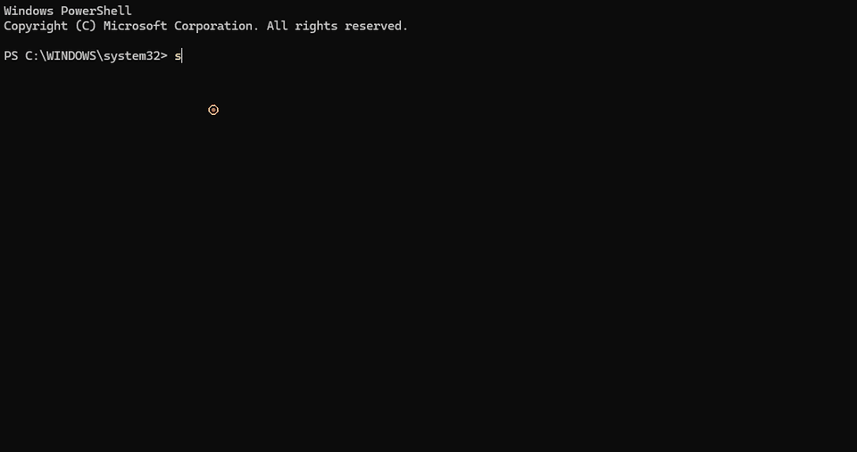
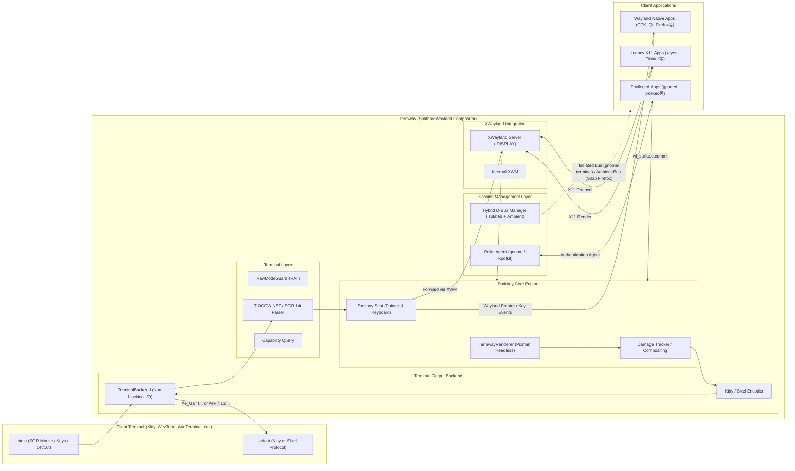

# termway: The Ultimate Terminal GUI Bridge

[English](README.md) | [日本語](README.ja.md)

ターミナル（端末エミュレータ）の画面内に、Wayland および X11 GUI アプリケーションを直接埋め込んで実行・操作できる高速ブリッジツールです。Smithay ベースの自立型ヘッドレスコンポジタと XWayland を内蔵しています。



---

### 主な特徴

- **ターミナル画面内でのGUI実行**:
  - **Kitty Graphics Protocol** および **Sixel Graphics Protocol** を使用し、端末内に高精細な画像としてインライン描画。Windows Terminal や Mac の iTerm2 にも対応！
  - SSH の単一ポート（PTY 1本）のみが通る踏み台環境やクラウド、tmux セッション内でも、追加のポートフォワーディングやクライアント側XサーバーなしでGUIツールが利用可能。
- **フルマウス＆キーボード対話 (ホバー対応)**:
  - **xterm SGR 1006 マウスプロトコル (Any-event 1003h)** により、クリック、ドラッグ、ホイールスクロールに加えてマウスカーソルの移動（ホバー追従）を完全検知。
  - 端末起動時に **SGR 14t（Report text area size in pixels）** を自動送信してターミナルの物理フォントピクセルサイズをミリ秒単位で厳密に取得。Sixel時の1:1アスペクト比描画とピクセルパーフェクトな座標同期（ドリフト防止）を実現！
  - Smithay `Seat` (Pointer / Keyboard) 経由で Wayland および XWayland クライアントへイベントを直接ディスパッチ。
  - 矢印キー、Ctrlキー、Enter/Tab/Backspace 等のキー入力もノンブロッキングで即時転送（1キー遅延なし）。
- **イベント駆動・タイル差分レンダリング (Damage Tracking)**:
  - `wl_surface.commit` やダメージ通知に連動する完全イベント駆動レンダリングにより、省電力・超低遅延化を実現。
- **ハイブリッド D-Bus セッションと Snap アプリ対応 (Firefox / gnome-terminal / gparted 対応)**:
  - **デュアル D-Bus 管理機構**: `gnome-terminal` などの単一インスタンス型アプリに対しては独立した専用 D-Bus セッションバスを起動し、ホスト側の常駐サーバーとの競合を防いで確実に Termway 内で起動。一方で Ubuntu 標準の Snap 版 `firefox` や `xdg-open` などの厳格なサンドボックス（`snap-confine`）アプリには、cgroup スコープ生成に必要なホストの `systemd --user` セッションバスを自動でルーティング。（設計判断・トレードオフの詳細は [ADR-0001](docs/adr/0001-hybrid-dbus-session-routing.md) を参照）
  - **Polkit 認証エージェント自動連携**: `policykit-1-gnome` または `lxpolkit` などの認証エージェントを自動検知してセッション内に常駐。`gparted` や `pkexec` などの管理者権限アプリの起動時に、ターミナル画面内にパスワード入力ダイアログが正しく表示されます。
- **組み込みウィンドウマネージャ (Openbox / Fluxbox スタイル)**:
  - 外部 WM プロセス不要で動作する内蔵フローティングウィンドウマネージャ。
  - スリムタイトルバー、1px シャープボーダー、各種ウィンドウ操作ボタン（閉じる `[×]`、最大化/復元 `[□]`、最小化 `[-]`）、右下リサイズハンドル、内蔵 8x8 ビットマップフォントによるタイトル描画。
  - ウィンドウの**最大化**（`[□]` ボタンまたはタイトルバーのダブルクリック）および**最小化**（`[-]` ボタンで最下部タスクバーへ退避）に完全対応。
  - 画面最下部のタスクバーに各ウィンドウがクリッカブルなチップ（`[1: アプリ名]` / `[1: アプリ名 _]`）として常駐し、マウスクリックで即座に最小化解除・最前面表示・最小化トグルが可能。
  - 画面枠クランプ機構により、端末サイズに応じた解像度自動補正とウィンドウはみ出し・右端/下部カットを完全に防止。
- **ホストOSとの双方向クリップボード同期 (`Ctrl-C` / `Ctrl-V`)**:
  - OSC 52 および Bracketed Paste をサポート。ターミナル内 GUI アプリとホスト環境（Windows / macOS / Linux）の間で、日本語・マルチバイト文字を含むテキストの双方向コピー＆ペーストを完全サポート。
- **ワンキースクリーンショット (`F12`) & 安全終了 (`Ctrl-Q`)**:
  - `F12` キーによる即時 PNG 画像キャプチャ保存。`Ctrl-Q` によるターミナル状態復元を伴う安全な終了。

---

## アーキテクチャ概要



---

## 必要条件・環境

### 対応ターミナルエミュレータ
 
termway は高速グラフィックスプロトコル（**Kitty** および **Sixel**）の双方に対応しており、端末の応答に応じて自動判別またはオプション指定で描画を行います。
 
| グラフィックス方式 | ターミナルエミュレータ | 対応 OS | 備考 |
| :--- | :--- | :--- | :--- |
| **Kitty Graphics** | **Kitty** | Linux, macOS | 本家リファレンス実装 |
| | **Ghostty** | Linux, macOS | GPU 加速による超高速描画 |
| | **WezTerm** | Windows, Linux, macOS | Kitty グラフィックス完全対応 |
| | **Foot** | Linux (Wayland) | 高速 Wayland ネイティブ端末 |
| **Sixel Graphics** | **Windows Terminal** | Windows | Windows Terminal Preview で対応 (`--sixel`) |
| | **WezTerm** | Windows, Linux, macOS | Kitty / Sixel 両対応 |
| | **Foot** | Linux (Wayland) | Kitty / Sixel 両対応 |
| | **iTerm2** | macOS | Sixel 24-bit TrueColor フル対応 |
| | **mlterm** | Linux, Windows, macOS | Sixel リファレンスターミナル |
| | **RLogin** | Windows | 日本で広く使われている Sixel 対応 SSH クライアント |
| | **Alacritty** (Sixelパッチ版) / **xterm** | Linux, macOS | `xterm -ti vt340` モード |

### サーバー / 実行環境
- Linux (x86_64)
- Rust ツールチェーン (1.70 以上)
- 必要なシステムライブラリ:

```bash
# Ubuntu / Debian
sudo apt-get install -y build-essential pkg-config libpixman-1-dev libwayland-dev xwayland dbus-daemon

# gparted 等の管理者権限 GUI ツール（Polkit 認証ダイアログ）を使用する場合（いずれか1つ）
sudo apt-get install -y policykit-1-gnome   # Ubuntu 標準の GNOME 認証ダイアログ（推奨）
# または
sudo apt-get install -y lxpolkit           # 軽量な認証ダイアログ
```

---

## インストールとビルド

```bash
# リポジトリのクローン
git clone https://github.com/totatake/termway.git
cd termway

# ビルド
cargo build --release
```

バイナリは `target/release/termway` に生成されます。

---

## 使い方

以下の手順では、ビルド済みバイナリ `./target/release/termway`（または `PATH` に通した `termway`）を実行する例を記載しています。

### 1. 内蔵デモGUIの起動
```bash
./target/release/termway --demo
```
Sixelを使いたい場合は `--sixel` を追加します：
```bash
./target/release/termway --sixel --demo
```

### 2. 任意のアプリケーションの実行
`--` の後に実行したいコマンドと引数を指定します（デフォルトで Wayland コンポジタが立ち上がり、組み込みウィンドウマネージャおよび XWayland により Wayland/X11 アプリがそのまま快適に動作します）：

```bash
# GUI アプリケーションを起動（Wayland コンポジタ + Kitty/Sixel 自動検出 + 組み込み WM）
./target/release/termway -- gvim

# Webブラウザを起動（Ubuntu 標準の Snap 版 Firefox にも完全対応）
./target/release/termway -- firefox

# gnome-terminal (D-Bus セッション分離により Termway 内で確実に起動)
./target/release/termway -- gnome-terminal

# 管理者権限 GUI ツール（Polkit 認証ダイアログがターミナル内に表示されます）
./target/release/termway -- gparted

# X11 アプリケーションも内蔵 XWayland 経由でそのまま実行可能
./target/release/termway -- xclock
```

> **Note**:
> - `gvim` や `gedit` 等の自動的にバックグラウンド化（fork）するアプリケーションも、`-f` などのオプション不要でそのまま起動できます。ウィンドウが開いている間セッションを維持し、全ウィンドウを閉じた際に自動で終了します。
> - `firefox` 等のモダンブラウザ（Ubuntu 標準の Snap パッケージを含む）も、systemd ユーザーセッションバスの自動ルーティングにより設定不要でそのまま動作します。
> - 起動したアプリからさらに開かれるブラウザ（VS Code の GitHub ログインで `xdg-open` 経由で開かれる認証ページ等）も Termway 内に表示されます。`PATH` 経由で呼ばれる Snap アプリと URL ランチャーをシムでラップし、ホストのセッションバスへ振り向けています。
> - VS Code や Chromium など、libsecret 経由で OS キーリングに認証情報を保存するアプリも、ホストのキーリングを利用できます。Termway がホストのセッションバスの `org.freedesktop.secrets` を隔離バスへ中継しています。ホストのキーリングがロックされている場合、ロック解除のプロンプトはホスト側の画面に表示されます。
> - `gnome-terminal` などの Single-Instance デーモン機構を持つアプリも、内蔵の独立 D-Bus セッションバスによりリモート画面に飛ぶことなく Termway 内で正常に起動します。
> - `gparted` や `pkexec` 等の管理者権限ツールは、システムに `policykit-1-gnome` または `lxpolkit` 等の認証エージェントが導入されていれば、Termway 画面内にパスワード入力ダイアログが表示されてスムーズに認証・実行できます。
> - X11 アプリケーション実行時は `/tmp/.X11-unix` への書き込み権限が必要です。WSL2（WSLg）やコンテナ等の環境で読み取り専用になっている場合、ホスト環境のディスプレイへ予期せずエスケープすることなく、事前チェックにより安全かつ明確なエラーメッセージを出力して終了します（WSL2 でのエラー時は [FAQ](#よくある質問-faq) を参照し `sudo mount -o remount,rw /tmp/.X11-unix` を実行してください）。
> - **クリップボードの動作**: 双方向クリップボード同期に完全対応しています。アプリ内での `Ctrl-C`（またはマウス選択・右クリックコピー）によるコピーは OSC 52 シーケンスを通じてホスト側（Windows/macOS等）のクリップボードへ即座に同期され、ホスト側からの `Ctrl-V`（または端末の `Ctrl+Shift+V` / 右クリック貼り付け）は Bracketed Paste を通じて日本語やマルチバイト文字を含むテキストをそのままスムーズに貼り付けることができます。
> - **ショートカットキー**: `Ctrl-Q` でいつでも安全に終了できます。また、`F12` キーを押すと現在の GUI 画面を即座に PNG 画像として保存（ワンキースクリーンショット）できます。

### 3. グラフィックスプロトコルの自動検出と明示指定 (`--kitty`, `--sixel`)

termway は起動時に端末エミュレータのプロトコル対応状況を自動検出します：
- **Kitty 対応端末**（Kitty, Ghostty, WezTerm 等）: 自動的に Kitty Graphics Protocol を使用
- **Sixel 対応端末**（Windows Terminal, iTerm2, Foot, mlterm, RLogin 等）: 自動的に Sixel プロトコルを使用
- **VTE 系端末**（GNOME Terminal, xterm 等）: 自動的に Sixel プロトコルへフォールバック

明示的にプロトコルを強制したい場合は `--kitty` または `--sixel` を指定できます：

```bash
# Sixel プロトコルを明示指定
./target/release/termway --sixel -- gvim

# Kitty プロトコルを明示指定
./target/release/termway --kitty -- gvim
```

### 4. フォントセルサイズの動的測定と補正 (`--cell-size`, `TERMWAY_CELL_SIZE`)

Sixel および SGR マウスプロトコルでのピクセルパーフェクトな追従のため、起動時に `\x1b[16t` (Report font cell size) および `\x1b[14t` (Report text area size) を自動送信してターミナルの物理セル寸法を問い合わせます。
端末エミュレータ（VTE/GNOME Terminal等）がこれらに応答しない場合、以下の方法でセルサイズを明示的に指定・調整できます：

- CLI オプション: `--cell-size <幅x高さ>` (例: `--cell-size 10x22`)
- 環境変数: `TERMWAY_CELL_SIZE=<幅x高さ>` (例: `export TERMWAY_CELL_SIZE=10x22`)

```bash
# セルサイズを指定して起動
./target/release/termway --cell-size 10x22 -- gvim
```

### 5. ショートカットキーと便利機能

| キー操作 | 機能 | 説明 |
| :--- | :--- | :--- |
| `Ctrl-Q` | 安全終了 (Exit) | アプリケーションを終了し、ターミナルの生モードと画面状態を正常に復元します |
| `F12` | ワンキースクリーンショット | 現在の GUI 画面を即座に PNG 画像として保存します（`TERMWAY_SCREENSHOT_DIR` で保存先指定可、デフォルト: カレントディレクトリ） |
| `Ctrl-C` / マウス選択 | クリップボードへコピー | アプリ内の選択テキストを OSC 52 経由でホスト OS（Windows / macOS等）のクリップボードへ同期します |
| `Ctrl-V` / 端末貼り付け | クリップボードから貼り付け | ホスト側でコピーしたテキストを Bracketed Paste 経由で日本語・マルチバイト文字も含めそのままアプリへ貼り付けます |

### 6. 主なコマンドラインオプション

| オプション | 引数 | 説明 | デフォルト |
| :--- | :--- | :--- | :--- |
| `--wayland` | - | Smithay ベースのヘッドレス Wayland コンポジタモードを使用する（デフォルト） | 有効 |
| `--kitty` | - | Kitty Graphics Protocol を明示的に使用する | 自動検出 |
| `--sixel` | - | Sixel Graphics Protocol を明示的に使用する | 自動検出 |
| `--cell-size` | `<WxH>` | フォントセル寸法（幅x高さ）をピクセル単位で明示指定 (例: `10x22`) | SGR 14t 自動測定 |
| `--width` | `<PIXELS>` | 仮想ディスプレイ解像度の幅 | 端末サイズから自動算出 |
| `--height` | `<PIXELS>` | 仮想ディスプレイ解像度の高さ | 端末サイズから自動算出 |
| `--fps` | `<FPS>` | 目標フレームレート | `30` |
| `--hud` | - | 画面上部にリアルタイムパフォーマンスインジケータ（FPS・エンコード時間・帯域・Damageタイル数）を表示 | 無効 |
| `--profile` | - | 終了時にパイプライン各段（描画・差分検出・エンコード・端末書込）のレイテンシと帯域統計を表示（`TERMWAY_PROFILE=1` でも有効化可） | 無効 |
| `--no-splash` | - | 起動時のアニメーションスプラッシュ画面を非表示にする | 無効 |
| `--demo` | - | 内蔵 GTK3 デモアプリを起動 | - |
| `-V`, `--version` | - | バージョン情報を表示 | - |
| `-h`, `--help` | - | ヘルプ情報を表示 | - |

---

## よくある質問 (FAQ)

### Q. WSL2 (Ubuntu) 環境で `/tmp/.X11-unix` の書き込みエラーが出る / X11 アプリが起動しない
**A.** WSL2（WSLg 有効環境）では、ホスト側（Windows/WSLg）の X11 ソケットを共有するため、`/tmp/.X11-unix` が読み取り専用（`ro`）でマウントされている場合があります。`termway` 内蔵の XWayland が独立した X11 ディスプレイソケット（`:10` 以降）を作成できるようにするため、以下のコマンドで `/tmp/.X11-unix` を読み書き可能（`rw`）に再マウントしてください：

```bash
sudo mount -o remount,rw /tmp/.X11-unix
```

WSL2 起動時に自動で再マウントしたい場合は、`/etc/wsl.conf` に以下を追記して設定を永続化できます：

```ini
# /etc/wsl.conf
[boot]
command = "mount -o remount,rw /tmp/.X11-unix"
```

---

## テスト実行

本プロジェクトは要求仕様からシステム受入テストまでの厳密なトレーサビリティを確保して開発されており、単体テスト・結合テスト・ベンチマークテスト・E2Eシステムテストが整備されています。

```bash
# 全テスト (単体・結合・ベンチマーク・E2E: 計84テスト) の実行
cargo test --release
```

---

## 開発背景とユースケース

### なぜターミナル内にGUIを表示するのか？
従来のリモートGUIアプローチ（X11 Forwarding や VNC/RDP、Webベースなど）は、クライアント側に専用ソフト（Xサーバー、VNC Viewer等）を要求し、専用ポートの開放やポートフォワーディングを必要とします。

`termway` は、**「すべての画面描画と入力を、純粋な標準入出力（TTY/PTY のテキストストリーム）の中にカプセル化する」** という設計思想を持ちます。

1. **踏み台（Bastion）や超高セキュリティ環境での突破力**:
   - `AllowTcpForwarding no`（SSHポートフォワード禁止）やファイアウォールでポートが塞がれているクラウドやエンタープライズ環境でも、**SSH の単一ポート（PTY 1本）さえ通れば 100% GUI が動作**します。
2. **tmux による「GUI セッションの完全永続化」**:
   - 通常の X11/Wayland アプリは接続が切れると終了しますが、`termway` を tmux 内で起動しておけば、回線が切断されても後から `tmux attach` することで**作業中の GUI 状態へ即座に復帰**できます。
3. **クライアント環境のポータビリティ**:
   - 手元のマシンに X サーバーや専用ランタイムをインストールする必要がなく、iPad のターミナルや会社支給の制限端末からでも Linux GUI ツールを利用可能です。

### 手法別の比較

| 項目 | termway (In-Terminal GUI) | SSH X11 Forwarding (`ssh -X`) | リモートデスクトップ (VNC / RDP) |
| :--- | :--- | :--- | :--- |
| **クライアント要件** | **対応ターミナルのみ (Kitty, WinTerm等)** | Xサーバー (XQuartz, VcXsrv等) | 専用 Viewer (TightVNC, mstsc等) |
| **使用ポート** | **SSH (22) のみ** | SSH (22) のポート転送 | 専用ポート (5900, 3389等) |
| **ファイアウォール耐性**| **極めて高い (PTY が通れば動作)** | 中 (ポートフォワード許可が必要) | 低 (専用ポート開放が必要) |
| **セッション永続性 (tmux)**| **完全対応 (デタッチ・再アタッチ可)** | 不可 (SSH切断で全滅) | サーバー側で維持可能 |

---

## ドキュメント

- **[システムアーキテクチャ詳細設計書 (`docs/ARCHITECTURE.md`)](docs/ARCHITECTURE.md)**: 静的構造（レイヤー構成・クラス図・責務分割）および動的構造（起動シーケンス・非同期レンダリングパイプライン・ウィンドウ状態遷移・ヒットテスト優先順位）。
- **[要求仕様およびテスト仕様書 (`docs/SPECIFICATION.md`)](docs/SPECIFICATION.md)**: 機能要件・非機能要件と全 75 テストのトレーサビリティマトリクス。
- **[Architecture Decision Records (`docs/adr/`)](docs/adr/README.md)**: 設計上の意思決定とトレードオフの記録（[ADR-0001: ハイブリッド D-Bus セッションルーティング](docs/adr/0001-hybrid-dbus-session-routing.md) 等）。
- **[エンジニアリング・ロードマップ (`docs/ROADMAP.md`)](docs/ROADMAP.md)**: パフォーマンス刷新・ドメイン分割・エンジン統合の達成状況と今後の計画。

---

## ライセンス

本プロジェクトは [MIT License](LICENSE) の下で公開されています。

