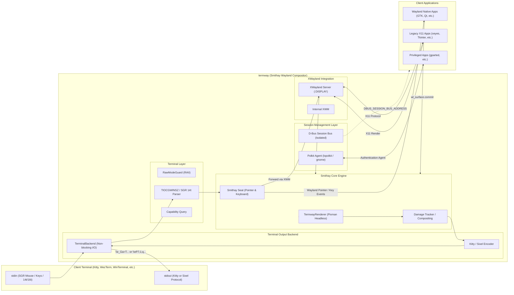

# termway: The Ultimate Terminal GUI Bridge

[English](README.md) | [日本語](README.ja.md)

**termway** is a high-performance terminal GUI bridge that embeds and renders Wayland and X11 GUI applications directly inside your terminal emulator. It features an integrated headless Wayland compositor powered by [Smithay](https://github.com/Smithay/smithay) and XWayland support.

---

### Key Features

- **In-Terminal GUI Execution**:
  - High-definition inline rendering using **Kitty Graphics Protocol** and **Sixel Graphics Protocol**. Works with terminals on Linux, macOS (iTerm2, Ghostty, Kitty), and Windows Terminal!
  - Run full graphical tools over a single standard SSH connection (single PTY), even in bastion hosts, air-gapped environments, or cloud VMs where port forwarding (`AllowTcpForwarding no`) is blocked.
- **Full Mouse & Keyboard Interaction (Hover & Resize Support)**:
  - Supports **xterm SGR 1006 mouse protocol (Any-event 1003h)**: Detects left/middle/right clicks, dragging, scrolling, and cursor hover motion.
  - Automatically queries **SGR 14t (Report text area size in pixels)** on startup to calculate exact font cell dimensions, achieving 1:1 pixel-perfect cursor tracking and aspect ratio with zero coordinate drift.
  - Native Wayland pointer and keyboard events dispatched via Smithay `Seat` to Wayland and XWayland clients.
  - Non-blocking keyboard input forwarding for arrow keys, Ctrl shortcuts (e.g. `Ctrl-U`, `Ctrl-W`), Enter, Tab, and Backspace.
- **Event-Driven Tile Damage Tracking**:
  - Renders only modified regions on `wl_surface.commit` and damage events, drastically minimizing CPU usage and latency.
- **D-Bus Session Isolation & Polkit Agent Integration (gnome-terminal & gparted ready)**:
  - **D-Bus Session Isolation**: Spawns an isolated D-Bus session bus automatically, preventing single-instance daemon applications (e.g. `gnome-terminal`) from mistakenly launching on existing remote desktop displays (such as `DISPLAY :0`).
  - **Integrated Polkit Authentication Agent**: Automatically discovers and runs background authentication agents (such as `lxpolkit`). Elevation prompts for privileged tools like `gparted` or `pkexec` pop up seamlessly inside your terminal window.
- **Built-in Floating Window Manager (Openbox / Fluxbox Style)** (`--wm`):
  - Self-contained window management without requiring external window managers.
  - Minimalist, distraction-free decorations: 22px title bar, 1px border, close button `[×]`, bottom-right resize handle, and 8x8 bitmap font window titles.
  - Window clamping mechanism prevents windows from being dragged or resized outside terminal view boundaries.

---

## Architecture



---

## Prerequisites

### Client Terminal
- **Kitty Graphics Protocol** compatible:
  - Kitty, WezTerm, Ghostty, Foot, etc.
- or **Sixel Graphics Protocol** compatible:
  - Windows Terminal (Preview), iTerm2, xterm, mlterm, mintty, etc.

### Host / Server Environment
- Linux (x86_64)
- Rust toolchain (1.70 or later)
- System libraries:

```bash
# Ubuntu / Debian
sudo apt-get install -y build-essential pkg-config libx11-dev libxtst-dev libpixman-1-dev libwayland-dev xwayland dbus-daemon

# Recommended for running privileged tools (e.g. gparted) with password prompts
sudo apt-get install -y lxpolkit

# Required only if using legacy --x11 / --xvfb mode
sudo apt-get install -y xvfb openbox
```

---

## Installation & Build

```bash
# Clone repository
git clone https://github.com/username/termway.git
cd termway

# Build release binary
cargo build --release
```

The compiled binary will be placed at `target/release/termway`.

---

## Usage

### 1. Launch Built-in Demo GUI
```bash
cargo run --release -- --demo
```
To enable the built-in window manager with title bars and borders:
```bash
cargo run --release -- --wm --demo
```
To force Sixel graphics mode:
```bash
cargo run --release -- --sixel --wm --demo
```

### 2. Run Any GUI Application
Specify the target command and arguments after `--`:

```bash
# Run gvim (Wayland compositor + auto-detected protocol)
cargo run --release -- gvim

# Run with floating window manager (title bar, resize handle, close button)
cargo run --release -- --wm -- gvim

# Run privileged administrative tools (password dialog prompts inside termway)
cargo run --release -- --wm -- gparted

# Run gnome-terminal (isolated D-Bus session ensures window opens inside termway)
cargo run --release -- --wm -- gnome-terminal

# Explicitly force Sixel protocol
cargo run --release -- --sixel -- gvim

# Explicitly force Kitty protocol
cargo run --release -- --kitty -- gvim

# Run in legacy X11 / Xvfb mode
cargo run --release -- --x11 --wm -- xclock
```

> **Note**:
> - GUI applications that automatically fork into the background (such as `gvim` or `gedit`) can be launched without `-f`. `termway` tracks the window lifecycle and automatically terminates when all application windows are closed.
> - Single-instance daemon applications like `gnome-terminal` work seamlessly inside `termway` thanks to the automated isolated D-Bus session.
> - Privileged GUI tools like `gparted` or `pkexec` will display their authentication dialog within the terminal when `lxpolkit` is installed.

### 3. Font Cell Size Optimization (`--cell-size`, `TERMWAY_CELL_SIZE`)
For pixel-perfect mouse tracking, `termway` automatically sends `\x1b[16t` and `\x1b[14t` on startup. If your terminal emulator does not answer these queries, you can manually specify the font cell dimensions:

```bash
# CLI option: width x height
cargo run --release -- --cell-size 10x22 -- gvim

# Or via environment variable
export TERMWAY_CELL_SIZE=10x22
cargo run --release -- gvim
```

### 4. Command Line Options

| Option | Argument | Description | Default |
| :--- | :--- | :--- | :--- |
| `--wayland` | - | Use Smithay headless Wayland compositor mode (default) | Enabled |
| `--x11`, `--xvfb` | - | Use legacy X11 / Xvfb capture mode | - |
| `--kitty` | - | Force Kitty Graphics Protocol | Auto-detected |
| `--sixel` | - | Force Sixel Graphics Protocol | Auto-detected |
| `--wm` | - | Enable internal floating window manager decorations and controls | - |
| `--cell-size` | `<WxH>` | Specify font cell dimensions in pixels (e.g. `10x22`) | Auto-detected via SGR 14t |
| `--width` | `<PIXELS>` | Virtual display resolution width | Auto-calculated from terminal |
| `--height` | `<PIXELS>` | Virtual display resolution height | Auto-calculated from terminal |
| `--fps` | `<FPS>` | Target frame rate limit | `30` |
| `--demo` | - | Launch built-in Tkinter demo application | - |

---

## Running Tests

`termway` comes with a comprehensive test suite (unit, integration, and end-to-end tests):

```bash
cargo test
```

---

## Background & Use Cases

### Why In-Terminal GUI?
Traditional remote GUI solutions (X11 Forwarding via `ssh -X`, VNC, RDP, or web-based desktops) require dedicated viewer clients, separate listening ports, and firewall exceptions.

`termway` encapsulates **all display output and input interactions directly into standard TTY/PTY input/output streams**:

1. **High-Security & Bastion Jump Hosts**:
   - Works in environments where SSH port forwarding is disabled (`AllowTcpForwarding no`) or external ports are blocked. If a standard SSH shell session connects, GUI applications work out-of-the-box.
2. **Persistent GUI Sessions via `tmux`**:
   - Run `termway` inside a `tmux` session. If your network connection drops, reconnect and run `tmux attach` to restore your working GUI session instantly without losing state.
3. **Portability**:
   - No need to install XQuartz on macOS or VcXsrv on Windows. Works on modern terminal emulators across Linux, macOS, and Windows.

### Comparison

| Feature | termway (In-Terminal GUI) | SSH X11 Forwarding (`ssh -X`) | Remote Desktop (VNC / RDP) |
| :--- | :--- | :--- | :--- |
| **Client Requirement** | **Supported Terminal (Kitty, WinTerm, etc.)** | X Server (XQuartz, VcXsrv, etc.) | Dedicated Viewer (TigerVNC, mstsc) |
| **Network Ports** | **SSH (22) Only** | SSH Port Forwarding required | Dedicated Ports (5900, 3389, etc.) |
| **Firewall / Bastion Resistance** | **Highest (Works wherever PTY works)** | Moderate (Requires port forwarding) | Low (Requires open ports) |
| **Session Persistence (tmux)** | **Fully Supported (Detach & Re-attach)** | Not Supported (Terminates on disconnect) | Supported on server |

---

## License

This project is licensed under the [MIT License](LICENSE).
