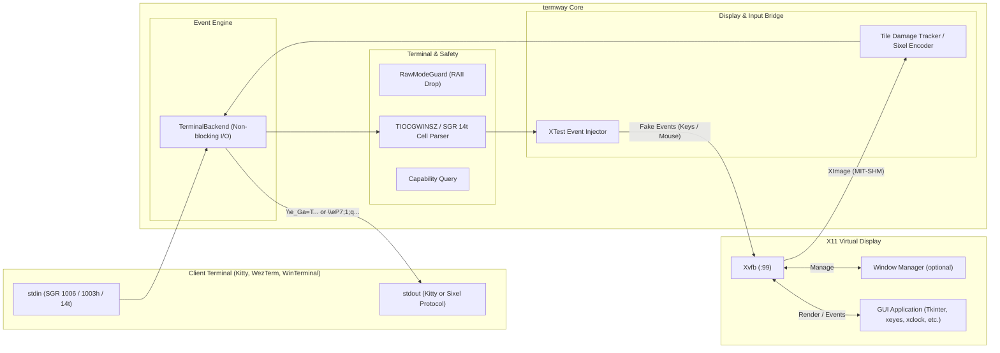

# termway: The Ultimate X11-to-Terminal GUI Bridge

ターミナル（端末エミュレータ）の画面内に、X11 GUI アプリケーションを直接埋め込んで実行・操作できる高速ブリッジツールです。

---

### 主な特徴

- **ターミナル画面内でのGUI実行**:
  - **Kitty Graphics Protocol** および **Sixel Graphics Protocol** を使用し、端末内に高精細な画像としてインライン描画。Windows Terminal や Mac の iTerm2 にも対応！
  - SSH の単一ポート（PTY 1本）のみが通る踏み台環境やクラウド、tmux セッション内でも、追加のポートフォワーディングやクライアント側XサーバーなしでGUIツールが利用可能。
- **フルマウス＆キーボード対話 (ホバー対応)**:
  - **xterm SGR 1006 マウスプロトコル (Any-event 1003h)** により、クリック、ドラッグ、ホイールスクロールに加えてマウスカーソルの移動（ホバー追従）を完全検知。
  - 端末起動時に **SGR 14t（Report text area size in pixels）** を自動送信してターミナルの物理フォントピクセルサイズをミリ秒単位で厳密に取得。Sixel時の1:1アスペクト比描画とX11ヒットボックスのピクセルパーフェクトな座標同期（ドリフト防止）を実現！
  - **XTest** 拡張経由でX11クライアントに合成注入。
  - 矢印キー、Ctrlキー、Enter/Tab/Backspace 等のキー入力もノンブロッキングで即時転送（1キー遅延なし）。
- **タイル差分レンダリング (Damage Tracking)**:
  - 画面をタイル（32x32ピクセル等）に分割し、高速ハッシュ比較により変化があった矩形領域のみを端末へ差分転送。帯域とターミナル負荷を大幅に削減。
- **軽量Window Managerの統合 (--wm)**:
  - 実行時に Openbox 等を統合し、通常のデスクトップ環境と同じようにウィンドウ枠、タイトルバー、複数ウィンドウのドラッグ＆ドロップをターミナル内で実現。

---

## アーキテクチャ概要



---

## 必要条件・環境

### クライアント端末
- **Kitty Graphics Protocol** 対応ターミナル:
  - Kitty, WezTerm, Ghostty, Foot 等
- または **Sixel Graphics Protocol** 対応ターミナル:
  - Windows Terminal (Preview), iTerm2, xterm, mlterm, mintty 等

### サーバー / 実行環境
- Linux (x86_64)
- `Xvfb` (仮想フレームバッファXサーバー)
- `openbox` (推奨: ウィンドウマネージャー)
- X11 ライブラリ (`libX11`, `libXtst`, `libXext`)
- Rust ツールチェーン (1.70 以上)

---

## インストールとビルド

```bash
# リポジトリのクローン
git clone <repository-url>
cd termway

# ビルド
cargo build --release
```

バイナリは `target/release/termway` に生成されます。

---

## 使い方

### 1. 内蔵デモGUIの起動
```bash
cargo run -- --demo
```
Sixelを使いたい場合は `--sixel` を追加します。ウィンドウの枠が欲しい場合は `--wm` を追加します。
```bash
cargo run --release -- --sixel --wm --demo
```

### 2. 任意のX11アプリケーションの実行
`--` の後に実行したいコマンドと引数を指定します：

```bash
# マウス追従アプリ（Sixel ＆ ウィンドウマネージャー付き）
cargo run --release -- --sixel --wm -- xeyes

# 時計アプリ
cargo run --release -- --sixel --wm -- xclock
```

### 3. 主なコマンドラインオプション

| オプション | 引数 | 説明 | デフォルト |
| :--- | :--- | :--- | :--- |
| `--sixel` | - | Kittyプロトコルの代わりにSixelプロトコルを使用する | - |
| `--wm` | - | 仮想ディスプレイで軽量ウィンドウマネージャー (Openbox) を起動する | - |
| `--width` | `<PIXELS>` | 仮想ディスプレイ解像度の幅 | 端末サイズから自動算出 |
| `--height` | `<PIXELS>` | 仮想ディスプレイ解像度の高さ | 端末サイズから自動算出 |
| `--fps` | `<FPS>` | 目標フレームレート | `30` |
| `--demo` | - | 内蔵 Tkinter デモアプリを起動 | - |

---

## テスト実行

本プロジェクトは要求仕様からシステム受入テストまでの厳密なトレーサビリティを確保して開発されており、単体テスト・結合テスト・E2Eシステムテストが整備されています。

```bash
# 全テスト (単体・結合・E2E: 計31テスト) の実行
cargo test
```

## 🚀 今後のロードマップ (Roadmap)

`termway` は将来のバージョンに向けて、以下の機能拡張を計画しています。

- [x] **Sixel プロトコル対応 (Broad Terminal Support)**
  - Kitty Graphics Protocol に加え、Sixel画像プロトコルに対応完了。SGR 14t ピクセルパースによるピクセルパーフェクトなマウストラッキングを実現しました。
- [ ] **画面リサイズへの動的追従 (Dynamic Resolution Resizing)**
  - ターミナル（ホスト側）のウィンドウサイズ変更（`SIGWINCH`）に連動し、`XRandR` 拡張を用いて内部の X11 仮想ディスプレイ解像度をシームレスに動的リサイズします。
- [ ] **双方向クリップボードの完全同期 (Bidirectional Clipboard Sync)**
  - ターミナルのブラケットペースト（Bracketed Paste）機能を活用し、既存の「ゲスト(X) → ホスト」の同期に加え、「ホスト → ゲスト(X)」へのコピー＆ペーストも実現します。
- [ ] **ワンキー・スクリーンショット / GIF 録画**
  - ターミナル内での GUI 動作状況を、ショートカットキー一発で PNG 画像やアニメーション GIF として手軽にエクスポートする機能です。
