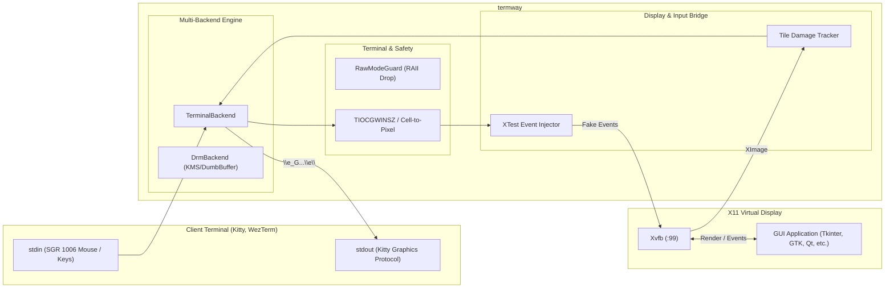

# termway

**In-Terminal X11 GUI & DRM/KMS Client Runner**

`termway` は、モダンターミナル（Kitty, WezTerm 等）の画面内に X11 GUI アプリケーションを直接埋め込み描画し、マウスやキーボードで対話操作できるようにするCLIブリッジツールです。また、ローカルの仮想端末（VT/Console）環境では、カーネルの DRM/KMS 経由で直接ハードウェア描画を行う「二刀流」アーキテクチャを備えています。

---

## 主な特徴

- **ターミナル画面内でのGUI実行**:
  - **Kitty Graphics Protocol** を使用し、端末セル内に高精細なピクセル画像としてインライン描画。
  - SSH の単一ポート（PTY 1本）のみが通る踏み台環境やクラウド、tmux セッション内でも、追加のポートフォワーディングやクライアント側XサーバーなしでGUIツールが利用可能。
- **フルマウス＆キーボード対話**:
  - **xterm SGR 1006 マウスプロトコル** により、クリック、ドラッグ、マウス移動、ホイールスクロールを検知。
  - 端末文字セル座標を仮想ディスプレイのピクセル解像度へ正確にマッピングし、**XTest** 拡張経由でX11クライアントに合成注入。
  - 矢印キー、Ctrlキー、Enter/Tab/Backspace 等のキー入力も完全転送。
- **タイル差分レンダリング (Damage Tracking)**:
  - 画面をタイル（32x32ピクセル等）に分割し、高速ハッシュ比較により変化があった矩形領域のみを端末へ差分転送。帯域とターミナル負荷を大幅に削減。
- **マルチバックエンド（二刀流）**:
  - **`TerminalBackend` (リモート/PTY用)**: Kitty Graphics + SGR マウス + 仮想X11 (Xvfb)。
  - **`DrmBackend` (ローカルVT用)**: Linuxカーネルの DRM/KMS (Dumb Buffer) を直接制御したハードウェア描画。
  - 起動環境（SSH/PTY か ローカルVT か）を自動判別し、`--backend` での明示指定も可能。
- **堅牢な端末保護 (RAII Guard)**:
  - `RawModeGuard` の `Drop` 実装により、プログラムが強制終了（Ctrl+C 等）やパニックを起こしても、端末のマウス追跡解除・カーソル表示・画面復元を100%保証。

---

## アーキテクチャ概要



---

## 必要条件・環境

### クライアント端末
- **Kitty Graphics Protocol** 対応ターミナル:
  - [Kitty](https://sw.kovidgoyal.net/kitty/)
  - [WezTerm](https://wezfurlong.org/wezterm/)
  - [Ghostty](https://ghostty.org/)
  - [Foot](https://codeberg.org/dnkl/foot) 等

### サーバー / 実行環境
- Linux (x86_64)
- `Xvfb` (仮想フレームバッファXサーバー)
- X11 ライブラリ (`libX11`, `libXtst`)
- Rust ツールチェーン (1.70 以上)

---

## インストールとビルド

```bash
# リポジトリのクローン
git clone <repository-url>
cd termway

# オフラインまたは通常ビルド
cargo build --release
```

バイナリは `target/release/termway` に生成されます。

---

## 使い方

### 1. 内蔵デモGUIの起動
```bash
cargo run -- --demo
```
ボタンクリックでカウンタが増加し、テキストボックスにキー入力ができる Tkinter GUI がターミナル内に起動します。
終了するには `q` または `Ctrl+C` を押します。

### 2. 任意のX11アプリケーションの実行
`--` の後に実行したいコマンドと引数を指定します：

```bash
# Python GUI スクリプトの実行
cargo run -- -- python3 my_gui_app.py

# 標準的なX11アプリの実行
cargo run -- -- xclock
cargo run -- -- gedit
cargo run -- -- wireshark
```

### 3. バックエンドの手動切り替え
```bash
# ターミナル描画モード
cargo run -- --backend terminal --demo

# ローカルVT / DRM描画モード
cargo run -- --backend drm --demo
```

### 4. 主なコマンドラインオプション

| オプション | 引数 | 説明 | デフォルト |
| :--- | :--- | :--- | :--- |
| `--backend` | `terminal` \| `drm` | 表示・入力バックエンドの選択 | 自動判別 |
| `--width` | `<PIXELS>` | 仮想ディスプレイ解像度の幅 | 端末サイズから自動算出 |
| `--height` | `<PIXELS>` | 仮想ディスプレイ解像度の高さ | 端末サイズから自動算出 |
| `--fps` | `<FPS>` | 目標フレームレート | `30` |
| `--demo` | - | 内蔵 Tkinter デモアプリを起動 | - |
| `-h`, `--help` | - | ヘルプメッセージを表示 | - |

---

## テスト実行 (V字開発モデル検証)

本プロジェクトは要件定義からシステム受入テストまでの V字開発モデル に基づいて開発されており、単体テスト・結合テスト・E2Eシステムテストが整備されています。

```bash
# 全テスト (単体・結合・E2E) の実行
cargo test

# システムE2Eテストのみ実行 (Xvfb + 実Tkinter GUIの連携検証)
cargo test --test system_e2e_gui -- --nocapture
```

詳細なテスト仕様と要件マッピングについては [docs/V_MODEL_SPEC.md](docs/V_MODEL_SPEC.md) を参照してください。

---

## 関連ドキュメント

- [システムアーキテクチャ詳細設計書 (docs/ARCHITECTURE.md)](docs/ARCHITECTURE.md)
- [V字開発 要件定義書 & テスト仕様書 (docs/V_MODEL_SPEC.md)](docs/V_MODEL_SPEC.md)
