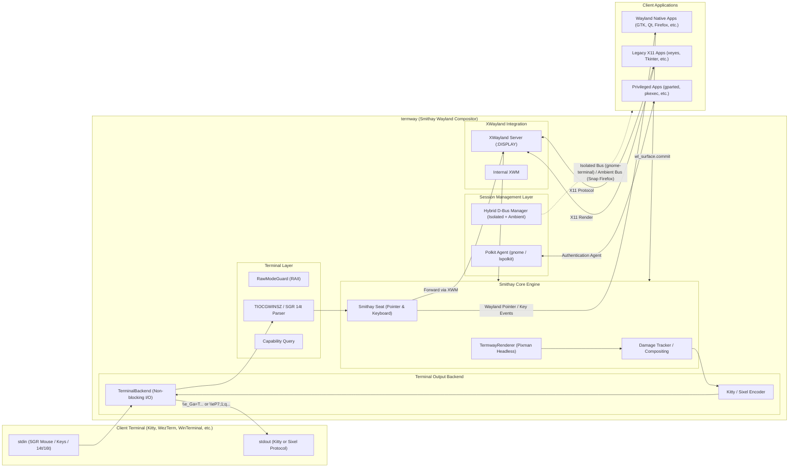

# termway: The Ultimate Terminal GUI Bridge

[English](README.md) | [日本語](README.ja.md)

**termway** is a high-performance terminal GUI bridge that embeds and renders Wayland and X11 GUI applications directly inside your terminal emulator. It features an integrated headless Wayland compositor powered by [Smithay](https://github.com/Smithay/smithay) and XWayland support.


---

### Key Features

- **In-Terminal GUI Execution**:
  - High-definition inline rendering using **Kitty Graphics Protocol** and **Sixel Graphics Protocol**. Works with terminals on Linux, macOS (iTerm2, Ghostty, Kitty), and Windows Terminal!
  - Run full graphical tools over a single standard SSH connection (single PTY), even in bastion hosts, air-gapped environments, or cloud VMs where port forwarding (`AllowTcpForwarding no`) is blocked.
- **Full Mouse & Keyboard Interaction (Hover, Resize & Cursor Shape Support)**:
  - Supports **xterm SGR 1006 mouse protocol (Any-event 1003h)**: Detects left/middle/right clicks, dragging, scrolling, and cursor hover motion.
  - Automatically queries **SGR 14t (Report text area size in pixels)** on startup to calculate exact font cell dimensions, achieving 1:1 pixel-perfect cursor tracking and aspect ratio with zero coordinate drift.
  - **OSC 22 Mouse Cursor Shape Synchronization**: Dynamically synchronizes terminal mouse cursor shapes (`\x1b]22;<name>\x07`) to reflect window borders, resize handles (`nwse-resize`), titlebar drag (`grab`), and buttons (`pointer`).
  - **Kitty Keyboard Protocol**: Supports progressive keyboard enhancement (`\x1b[>1u`), providing unambiguous modifier combinations and special escape sequences without breaking standard terminals.
  - Native Wayland pointer and keyboard events dispatched via Smithay `Seat` to Wayland and XWayland clients.
  - Non-blocking keyboard input forwarding for arrow keys, Ctrl shortcuts (e.g. `Ctrl-U`, `Ctrl-W`), Enter, Tab, and Backspace.
- **Event-Driven Tile Damage Tracking**:
  - Renders only modified regions on `wl_surface.commit` and damage events, drastically minimizing CPU usage and latency.
- **Hybrid D-Bus Session & Snap Support (Firefox, gnome-terminal & gparted ready)**:
  - **Dual D-Bus Architecture**: Automatically spawns an isolated D-Bus session bus for single-instance applications (e.g. `gnome-terminal`) to guarantee dedicated server instances on Termway's display, while transparently routing the host's ambient `systemd --user` session bus to strictly confined Snap applications (e.g. Ubuntu's Snap-packaged `firefox`) and URL openers (`xdg-open`) for cgroup scope creation. (See [ADR-0001](docs/adr/0001-hybrid-dbus-session-routing.md) for detailed architecture decisions and trade-offs).
  - **Integrated Polkit Authentication Agent**: Automatically discovers and runs background authentication agents (`policykit-1-gnome` or `lxpolkit`). Elevation prompts for privileged tools like `gparted` or `pkexec` pop up seamlessly inside your terminal window.
- **Built-in Floating Window Manager (Openbox / Fluxbox Style)**:
  - Self-contained window management without requiring external window managers.
  - Minimalist, distraction-free decorations: 22px title bar, 1px border, window control buttons (Close `[×]`, Maximize/Restore `[□]`, Minimize `[-]`), bottom-right resize handle, and 8x8 bitmap font window titles.
  - Full support for window **Maximization** (via `[□]` button or titlebar double-click) and **Minimization** (via `[-]` button into the bottom row taskbar).
  - Integrated bottom taskbar with interactive clickable chips (`[1: AppName]` / `[1: AppName _]`) allowing instant un-minimizing, raising, and toggling of active windows.
  - Screen boundary clamping mechanism prevents windows and Sixel graphics from being clipped at the right or bottom terminal edges.
- **Bidirectional Host Clipboard Synchronization & Primary Selection (`Ctrl-C` / `Ctrl-V` / Middle Click)**:
  - Full support for OSC 52 and Bracketed Paste protocols. Seamless bidirectional copy-and-paste between in-terminal GUI apps and the host OS (Windows, macOS, Linux), including full multibyte / UTF-8 text support.
  - Full support for **Wayland Primary Selection** (`zwp_primary_selection_v1` / `gtk_primary_selection`): copy on text highlight and paste via middle mouse click.
- **Terminal Window & Tab Title Synchronization (OSC 2)**:
  - Automatically synchronizes the active GUI window title to the host terminal's window and tab title bar (`\x1b]2;termway: <Title>\x07`), and cleanly restores the previous title upon exit.
- **One-Key Screenshot (`F12`) & Clean Exit (`Ctrl-Q`)**:
  - Instant PNG capture via `F12`. Safe terminal state restoration and clean teardown via `Ctrl-Q`.

---

## Architecture



---

## Prerequisites

### Supported Terminal Emulators

termway supports both high-speed inline graphics protocols (**Kitty** & **Sixel**), automatically detecting or enabling them based on terminal capabilities:

| Protocol | Terminal Emulator | Supported OS | Notes |
| :--- | :--- | :--- | :--- |
| **Kitty Graphics** | **Kitty** | Linux, macOS | Native reference implementation |
| | **Ghostty** | Linux, macOS | Full support with GPU acceleration |
| | **WezTerm** | Windows, Linux, macOS | Full Kitty graphics support |
| | **Foot** | Linux (Wayland) | High performance Wayland terminal |
| **Sixel Graphics** | **Windows Terminal** | Windows | Supported in Windows Terminal Preview (`--sixel`) |
| | **WezTerm** | Windows, Linux, macOS | Supports both Kitty & Sixel |
| | **Foot** | Linux (Wayland) | Supports both Kitty & Sixel |
| | **iTerm2** | macOS | Full Sixel & 24-bit TrueColor support |
| | **mlterm** | Linux, Windows, macOS | Native Sixel reference terminal |
| | **RLogin** | Windows | Popular Windows SSH client with Sixel support |
| | **Alacritty** (with sixel patch) / **xterm** | Linux, macOS | `xterm -ti vt340` |

### Host / Server Environment
- Linux (x86_64, aarch64 / ARM64)
- Rust toolchain (1.70 or later)
- System libraries:

```bash
# Ubuntu / Debian (Native x86_64 or aarch64)
sudo apt-get install -y build-essential pkg-config libpixman-1-dev libwayland-dev xwayland dbus-daemon

# Recommended for running privileged tools (e.g. gparted) with password prompts (choose one)
sudo apt-get install -y policykit-1-gnome   # Official GNOME authentication dialog (Recommended)
# or
sudo apt-get install -y lxpolkit           # Lightweight authentication dialog
```

---

## Installation & Build

### Native Build (x86_64 or aarch64)

```bash
# Clone repository
git clone https://github.com/totatake/termway.git
cd termway

# Build release binary
cargo build --release
```

The compiled binary will be placed at `target/release/termway`.

### Cross-Compiling for aarch64 (on Ubuntu x86_64)

To build an ARM64 binary with NEON SIMD optimizations from an Ubuntu x86_64 host:

```bash
# Install aarch64 cross-toolchain and multiarch dependencies
sudo ./scripts/setup_cross_aarch64.sh

# Add Rust aarch64 target
rustup target add aarch64-unknown-linux-gnu

# Build release binary
PKG_CONFIG_ALLOW_CROSS=1 PKG_CONFIG_PATH=/usr/lib/aarch64-linux-gnu/pkgconfig \
  cargo build --release --target aarch64-unknown-linux-gnu
```

The compiled binary will be placed at `target/aarch64-unknown-linux-gnu/release/termway`.

---

## Usage

The examples below use the compiled binary `./target/release/termway` (or `termway` if added to your `PATH`).

### 1. Launch Built-in Demo GUI
```bash
./target/release/termway --demo
```
To force Sixel graphics mode:
```bash
./target/release/termway --sixel --demo
```

### 2. Run Any GUI Application
Specify the target command and arguments after `--`:

```bash
# Run GUI application (Wayland compositor + auto-detected graphics protocol + built-in WM)
./target/release/termway -- gvim

# Run web browser (supports Ubuntu Snap-packaged Firefox out-of-the-box)
./target/release/termway -- firefox

# Run gnome-terminal (isolated D-Bus session ensures window opens inside termway)
./target/release/termway -- gnome-terminal

# Run privileged administrative tools (Polkit password dialog prompts inside termway)
./target/release/termway -- gparted

# Run X11 applications seamlessly via built-in XWayland
./target/release/termway -- xclock
```

> **Note**:
> - GUI applications that automatically fork into the background (such as `gvim` or `gedit`) can be launched without `-f`. `termway` tracks the window lifecycle and automatically terminates when all application windows are closed.
> - Modern web browsers like `firefox` (including default Ubuntu Snap packages) work out-of-the-box thanks to automatic ambient systemd session bus routing.
> - Browsers opened *by* a running app (e.g. the GitHub sign-in page launched from VS Code via `xdg-open`) also open inside Termway: Snap launchers and URL openers reached through `PATH` are shimmed to use the ambient bus.
> - Apps that keep credentials in the OS keyring through libsecret (e.g. VS Code, Chromium) can use the host keyring: Termway relays `org.freedesktop.secrets` from the host session bus into its isolated bus. If the host keyring is locked, the unlock prompt appears on the host display.
> - Single-instance daemon applications like `gnome-terminal` work seamlessly inside `termway` thanks to the automated isolated D-Bus session.
> - Privileged GUI tools like `gparted` or `pkexec` will display their authentication dialog within the terminal when `policykit-1-gnome` or `lxpolkit` is installed.
> - Running legacy X11 applications requires write permissions to `/tmp/.X11-unix`. If `/tmp/.X11-unix` is read-only (such as on WSL2 or restricted container environments), `termway` proactively detects this and terminates with a descriptive error (on WSL2, see [FAQ](#frequently-asked-questions-faq) to remount as writable via `sudo mount -o remount,rw /tmp/.X11-unix`).
> - **Clipboard Support**: Bidirectional clipboard synchronization is fully supported across Wayland and XWayland applications. Copying inside applications via `Ctrl-C` (or mouse selection) synchronizes to the host clipboard via OSC 52, and pasting from the host via `Ctrl-V` (or terminal paste `Ctrl+Shift+V` / right-click) seamlessly pastes into the application via Bracketed Paste with full UTF-8 / multibyte character support.
> - **Shortcuts**: Press `Ctrl-Q` at any time to safely exit. Press `F12` to instantly save the current GUI display to a PNG image file (one-key screenshot).

### 3. Graphics Protocol Auto-Detection & Explicit Selection (`--kitty`, `--sixel`)
`termway` automatically detects terminal graphics protocol capabilities on startup:
- **Kitty-capable terminals** (Kitty, Ghostty, WezTerm, etc.): Automatically uses Kitty Graphics Protocol.
- **Sixel-capable terminals** (Windows Terminal, iTerm2, Foot, mlterm, RLogin, etc.): Automatically uses Sixel Graphics Protocol.
- **VTE-based terminals** (GNOME Terminal, xterm, etc.): Automatically falls back to Sixel protocol.

You can explicitly override the protocol using `--kitty` or `--sixel`:

```bash
# Force Sixel protocol
./target/release/termway --sixel -- gvim

# Force Kitty protocol
./target/release/termway --kitty -- gvim
```

### 4. Font Cell Size Optimization (`--cell-size`, `TERMWAY_CELL_SIZE`)
For pixel-perfect mouse tracking, `termway` automatically sends `\x1b[16t` and `\x1b[14t` on startup. If your terminal emulator does not answer these queries, you can manually specify the font cell dimensions:

```bash
# CLI option: width x height
./target/release/termway --cell-size 10x22 -- gvim

# Or via environment variable
export TERMWAY_CELL_SIZE=10x22
./target/release/termway -- gvim
```

### 5. Shortcuts & Built-in Features

| Shortcut | Action | Description |
| :--- | :--- | :--- |
| `Ctrl-Q` | Safe Exit | Terminates the application and cleanly restores terminal raw mode and screen buffer |
| `F12` | One-Key Screenshot | Instantly saves the current GUI frame as a high-resolution PNG image (configurable via `TERMWAY_SCREENSHOT_DIR`, defaults to current directory) |
| `Ctrl-C` / Mouse Selection | Copy to Clipboard | Synchronizes the selected text to the host OS clipboard (Windows / macOS / Linux) via OSC 52 |
| `Ctrl-V` / Terminal Paste | Paste from Clipboard | Pastes text from the host clipboard directly into the application via Bracketed Paste with full UTF-8 / multibyte support |
| Middle Mouse Click | Paste Primary Selection | Pastes highlighted text via Wayland Primary Selection protocol (`zwp_primary_selection_v1`) |

### 6. Command Line Options

| Option | Argument | Description | Default |
| :--- | :--- | :--- | :--- |
| `--wayland` | - | Use Smithay headless Wayland compositor mode (default) | Enabled |
| `--kitty` | - | Force Kitty Graphics Protocol | Auto-detected |
| `--sixel` | - | Force Sixel Graphics Protocol | Auto-detected |
| `--cell-size` | `<WxH>` | Specify font cell dimensions in pixels (e.g. `10x22`) | Auto-detected via SGR 14t |
| `--width` | `<PIXELS>` | Virtual display resolution width | Auto-calculated from terminal |
| `--height` | `<PIXELS>` | Virtual display resolution height | Auto-calculated from terminal |
| `--fps` | `<FPS>` | Target frame rate limit | `30` |
| `--scale` | `<FACTOR>` | Wayland output scale factor for HiDPI / fractional scaling (e.g. `1.25`, `1.5`, `2.0`) | `1.0` |
| `--hud` | - | Show real-time performance HUD overlay (FPS, encode time, bandwidth, damage tiles) | Disabled |
| `--profile` | - | Print stage-by-stage performance profiling report on exit (also enabled via `TERMWAY_PROFILE=1`) | Disabled |
| `--no-splash` | - | Disable the animated startup splash screen while waiting for the first window | Disabled |
| `--demo` | - | Launch built-in GTK3 Wayland demo application | - |
| `-V`, `--version` | - | Print version information | - |
| `-h`, `--help` | - | Print help information | - |

---

## Frequently Asked Questions (FAQ)

### Q. Write error on `/tmp/.X11-unix` / X11 applications fail to start on WSL2 (Ubuntu)
**A.** On WSL2 with WSLg enabled, `/tmp/.X11-unix` is often mounted as read-only (`ro`) by default to share the host WSLg X11 socket. To allow `termway`'s internal XWayland server to create its isolated X11 display socket (`:10` and above), remount `/tmp/.X11-unix` as read-write (`rw`):

```bash
sudo mount -o remount,rw /tmp/.X11-unix
```

To automatically remount it on WSL2 startup, add the command to `/etc/wsl.conf`:

```ini
# /etc/wsl.conf
[boot]
command = "mount -o remount,rw /tmp/.X11-unix"
```

---

## Running Tests

`termway` comes with a comprehensive test suite (unit, integration, benchmark, and end-to-end tests: 98 tests total):

```bash
cargo test --release
```

---

## Background & Use Cases

### Why In-Terminal GUI?
Traditional remote GUI solutions (X11 Forwarding via `ssh -X`, VNC, RDP, or web-based desktops) require dedicated viewer clients, separate listening ports, and firewall exceptions.

`termway` encapsulates **all display output and input interactions directly into standard TTY/PTY input/output streams**:

1. **High-Security & Bastion Jump Hosts**:
   - Works in environments where SSH port forwarding is disabled (`AllowTcpForwarding no`) or external ports are blocked. If a standard SSH shell session connects, GUI applications work out-of-the-box.
2. **Persistent GUI Sessions via `tmux`**:
   - Run `termway` inside a `tmux` session. If your network connection drops, reconnect and run `tmux attach` to restore your working GUI session instantly without losing state.
3. **Portability**:
   - No need to install XQuartz on macOS or VcXsrv on Windows. Works on modern terminal emulators across Linux, macOS, and Windows.

### Comparison

| Feature | termway (In-Terminal GUI) | SSH X11 Forwarding (`ssh -X`) | Remote Desktop (VNC / RDP) |
| :--- | :--- | :--- | :--- |
| **Client Requirement** | **Supported Terminal (Kitty, WinTerm, etc.)** | X Server (XQuartz, VcXsrv, etc.) | Dedicated Viewer (TigerVNC, mstsc) |
| **Network Ports** | **SSH (22) Only** | SSH Port Forwarding required | Dedicated Ports (5900, 3389, etc.) |
| **Firewall / Bastion Resistance** | **Highest (Works wherever PTY works)** | Moderate (Requires port forwarding) | Low (Requires open ports) |
| **Session Persistence (tmux)** | **Fully Supported (Detach & Re-attach)** | Not Supported (Terminates on disconnect) | Supported on server |

---

## Documentation

- **[System Architecture & Design (`docs/ARCHITECTURE.md`)](docs/ARCHITECTURE.md)**: Static structure (module layering, class/ownership diagrams) and dynamic structure (startup sequence, async render pipeline, window state machine, hit-test routing).
- **[Requirements & Test Specification (`docs/SPECIFICATION.md`)](docs/SPECIFICATION.md)**: Functional/non-functional requirements and traceability matrix across all 88 tests.
- **[Architecture Decision Records (`docs/adr/`)](docs/adr/README.md)**: Key architectural decisions and trade-offs (e.g. [ADR-0001: Hybrid D-Bus Session Routing](docs/adr/0001-hybrid-dbus-session-routing.md)).
- **[Engineering Roadmap (`docs/ROADMAP.md`)](docs/ROADMAP.md)**: Completed optimization phases and future milestones.

---

## License

This project is licensed under the [MIT License](LICENSE).
