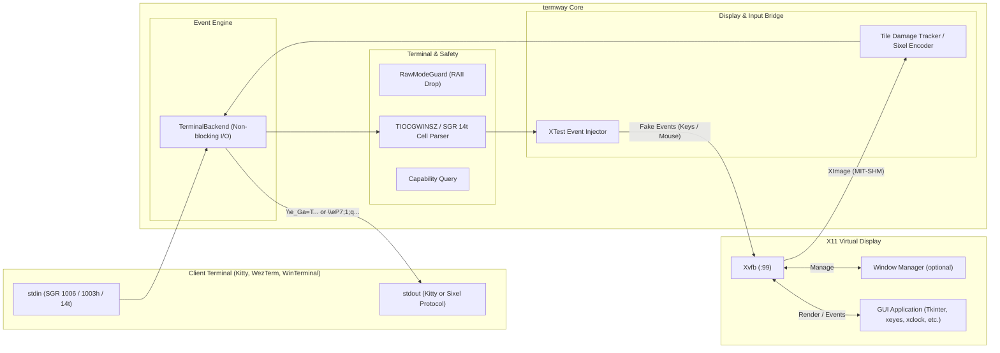

# termway: The Ultimate X11-to-Terminal GUI Bridge

ターミナル（端末エミュレータ）の画面内に、X11 GUI アプリケーションを直接埋め込んで実行・操作できる高速ブリッジツールです。

---

### 主な特徴

- **ターミナル画面内でのGUI実行**:
  - **Kitty Graphics Protocol** および **Sixel Graphics Protocol** を使用し、端末内に高精細な画像としてインライン描画。Windows Terminal や Mac の iTerm2 にも対応！
  - SSH の単一ポート（PTY 1本）のみが通る踏み台環境やクラウド、tmux セッション内でも、追加のポートフォワーディングやクライアント側XサーバーなしでGUIツールが利用可能。
- **フルマウス＆キーボード対話 (ホバー対応)**:
  - **xterm SGR 1006 マウスプロトコル (Any-event 1003h)** により、クリック、ドラッグ、ホイールスクロールに加えてマウスカーソルの移動（ホバー追従）を完全検知。
  - 端末起動時に **SGR 14t（Report text area size in pixels）** を自動送信してターミナルの物理フォントピクセルサイズをミリ秒単位で厳密に取得。Sixel時の1:1アスペクト比描画とX11ヒットボックスのピクセルパーフェクトな座標同期（ドリフト防止）を実現！
  - **XTest** 拡張経由でX11クライアントに合成注入。
  - 矢印キー、Ctrlキー、Enter/Tab/Backspace 等のキー入力もノンブロッキングで即時転送（1キー遅延なし）。
- **タイル差分レンダリング (Damage Tracking)**:
  - 画面をタイル（32x32ピクセル等）に分割し、高速ハッシュ比較により変化があった矩形領域のみを端末へ差分転送。帯域とターミナル負荷を大幅に削減。
- **軽量Window Managerの統合 (--wm)**:
  - 実行時に Openbox 等を統合し、通常のデスクトップ環境と同じようにウィンドウ枠、タイトルバー、複数ウィンドウのドラッグ＆ドロップをターミナル内で実現。

---

## アーキテクチャ概要



---

## 必要条件・環境

### クライアント端末
- **Kitty Graphics Protocol** 対応ターミナル:
  - Kitty, WezTerm, Ghostty, Foot 等
- または **Sixel Graphics Protocol** 対応ターミナル:
  - Windows Terminal (Preview), iTerm2, xterm, mlterm, mintty 等

### サーバー / 実行環境
- Linux (x86_64)
- `Xvfb` (仮想フレームバッファXサーバー)
- `openbox` (推奨: ウィンドウマネージャー)
- X11 ライブラリ (`libX11`, `libXtst`, `libXext`)
- Rust ツールチェーン (1.70 以上)

---

## インストールとビルド

```bash
# リポジトリのクローン
git clone <repository-url>
cd termway

# ビルド
cargo build --release
```

バイナリは `target/release/termway` に生成されます。

---

## 使い方

### 1. 内蔵デモGUIの起動
```bash
cargo run -- --demo
```
Sixelを使いたい場合は `--sixel` を追加します。ウィンドウの枠が欲しい場合は `--wm` を追加します。
```bash
cargo run --release -- --sixel --wm --demo
```

### 2. 任意のX11アプリケーションの実行
`--` の後に実行したいコマンドと引数を指定します：

```bash
# マウス追従アプリ（Sixel ＆ ウィンドウマネージャー付き）
cargo run --release -- --sixel --wm -- xeyes

# 時計アプリ
cargo run --release -- --sixel --wm -- xclock
```

### 3. Smithay Wayland コンポジタモードの使用（v2.0 実装済み）

`--wayland` フラグを指定すると、termway 自身が Smithay ベースのヘッドレス Wayland コンポジタとして起動します。
XWayland も自動で起動されるため、レガシーな X11 アプリケーションもそのまま実行できます。

```bash
# Smithay コンポジタモードで gvim を起動（端末プロトコルは自動判定）
cargo run --release -- --wayland -- gvim -f

# Kitty プロトコルを明示指定して起動
cargo run --release -- --wayland --kitty -- gvim -f

# Sixel プロトコルを明示指定して起動
cargo run --release -- --wayland --sixel -- gvim -f

# フォントセルサイズ（幅x高さ）を明示指定してマウス座標精度を最適化
cargo run --release -- --wayland --cell-size 10x22 -- gvim -f
```

### 4. フォントセルサイズの動的測定と補正 (--cell-size, TERMWAY_CELL_SIZE)

Sixel および SGR マウスプロトコルでのピクセルパーフェクトな追従のため、起動時に `\x1b[16t` (Report font cell size) および `\x1b[14t` (Report text area size) を自動送信してターミナルの物理セル寸法を問い合わせます。
端末エミュレータ（VTE/GNOME Terminal等）がこれらに応答しない場合、以下の方法でセルサイズを明示的に指定・調整できます：

- CLI オプション: `--cell-size <幅x高さ>` (例: `--cell-size 10x22`)
- 環境変数: `TERMWAY_CELL_SIZE=<幅x高さ>` (例: `export TERMWAY_CELL_SIZE=10x22`)

### 5. グラフィックスプロトコルの自動検出と明示指定 (--kitty, --sixel)

termway は起動時に端末エミュレータのプロトコル対応状況を自動検出します：
- Kitty 対応端末（Kitty, WezTerm, Ghostty 等）: 自動的に Kitty Graphics Protocol を使用
- Sixel 対応端末（Windows Terminal, iTerm2, Mintty 等）: 自動的に Sixel プロトコルを使用
- VTE 系端末（GNOME Terminal, xterm 等）: 自動的に Sixel プロトコルへフォールバック

明示的にプロトコルを強制したい場合は `--kitty` または `--sixel` を指定できます：

```bash
# Kitty プロトコルを強制
cargo run --release -- --kitty -- gvim -f

# Sixel プロトコルを強制
cargo run --release -- --sixel -- gvim -f
```

### 5. 主なコマンドラインオプション

| オプション | 引数 | 説明 | デフォルト |
| :--- | :--- | :--- | :--- |
| `--sixel` | - | Kittyプロトコルの代わりにSixelプロトコルを明示的に使用する（`KITTY_WINDOW_ID` 未設定時は自動有効化） | - |
| `--wayland` | - | Smithay ベースのヘッドレス Wayland コンポジタモードで起動する（XWayland を自動起動） | - |
| `--wm` | - | 仮想ディスプレイで軽量ウィンドウマネージャー (Openbox) を起動する | - |
| `--width` | `<PIXELS>` | 仮想ディスプレイ解像度の幅 | 端末サイズから自動算出 |
| `--height` | `<PIXELS>` | 仮想ディスプレイ解像度の高さ | 端末サイズから自動算出 |
| `--fps` | `<FPS>` | 目標フレームレート | `30` |
| `--demo` | - | 内蔵 Tkinter デモアプリを起動 | - |

---

## テスト実行

本プロジェクトは要求仕様からシステム受入テストまでの厳密なトレーサビリティを確保して開発されており、単体テスト・結合テスト・E2Eシステムテストが整備されています。

```bash
# 全テスト (単体・結合・E2E: 計31テスト) の実行
cargo test
```

## 開発背景とユースケース

### なぜターミナル内にGUIを表示するのか？
従来のリモートGUIアプローチ（X11 Forwarding や VNC/RDP、Webベースなど）は、クライアント側に専用ソフト（Xサーバー、VNC Viewer等）を要求し、専用ポートの開放やポートフォワーディングを必要とします。

`termway` は、**「すべての画面描画と入力を、純粋な標準入出力（TTY/PTY のテキストストリーム）の中にカプセル化する」** という設計思想を持ちます。

1. **踏み台（Bastion）や超高セキュリティ環境での突破力**:
   - `AllowTcpForwarding no`（SSHポートフォワード禁止）やファイアウォールでポートが塞がれているクラウドやエンタープライズ環境でも、**SSH の単一ポート（PTY 1本）さえ通れば 100% GUI が動作**します。
2. **tmux による「GUI セッションの完全永続化」**:
   - 通常の X11/Wayland アプリは接続が切れると終了しますが、`termway` を tmux 内で起動しておけば、回線が切断されても後から `tmux attach` することで**作業中の GUI 状態へ即座に復帰**できます。
3. **クライアント環境のポータビリティ**:
   - 手元のマシンに X サーバーや専用ランタイムをインストールする必要がなく、iPad のターミナルや会社支給の制限端末からでも Linux GUI ツールを利用可能です。

### 手法別の比較

| 項目 | termway (In-Terminal GUI) | SSH X11 Forwarding (`ssh -X`) | リモートデスクトップ (VNC / RDP) |
| :--- | :--- | :--- | :--- |
| **クライアント要件** | **対応ターミナルのみ (Kitty, WinTerm等)** | Xサーバー (XQuartz, VcXsrv等) | 専用 Viewer (TightVNC, mstsc等) |
| **使用ポート** | **SSH (22) のみ** | SSH (22) のポート転送 | 専用ポート (5900, 3389等) |
| **ファイアウォール耐性**| **極めて高い (PTY が通れば動作)** | 中 (ポートフォワード許可が必要) | 低 (専用ポート開放が必要) |
| **セッション永続性 (tmux)**| **完全対応 (デタッチ・再アタッチ可)** | 不可 (SSH切断で全滅) | サーバー側で維持可能 |

---

## v2.0 実装済み: Smithay + XWayland 自立型コンポジタ

v1.0（Xvfb 外部キャプチャ＆ XTest 注入の PoC 構成）から、**Smithay による自立型 Headless Wayland コンポジタ ＋ XWayland** へのアーキテクチャ移行を実装しました（`--wayland` フラグで起動）。

- [x] **Smithay Headless / Pixman レンダラー統合**:
  - `wl_surface.commit` やダメージ通知に連動する完全イベント駆動レンダリング（ポーリング廃止、省電力・超低遅延化）。
- [x] **Wayland ネイティブアプリ ＋ X11 アプリ両対応**:
  - `WAYLAND_DISPLAY` と `DISPLAY` (XWayland) を同時に提供し、最新の Wayland アプリと従来の X11 アプリ（xeyes, xclock 等）を混在実行可能。
- [x] **Smithay `Seat` による入力直接統合**:
  - Wayland ポインタイベント経由で正確なフォーカス・ウィンドウ制御を実現（XTest による外部偽装注入を廃止）。
- [x] **自律ウィンドウ管理**:
  - `X11Wm::start_wm()` によるコンポジタ内蔵の X11 ウィンドウマネージャを実装。

### 機能拡張
- [x] **Sixel プロトコル対応 (Broad Terminal Support)**:
  - Kitty Graphics Protocol に加え、Sixel画像プロトコルに対応完了。SGR 14t ピクセルパースによるピクセルパーフェクトなマウストラッキングを実現しました。
- [ ] **画面リサイズへの動的追従 (Dynamic Resolution Resizing)**:
  - ターミナルウィンドウのサイズ変更（`SIGWINCH`）に連動し、解像度をシームレスに動的追従。
- [ ] **双方向クリップボードの完全同期 (Bidirectional Clipboard Sync)**:
  - Bracketed Paste 等を活用した「ホスト → ゲスト」への双方向コピー＆ペースト。
- [ ] **ワンキー・スクリーンショット / GIF 録画**
