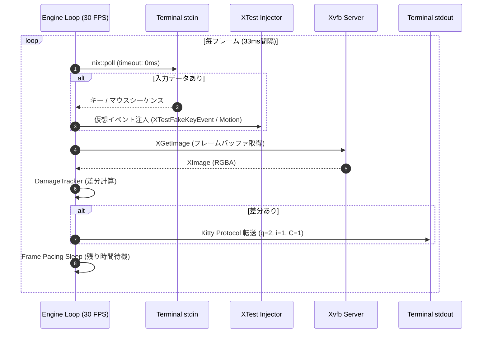
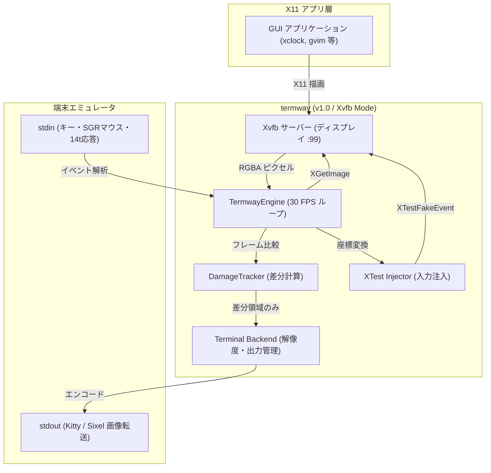
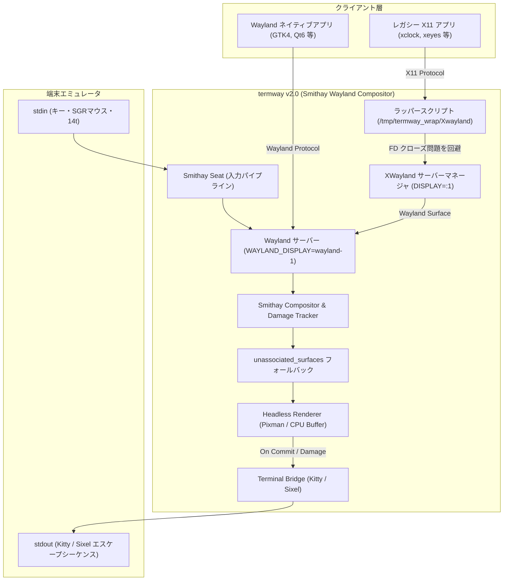
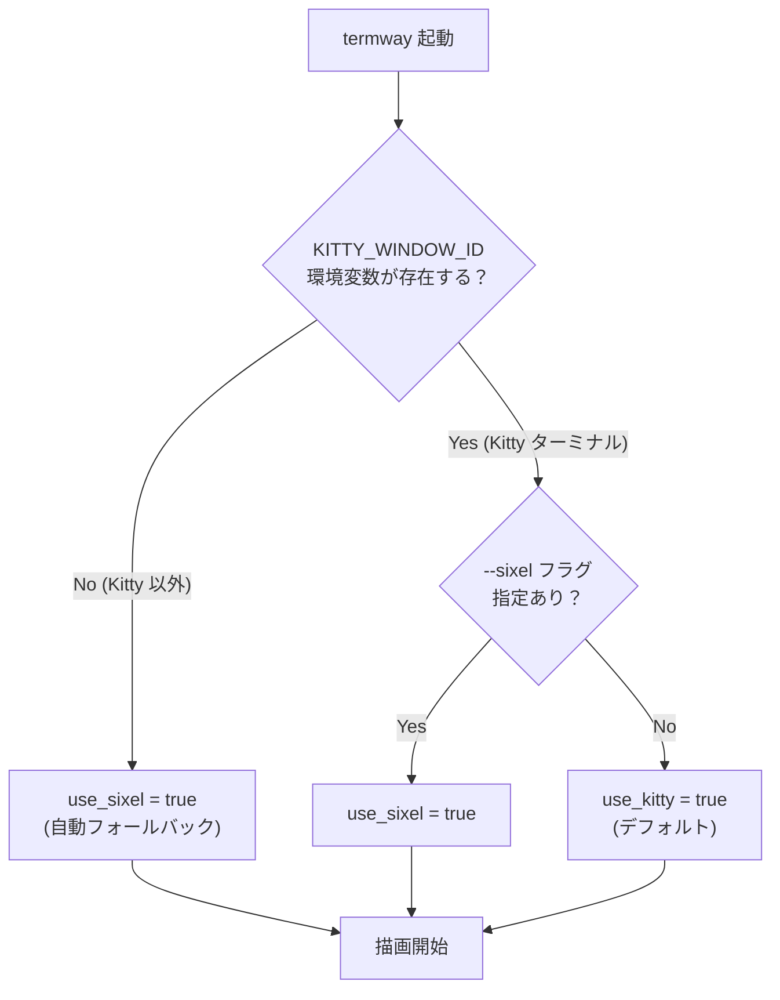

# termway システムアーキテクチャ詳細設計書

本書は、`termway` の内部構造、モジュール設計、プロトコル仕様、およびイベント同期制御について解説する技術設計ドキュメントです。

---

## 1. 全体構造とモジュール構成

`termway` は以下の疎結合なコアレイヤーによって構成されています。

```
src/
├── main.rs                   # CLIパーサー、起動パラメータ初期化
├── engine.rs                 # メインイベントループ、フレーム同期制御
├── terminal/                 # 端末制御・保護・プロトコル検証層
│   ├── winsize.rs            # TIOCGWINSZ によるピクセル/セル解像度取得
│   ├── raw.rs                # termios Rawモード化 & RAII Drop ガード
│   └── query.rs              # Kitty Graphics Protocol 対応可否の事前検証
├── protocol/                 # エスケープシーケンス解析・生成層
│   ├── kitty.rs              # Kitty Graphics Protocol エンコーダ
│   ├── sgr_mouse.rs          # xterm SGR 1006 マウスプロトコルパーサー
│   └── keyboard.rs           # ANSIキー入力・特殊キーパーサー
├── display/                  # 仮想ディスプレイ管理・差分検出層
│   ├── xvfb.rs               # Xvfb ライフサイクル管理
│   ├── framebuffer.rs        # RGBA8888 フレームバッファ & XImage 変換
│   └── damage.rs             # タイルベース差分トラッカー
├── input/                    # 入力注入層
│   └── xtest.rs              # libXtst によるマウス/キー仮想イベント注入
└── backend/                  # ターミナル描画・入力処理層
    ├── mod.rs                # モジュールエクスポート
    └── terminal.rs           # TerminalBackend (Kitty + SGR + 非同期I/O)
```

---

## 2. プロトコル仕様と変換アルゴリズム

### 2.1 Kitty Graphics Protocol エンコード (`src/protocol/kitty.rs`)
Kitty Graphics Protocol は、エスケープシーケンス `\x1b_G<control-data>;<payload>\x1b\\` を用いて、テキスト端末内に直接ピクセル画像を描画します。

#### コントロールキー定義
- `a=T`: 即時転送および表示 (Transmit and display)
- `f=32`: 32-bit RGBA フォーマット
- `s={width}, v={height}`: 送信画像矩形のピクセルサイズ
- `X={col}, Y={row}`: ターミナルウィンドウ内でのピクセルオフセット配置
- `q=2`: 応答抑制モード (Quiet mode 2)。端末からの `\x1b_Gi=...;OK\x1b\` 自律応答を抑止し、標準入力への文字混入・エコーバック無限ループを防止。
- `C=1`: カーソル移動の抑制。画像表示時にテキストカーソルが勝手に移動・スクロールするのを防止。
- `i=1`: 画像識別ID。フレーム置換を行うことで画像が重複描画されるのを防止。
- `m=1`: チャンク継続フラグ（次のエスケープシーケンスに後続データがあることを示す）
- `m=0`: チャンク終了フラグ（ペイロードの最終ブロック）

#### チャンク分割転送
ターミナルエミュレータのバッファオーバーフローを防止するため、エンコードされた Base64 ペイロードは 4096 文字ごとに分割して送信します：
1. **先頭チャンク**: `\x1b_Ga=T,q=2,f=32,s=100,v=100,X=10,Y=20,m=1;<Base64 chunk 1>\x1b\`
2. **中間チャンク**: `\x1b_Gm=1;<Base64 chunk 2>\x1b\`
3. **最終チャンク**: `\x1b_Gm=0;<Base64 chunk N>\x1b\`

---

### 2.2 xterm SGR 1006 マウスプロトコル解析 (`src/protocol/sgr_mouse.rs`)
ターミナルに `\x1b[?1000h\x1b[?1003h\x1b[?1006h` を送信することで、SGR 1006 拡張マウスモードおよび Any-event トラッキングを有効化します。

#### シーケンスフォーマット
- ボタン押下 / ドラッグ / 移動: `\x1b[<{btn};{col};{row}M`
- ボタン解放: `\x1b[<{btn};{col};{row}m`

#### ボタンビットフィールド解析
- 下位 2 ビット:
  - `0`: 左クリック
  - `1`: 中クリック
  - `2`: 右クリック
  - `3`: ボタン解放またはボタン非押下での移動（Hover）
- ビット 5 (32): マウス移動フラグ (Drag または Hover)
- ビット 6 (64): ホイールイベント (64: WheelUp, 65: WheelDown)
- 修飾キー: Shift (+4), Meta (+8), Ctrl (+16)

#### セル座標から仮想ディスプレイへのマッピング式 (`src/terminal/winsize.rs`)
端末全体のピクセル解像度を $W_{term}, H_{term}$、文字セル数を $C, R$、仮想ディスプレイ解像度を $W_{x11}, H_{x11}$ とすると、受信したセル座標 $(col, row)$ は次のようにピクセルへ変換されます：

$$cw = \lfloor W_{term} / C \rfloor, \quad ch = \lfloor H_{term} / R \rfloor$$
$$px = (col - 1) \times cw + \lfloor cw / 2 \rfloor$$
$$py = (row - 1) \times ch + \lfloor ch / 2 \rfloor$$
$$x_{x11} = \mathrm{clamp}\left(\lfloor \frac{px \times W_{x11}}{W_{term}} \rfloor, 0, W_{x11} - 1\right)$$
$$y_{x11} = \mathrm{clamp}\left(\lfloor \frac{py \times H_{x11}}{H_{term}} \rfloor, 0, H_{x11} - 1\right)$$

#### Wayland コンポジタモードにおけるセル座標変換 (`src/compositor/`)
`--wayland` モードでは、`TermwayCompositor` がコンポジタ空間のピクセル解像度 $W_{comp}, H_{comp}$ および端末のセル数 $C_{term}, R_{term}$ を保持します（`term_cols: u16`, `term_rows: u16` フィールド）。SGR マウスイベントのセル座標 $(col, row)$（1 始まり）を次の式でコンポジタ空間ピクセル座標へ変換します：

$$cell\_w = W_{comp} / C_{term}, \quad cell\_h = H_{comp} / R_{term}$$
$$px = (col - 1) \times cell\_w + (cell\_w \times 0.5)$$
$$py = (row - 1) \times cell\_h + (cell\_h \times 0.5)$$

##### フォントセル寸法の動的取得とドリフト防止
Sixel 等のグラフィックス描画時、端末エミュレータ上の物理セルサイズとコンポジタが仮定したセルサイズ（デフォルト 9x18 または 10x20）が乖離していると、右下へ向かうにつれてマウス座標の累積ズレ（Linear Drift）が発生します。これを防ぐため以下の多重機構を備えています：
1. **動的問い合わせ (`\x1b[16t` / `\x1b[14t`)**: 起動シーケンスで端末にフォントセル解像度およびウィンドウピクセルサイズを問い合わせ、応答（`\x1b[6;h;wt` / `\x1b[4;h;wt`）を受信次第、コンポジタおよびレンダラーの解像度を即時動的リサイズして誤差 0 を達成。
2. **手動微調整 (`--cell-size`, `TERMWAY_CELL_SIZE`)**: VTE 等の端末が問い合わせを無視する場合、`--cell-size <WxH>` または環境変数 `TERMWAY_CELL_SIZE` で端末フォントの実測サイズ（例: Ubuntu Mono 13pt なら `10x22`）を直接指定可能。
3. **Sixel 自動スクロール防止 (`\x1b[?7l` & 末尾改行抑止)**: 最終 Sixel バンド末尾での不要な改行シーケンス `-` の抑止および Auto-wrap 無効化（`\x1b[?7l`）により、最下行描画時にターミナル画面がスクロールして上部メニューバーが画面外へ押し出される現象を防止。

---

## 3. 差分レンダリング (Tile Damage Tracking)

フルHD画面（1920x1080）を毎フレーム全体転送すると約 8MB/frame の Base64 テキストが必要となり、端末が描画飽和を起こします。そのため、`termway` はタイルベースの差分トラッカー（`src/display/damage.rs`）を内蔵しています。

1. **画面のグリッド分割**: 画面を 32x32 ピクセル（または 64x64）のタイルに分割。
2. **高速ハッシュ比較**: 各タイルの RGBA バイト列に対して FNV-1a 64-bit ハッシュを計算し、前フレームのハッシュ配列と比較。
3. **汚損領域の抽出**: ハッシュ値が異なるタイルのみを Dirty 矩形として抽出。
4. **Coalescing (矩形統合)**: 汚損タイルが多数（画面の50%以上）に及ぶ場合は、エスケープシーケンスのヘッダオーバーヘッドを避けるため、外接バウンディングボックス 1 枚の更新へ自動結合。

---

## 4. イベント駆動・フレーム同期エンジン (`src/engine.rs`)

`termway` のメインループは、入力待機による描画ブロック（スタベーション）を排除したノンブロッキング設計となっています。



### 4.1 ノンブロッキング入力ポーリング
`src/backend/terminal.rs` では `nix::poll` を `PollTimeout::ZERO` で使用。キーやマウスの入力がない場合でもブロックすることなく即座に画面キャプチャと描画ステップに進むため、「キーを押すまで画面が表示されない」「入力が1文字遅れて反映される」といった入力遅延問題を根絶しています。

---

## 5. 端末保護とライフサイクル安全設計

ターミナルを Raw モードおよびマウストラッキングモードに設定した状態でプログラムが不正終了（Panic, SIGINT, Segmentation Fault 等）すると、元のシェルがマウスクリック文字で埋め尽くされ操作不能になります。

これを防止するため、`termway` は **RAII (Resource Acquisition Is Initialization)** パターンを採用しています：

```rust
impl Drop for RawModeGuard {
    fn drop(&mut self) {
        self.restore();
    }
}
```
- `RawModeGuard` がスコープを抜ける際（通常終了、return、`?` によるエラー伝播、パニック時のスタック巻き戻しのいずれでも）、必ず以下の端末復元シーケンスが標準出力へフラッシュされ、`tcsetattr` で元の termios が再設定されます：
  - `\x1b[?1006l\x1b[?1003l\x1b[?1000l`: マウストラッキング（Any-event含む）無効化
  - `\x1b[?25h`: カーソル再表示
  - `\x1b[?1049l`: Alternate Screen の終了（元のシェル画面に戻る）

---

## 6. Smithay + XWayland 自立型コンポジタ（v2.0 実装済み）

### 6.1 v1.0 (Xkitty方式) の成果と課題
v1.0 では、外部の `Xvfb` および `openbox` を子プロセスとして立ち上げ、MIT-SHM によるフレームバッファの定周期キャプチャと XTest による入力注入を行う方式（Xkitty と同様の構造）を採用しました。
このアプローチにより、「端末内に Kitty/Sixel で高速描画し、SGR マウスで対話する」というフロントエンドのプロトコル制御やピクセル追従（SGR 14t）の検証（PoC）には成功しました。

しかしながら、以下の本質的な課題が存在します：
1. **画面のポーリング監視**: 描画更新の有無に関わらずタイマー駆動でキャプチャを試みるため、不要な CPU 負荷や遅延が発生しやすい。
2. **X11 への制限**: 純粋な Wayland ネイティブアプリ（GTK4 や Wayland 専用ツール）が動作しない。
3. **外部依存**: `Xvfb` や `openbox`、`libXtst` などの外部バイナリ・ライブラリの事前インストールが必要。



### 6.2 v2.0: Smithay ベースの自立型 Headless Wayland コンポジタ（実装済み）

`--wayland` フラグにより、`termway` 自体が **Smithay (Rust製Waylandコンポジタフレームワーク)** を用いた自立型コンポジタとして動作します。



### 6.3 XWayland 接続ワークアラウンド（FD クローズ問題）

XWayland は Wayland クライアントとして動作するため、コンポジタ（termway）の Wayland ソケット経由で接続します。
しかし、XWayland を直接起動した場合にファイルディスクリプタ（FD）のクローズ問題が発生し、接続に失敗することがあります。

これを回避するため、`--wayland` 起動時に termway は `/tmp/termway_wrap/Xwayland` というラッパースクリプトを自動生成します。
XWayland の起動はこのスクリプト経由で行われ、FD 管理の問題を透過的に解決します。

```bash
# 自動生成されるラッパースクリプトの例
#!/bin/sh
exec /usr/bin/Xwayland "$@"
```

### 6.4 unassociated_surfaces フォールバック機構

XWayland がラッパースクリプト経由でコンポジタに接続する構成では、`X11Surface::wl_surface()` が `None` を返すケースが発生します。
この場合、通常の Wayland サーフェス関連付けが行われないため、描画やマウス入力のフォーカス設定ができなくなります。

termway はこれを以下のワークアラウンドで対処します：

1. **`CompositorHandler::commit()` での収集**: `wl_surface()` が `None` の X11 サーフェスを `unassociated_surfaces: Vec<WlSurface>` リストに収集。
2. **レンダラーでの描画対象化**: Pixman レンダラーは通常の関連付き Wayland サーフェスに加え、`unassociated_surfaces` リストの内容も描画対象とする。
3. **マウス入力フォーカス**: Wayland ポインタの focus 設定時に `unassociated_surfaces.first()` を優先的に使用し、X11 アプリへのマウス入力を確保する。
   *修正: XWayland が複数のダミーサーフェス（ルートウィンドウ等）を生成するため、対象を `unassociated_surfaces.last()` に変更し、実体のアプリ画面へフォーカスが当たるように改善しました。*
4. **キーボードフォーカス**: 起動直後のフォーカス空振りを防ぐため、`commit` 時に新規の未関連付けサーフェスが登録された瞬間に `keyboard.set_focus()` を適用しています。
5. **修飾キー (Shift) のタイミング**: 記号 (`:`, `!` 等) の入力時、Shift の押下・解放と実キーのイベントのタイムスタンプを意図的に 1ms ずつずらして送信し、XWayland 側での解釈ミス（順番の前後や Shift 抜け）を防止しています。

### 6.5 XOpenDisplay デッドロック問題と解決策

コンポジタのイベントループ内から `XOpenDisplay` を呼び出すと、XWayland とのデッドロックが発生します。
これは XWayland 自体が Wayland クライアントであるため、コンポジタのイベントループが停止すると XWayland も応答できなくなり、相互待ちになるためです。

この問題を回避するため、以下の設計変更を実施しました：

- **廃止**: XTest 拡張経由の直接マウス・キー注入（`XOpenDisplay` が必要）
- **採用**: Smithay Seat の Wayland ポインタ・キーボードイベント経由での入力処理（コンポジタ内部で完結し、`XOpenDisplay` 不要）

### 6.6 Sixel 自動フォールバック

`--wayland` モードを含むすべての起動モードで、以下のロジックで Sixel プロトコルの自動選択が行われます：



これにより GNOME Terminal・xterm など VTE 系端末では `--sixel` フラグを指定しなくても正常に動作します。

### 6.7 アーキテクチャ比較表

| 観点 | v1.0 (Xkitty方式) | v2.0 (Smithay + XWayland方式) |
| :--- | :--- | :--- |
| **位置づけ** | 外部 X サーバーのキャプチャ＆転送 PoC | **自立型 Wayland コンポジタ ＋ 表示基盤** |
| **描画トリガー** | タイマーループ (30 FPS) による定周期キャプチャ | **`wl_surface.commit` やダメージに連動する完全イベント駆動** |
| **アプリ対応** | X11 アプリのみ | **Wayland ネイティブ ＋ X11 (XWayland経由) の両対応** |
| **入力処理** | XTest 拡張による外部フェイク注入 | **Smithay `Seat` による内部ダイレクト入力処理** |
| **ウィンドウ管理** | 外部 WM (`openbox`) に依存 | **内蔵フローティング WM (Openbox/Fluxbox 風装飾・ドラッグ・リサイズ・境界保護)** |
| **外部依存性** | Xvfb, openbox, libXtst 等が必要 | **Rust 単一バイナリ** (X11 アプリ起動時のみ Xwayland を使用) |
| **マウス座標変換** | `W_term` スケーリング経由の X11 座標 | **`cell_w = compositor_width / term_cols` による直接変換** |
| **Sixel 選択** | `--sixel` フラグ必須 | **`KITTY_WINDOW_ID` 不在時に自動フォールバック** |

---

### 6.8 組み込みフローティングウィンドウマネージャ (`src/compositor/window.rs`, `decoration.rs`)

`--wm` オプション指定時、termway は外部プロセス（openbox 等）に依存せず、コンポジタ内部に統合された Openbox / Fluxbox スタイルの軽量フローティングウィンドウマネージャを起動します（`--wm` 未指定時は画面全体にフィットするフレームレス単一アプリモードとして動作）。

#### 1. ウィンドウ管理モデル (`ManagedWindow`)
Wayland の `ToplevelSurface` と XWayland の `X11Surface` を `WindowSurface` 列挙型によって単一の `ManagedWindow` 構造体に抽象化し、以下の統一管理を行います：
- **ジオメトリ管理**: クライアント領域 (`loc`, `size`)、外枠フレーム (`frame_geometry`: タイトルバーと外周ボーダーを含む)、タイトルバー (`titlebar_geometry`)、閉じるボタン (`close_button_geometry`)、右下リサイズハンドル (`resize_handle_geometry`)。
- **Z-order とフォーカス**: `managed_windows: Vec<ManagedWindow>` の末尾を最前面（アクティブ）として管理。ウィンドウクリック時に `raise_window()` により最前面へ移動し、`Seat` 経由でキーボード・ポインタフォーカスを付与。

#### 2. Openbox / Fluxbox スタイルの Pixman レンダリング (`src/compositor/decoration.rs`)
Smithay の Pixman オフスクリーンバッファ上に、以下の装飾を直接描画（クリッピング保護付き）します：
- **スリムタイトルバー (22px)**:
  - アクティブ時: スレートダークブルー (`#263248`)
  - 非アクティブ時: ダークチャコール (`#1c1e24`)
- **シャープボーダー (1px)**:
  - 外周に 1px の枠線（アクティブ時: `#465f82`、非アクティブ時: `#2d3037`）
- **閉じるボタン [×]**:
  - タイトルバー右端に赤色背景 (`#be3737`) と白の「×」アイコン。端末の文字セル単位でのクリック判定を容易にするため、ヒット判定領域を横幅 32px に拡張。
- **リサイズハンドル**:
  - 右下角に 12x12px の視覚的グリップ線、ヒット判定は 28x28px に拡張。
- **ビットマップフォント描画 (`src/compositor/bitmap_font.rs`, `font_data.rs`)**:
  - 外部フォントファイル（TTF等）への依存を排除するため、ASCII 32〜126 を網羅する内蔵 8x8 ビットマップフォントデータをバイナリに直接埋め込み、ウィンドウタイトルを高速かつシャープに描画。

#### 3. マウス対話とドラッグ状態 (`WindowDragState`)
SGR 1006 マウスイベントと連動し、直感的なウィンドウ操作を提供：
- **ドラッグ移動 (`Moving`)**: タイトルバーを左クリックしてドラッグすることでウィンドウを任意位置へ移動。
- **リサイズ (`Resizing`)**: 右下角を左クリックしてドラッグすることでウィンドウサイズを拡大・縮小。
- **閉じる (`close`)**: [×] ボタンクリック時、Wayland の `send_close()` または X11 の `close()` を送信。すべての管理ウィンドウが閉じられた場合はコンポジタおよび子プロセスを正常終了。

#### 4. 画面境界保護（クランプ機構）
ターミナルの限られた解像度内でウィンドウを見失う・見切れる事故を防止するため、三重のクランプ処理を実装：
1. **端末リサイズ時 (`apply_terminal_size`)**: 画面サイズ変更時、`enable_wm` の場合は画面全体サイズを強制通知せず、各ウィンドウの座標から枠内に収まるサイズを算出して `configure_size` を通知。
2. **ドラッグ中クランプ (`dispatch_mouse_event`)**:
   - `Moving`: 上部タイトルバーが画面外に出て掴めなくなることを防止し、左右・下端も画面内にクランプ。
   - `Resizing`: 画面右端・下端を越えてウィンドウが拡大されるのを防止。
3. **コミット時位置同期 (`commit`)**: クライアントが自己都合サイズでバッファをコミットした場合、`bbox_from_surface_tree` で実サイズを反映し、画面端からはみ出した場合は枠内へ自動引き戻し。

#### 5. ウィンドウライフサイクル連動のセッション維持（フォーク型アプリ対応）
`gvim` や `gedit`、`emacs` 等の GUI アプリケーションは、起動時に自身を `fork()` してバックグラウンド化し、親プロセスが即座に `exit(0)` する動作がデフォルトとなっています。
termway は「起動した直系親プロセスの終了」に過度に依存せず、以下のライフサイクルステートマシンによりセッションを維持します：
- **ウィンドウ開示実績 (`has_opened_windows`) の記録**: ウィンドウが1枚でも表示された時点でセッションをアクティブと認識。
- **フォーク猶予時間 (Grace Period)**: 起動直後に親プロセスが exit(0) した場合でも、3秒間は子プロセスによるウィンドウの表示を待機。
- **全ウィンドウ破棄時の自動終了**: 一度ウィンドウが開かれた後は、ユーザーがアプリを終了（`:q` やメニュー等）または [×] ボタンで全ウィンドウが破棄された瞬間に、コンポジタを正常終了してターミナルシェルへ安全に復帰。
これにより、ユーザーは `-f` などのフォアグラウンドオプションを明示的に付与せずとも、自然にアプリを実行・終了できます。


