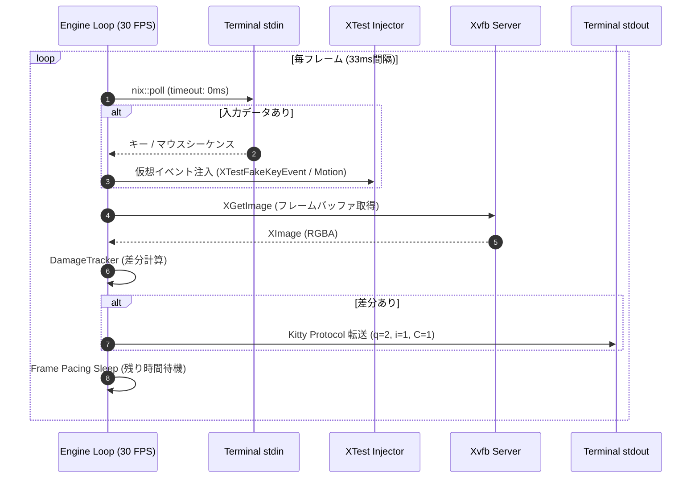
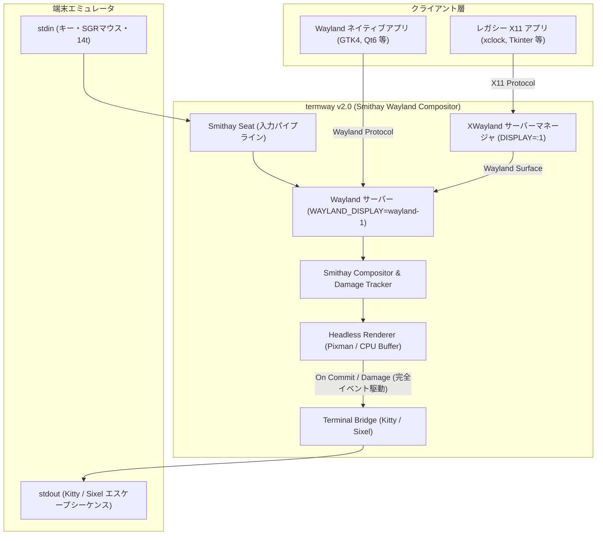

# termway システムアーキテクチャ詳細設計書

本書は、`termway` の内部構造、モジュール設計、プロトコル仕様、およびイベント同期制御について解説する技術設計ドキュメントです。

---

## 1. 全体構造とモジュール構成

`termway` は以下の疎結合なコアレイヤーによって構成されています。

```
src/
├── main.rs                   # CLIパーサー、起動パラメータ初期化
├── engine.rs                 # メインイベントループ、フレーム同期制御
├── terminal/                 # 端末制御・保護・プロトコル検証層
│   ├── winsize.rs            # TIOCGWINSZ によるピクセル/セル解像度取得
│   ├── raw.rs                # termios Rawモード化 & RAII Drop ガード
│   └── query.rs              # Kitty Graphics Protocol 対応可否の事前検証
├── protocol/                 # エスケープシーケンス解析・生成層
│   ├── kitty.rs              # Kitty Graphics Protocol エンコーダ
│   ├── sgr_mouse.rs          # xterm SGR 1006 マウスプロトコルパーサー
│   └── keyboard.rs           # ANSIキー入力・特殊キーパーサー
├── display/                  # 仮想ディスプレイ管理・差分検出層
│   ├── xvfb.rs               # Xvfb ライフサイクル管理
│   ├── framebuffer.rs        # RGBA8888 フレームバッファ & XImage 変換
│   └── damage.rs             # タイルベース差分トラッカー
├── input/                    # 入力注入層
│   └── xtest.rs              # libXtst によるマウス/キー仮想イベント注入
└── backend/                  # ターミナル描画・入力処理層
    ├── mod.rs                # モジュールエクスポート
    └── terminal.rs           # TerminalBackend (Kitty + SGR + 非同期I/O)
```

---

## 2. プロトコル仕様と変換アルゴリズム

### 2.1 Kitty Graphics Protocol エンコード (`src/protocol/kitty.rs`)
Kitty Graphics Protocol は、エスケープシーケンス `\x1b_G<control-data>;<payload>\x1b\\` を用いて、テキスト端末内に直接ピクセル画像を描画します。

#### コントロールキー定義
- `a=T`: 即時転送および表示 (Transmit and display)
- `f=32`: 32-bit RGBA フォーマット
- `s={width}, v={height}`: 送信画像矩形のピクセルサイズ
- `X={col}, Y={row}`: ターミナルウィンドウ内でのピクセルオフセット配置
- `q=2`: 応答抑制モード (Quiet mode 2)。端末からの `\x1b_Gi=...;OK\x1b\` 自律応答を抑止し、標準入力への文字混入・エコーバック無限ループを防止。
- `C=1`: カーソル移動の抑制。画像表示時にテキストカーソルが勝手に移動・スクロールするのを防止。
- `i=1`: 画像識別ID。フレーム置換を行うことで画像が重複描画されるのを防止。
- `m=1`: チャンク継続フラグ（次のエスケープシーケンスに後続データがあることを示す）
- `m=0`: チャンク終了フラグ（ペイロードの最終ブロック）

#### チャンク分割転送
ターミナルエミュレータのバッファオーバーフローを防止するため、エンコードされた Base64 ペイロードは 4096 文字ごとに分割して送信します：
1. **先頭チャンク**: `\x1b_Ga=T,q=2,f=32,s=100,v=100,X=10,Y=20,m=1;<Base64 chunk 1>\x1b\`
2. **中間チャンク**: `\x1b_Gm=1;<Base64 chunk 2>\x1b\`
3. **最終チャンク**: `\x1b_Gm=0;<Base64 chunk N>\x1b\`

---

### 2.2 xterm SGR 1006 マウスプロトコル解析 (`src/protocol/sgr_mouse.rs`)
ターミナルに `\x1b[?1000h\x1b[?1003h\x1b[?1006h` を送信することで、SGR 1006 拡張マウスモードおよび Any-event トラッキングを有効化します。

#### シーケンスフォーマット
- ボタン押下 / ドラッグ / 移動: `\x1b[<{btn};{col};{row}M`
- ボタン解放: `\x1b[<{btn};{col};{row}m`

#### ボタンビットフィールド解析
- 下位 2 ビット:
  - `0`: 左クリック
  - `1`: 中クリック
  - `2`: 右クリック
  - `3`: ボタン解放またはボタン非押下での移動（Hover）
- ビット 5 (32): マウス移動フラグ (Drag または Hover)
- ビット 6 (64): ホイールイベント (64: WheelUp, 65: WheelDown)
- 修飾キー: Shift (+4), Meta (+8), Ctrl (+16)

#### セル座標から仮想ディスプレイへのマッピング式 (`src/terminal/winsize.rs`)
端末全体のピクセル解像度を $W_{term}, H_{term}$、文字セル数を $C, R$、仮想ディスプレイ解像度を $W_{x11}, H_{x11}$ とすると、受信したセル座標 $(col, row)$ は次のようにピクセルへ変換されます：

$$cw = \lfloor W_{term} / C \rfloor, \quad ch = \lfloor H_{term} / R \rfloor$$
$$px = (col - 1) \times cw + \lfloor cw / 2 \rfloor$$
$$py = (row - 1) \times ch + \lfloor ch / 2 \rfloor$$
$$x_{x11} = \mathrm{clamp}\left(\lfloor \frac{px \times W_{x11}}{W_{term}} \rfloor, 0, W_{x11} - 1\right)$$
$$y_{x11} = \mathrm{clamp}\left(\lfloor \frac{py \times H_{x11}}{H_{term}} \rfloor, 0, H_{x11} - 1\right)$$

---

## 3. 差分レンダリング (Tile Damage Tracking)

フルHD画面（1920x1080）を毎フレーム全体転送すると約 8MB/frame の Base64 テキストが必要となり、端末が描画飽和を起こします。そのため、`termway` はタイルベースの差分トラッカー（`src/display/damage.rs`）を内蔵しています。

1. **画面のグリッド分割**: 画面を 32x32 ピクセル（または 64x64）のタイルに分割。
2. **高速ハッシュ比較**: 各タイルの RGBA バイト列に対して FNV-1a 64-bit ハッシュを計算し、前フレームのハッシュ配列と比較。
3. **汚損領域の抽出**: ハッシュ値が異なるタイルのみを Dirty 矩形として抽出。
4. **Coalescing (矩形統合)**: 汚損タイルが多数（画面の50%以上）に及ぶ場合は、エスケープシーケンスのヘッダオーバーヘッドを避けるため、外接バウンディングボックス 1 枚の更新へ自動結合。

---

## 4. イベント駆動・フレーム同期エンジン (`src/engine.rs`)

`termway` のメインループは、入力待機による描画ブロック（スタベーション）を排除したノンブロッキング設計となっています。



### 4.1 ノンブロッキング入力ポーリング
`src/backend/terminal.rs` では `nix::poll` を `PollTimeout::ZERO` で使用。キーやマウスの入力がない場合でもブロックすることなく即座に画面キャプチャと描画ステップに進むため、「キーを押すまで画面が表示されない」「入力が1文字遅れて反映される」といった入力遅延問題を根絶しています。

---

## 5. 端末保護とライフサイクル安全設計

ターミナルを Raw モードおよびマウストラッキングモードに設定した状態でプログラムが不正終了（Panic, SIGINT, Segmentation Fault 等）すると、元のシェルがマウスクリック文字で埋め尽くされ操作不能になります。

これを防止するため、`termway` は **RAII (Resource Acquisition Is Initialization)** パターンを採用しています：

```rust
impl Drop for RawModeGuard {
    fn drop(&mut self) {
        self.restore();
    }
}
```
- `RawModeGuard` がスコープを抜ける際（通常終了、return、`?` によるエラー伝播、パニック時のスタック巻き戻しのいずれでも）、必ず以下の端末復元シーケンスが標準出力へフラッシュされ、`tcsetattr` で元の termios が再設定されます：
  - `\x1b[?1006l\x1b[?1003l\x1b[?1000l`: マウストラッキング（Any-event含む）無効化
  - `\x1b[?25h`: カーソル再表示
  - `\x1b[?1049l`: Alternate Screen の終了（元のシェル画面に戻る）

---

## 6. 次期アーキテクチャ移行計画: Smithay + XWayland 自立型コンポジタ

### 6.1 v1.0 (Xkitty方式) の成果と課題
v1.0 では、外部の `Xvfb` および `openbox` を子プロセスとして立ち上げ、MIT-SHM によるフレームバッファの定周期キャプチャと XTest による入力注入を行う方式（Xkitty と同様の構造）を採用しました。
このアプローチにより、「端末内に Kitty/Sixel で高速描画し、SGR マウスで対話する」というフロントエンドのプロトコル制御やピクセル追従（SGR 14t）の検証（PoC）には成功しました。

しかしながら、以下の本質的な課題が存在します：
1. **画面のポーリング監視**: 描画更新の有無に関わらずタイマー駆動でキャプチャを試みるため、不要な CPU 負荷や遅延が発生しやすい。
2. **X11 への制限**: 純粋な Wayland ネイティブアプリ（GTK4 や Wayland 専用ツール）が動作しない。
3. **外部依存**: `Xvfb` や `openbox`、`libXtst` などの外部バイナリ・ライブラリの事前インストールが必要。

### 6.2 v2.0: Smithay ベースの自立型 Headless Wayland コンポジタ

v2.0 では、`termway` 自体を **Smithay (Rust製Waylandコンポジタフレームワーク)** を用いた自立型コンポジタへと刷新します。



### 6.3 アーキテクチャ比較表

| 観点 | v1.0 (Xkitty方式) | v2.0 (Smithay + XWayland方式) |
| :--- | :--- | :--- |
| **位置づけ** | 外部 X サーバーのキャプチャ＆転送 PoC | **自立型 Wayland コンポジタ ＋ 表示基盤** |
| **描画トリガー** | タイマーループ (30 FPS) による定周期キャプチャ | **`wl_surface.commit` やダメージに連動する完全イベント駆動** |
| **アプリ対応** | X11 アプリのみ | **Wayland ネイティブ ＋ X11 (XWayland経由) の両対応** |
| **入力処理** | XTest 拡張による外部フェイク注入 | **Smithay `Seat` による内部ダイレクト入力処理** |
| **ウィンドウ管理** | 外部 WM (`openbox`) に依存 | **コンポジタ自身がネイティブにタイリング/スタック管理** |
| **外部依存性** | Xvfb, openbox, libXtst 等が必要 | **Rust 単一バイナリ** (X11 アプリ起動時のみ Xwayland を使用) |

