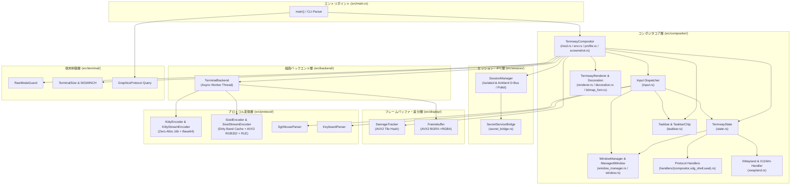
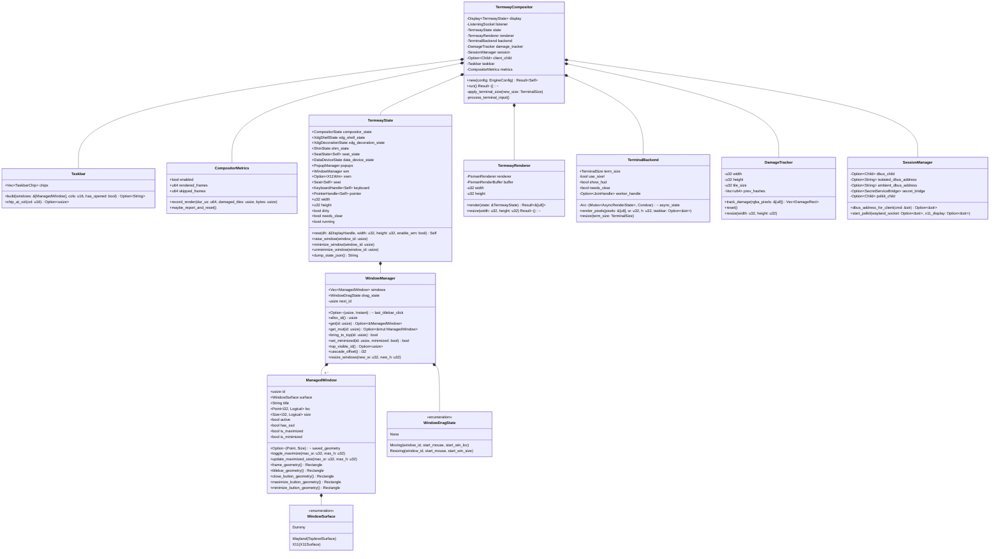
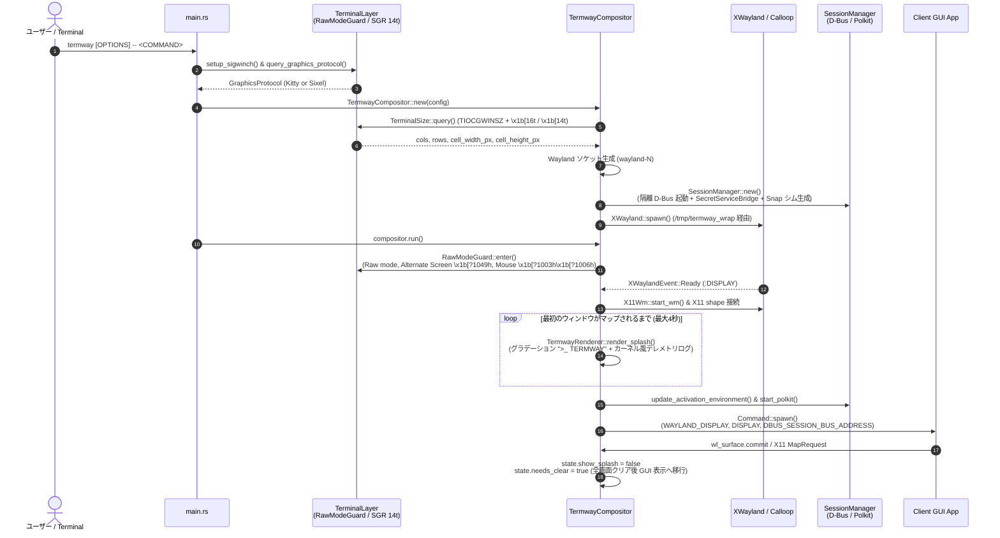
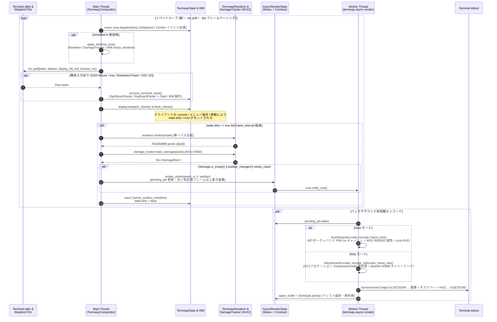
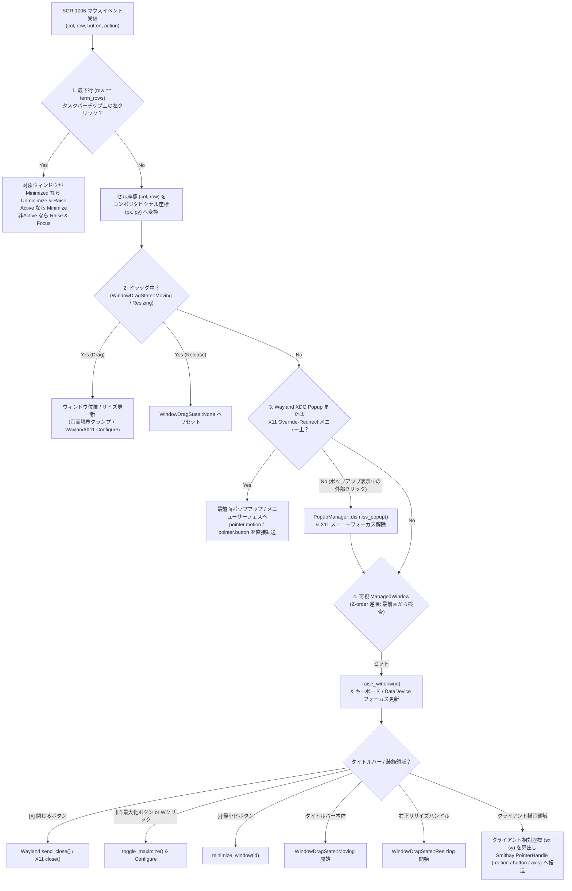

# termway システムアーキテクチャ詳細設計書 (v0.7.0)

本書は、`termway` の**静的構造（モジュール構成・クラス/構造体関係・責務分割）**および**動的構造（起動シーケンス・非同期レンダリングパイプライン・ウィンドウ状態遷移・入力ディスパッチ）**について解説する技術設計ドキュメントです。

---

## 1. 静的構造 (Static Architecture)

### 1.1 レイヤー構成とディレクトリツリー

`termway` は単一バイナリの Smithay ベース自立型 Wayland コンポジタとして設計されており、以下の 5 つの疎結合なコアレイヤーで構成されています（v0.6.0 にてレガシー Xvfb エンジンを廃止し Smithay + XWayland アーキテクチャへ一本化、v0.7.0 にてコンポジタのモジュール分割とストリーム最適化を実施）。

```text
src/
├── main.rs                         # CLIパーサー、グラフィックスプロトコル自動判定、エントリポイント
├── lib.rs                          # クレート公開モジュール定義
├── backend/                        # 【描画バックエンド・非同期I/O層】
│   ├── mod.rs
│   └── terminal.rs                 # TerminalBackend: 非同期エンコードワーカースレッド & 最新フレーム間引き
├── compositor/                     # 【Smithay Wayland コンポジタ & WM コア層】
│   ├── mod.rs                      # TermwayCompositor: 統一 FD ポーリング、フレームペーシング、メインループ
│   ├── env.rs                      # XDG ランタイム環境設定、X11 ディスプレイ候補検索、シグナル処理、ログ出力
│   ├── taskbar.rs                  # Taskbar & TaskbarChip: 下部ステータスバー・タスクバーチップ生成とクリック判定
│   ├── profile.rs                  # CompositorMetrics: パイプライン各段レイテンシ集計、帯域測定、レポート出力
│   ├── screenshot.rs               # save_screenshot: フレームバッファからの PNG スクリーンショット出力
│   ├── state.rs                    # TermwayState: コンポジタ全体のオーケストレータ状態 & JSON 状態ダンプ
│   ├── window_manager.rs           # WindowManager: Z-order・フォーカス・ドラッグ・最小化/最大化・リサイズ再配置
│   ├── window.rs                   # ManagedWindow / WindowSurface / WindowDragState: ウィンドウジオメトリ・ヒットテスト
│   ├── handlers/                   # Smithay プロトコルハンドラ群（ドメイン別分割）
│   │   ├── mod.rs                  # delegate_*! マクロ集約
│   │   ├── compositor.rs           # CompositorHandler / BufferHandler / ShmHandler / OutputHandler
│   │   ├── xdg_shell.rs            # XdgShellHandler / XdgDecorationHandler (Toplevel・Popup・Configure制御)
│   │   └── seat.rs                 # SeatHandler / SelectionHandler / DataDeviceHandler (OSC 52 & クリップボード統合)
│   ├── xwayland.rs                 # XwmHandler / XWaylandShellHandler: X11 ウィンドウ管理 & Override-Redirect 制御
│   ├── input.rs                    # SGRマウス・ANSIキーイベントの座標変換、WM操作、Smithay Seat ディスパッチ
│   ├── renderer.rs                 # TermwayRenderer: Pixman オフスクリーン合成（パス統合）、ポップアップ・スプラッシュ描画
│   ├── decoration.rs               # Openbox/Fluxbox 風 SSD タイトルバー・ボタン・枠線描画
│   ├── bitmap_font.rs              # ビットマップフォント文字列レンダラ・グラデーション描画
│   └── font_data.rs                # 内蔵 8x8 ASCII ビットマップフォントデータ
├── display/                        # 【フレームバッファ・差分検出層】
│   ├── mod.rs
│   ├── damage.rs                   # DamageTracker: 32x32 タイル FNV-1a ハッシュ比較 (AVX2 SIMD 高速化)
│   └── framebuffer.rs              # Framebuffer: RGBA8888 バッファ & BGRX→RGBA 変換 (AVX2 SIMD 高速化)
├── protocol/                       # 【ターミナルプロトコル エンコード・デコード層】
│   ├── mod.rs
│   ├── kitty.rs                    # KittyEncoder & KittyStreamEncoder: RFC 1950 zlib 圧縮 (o=z) & ゼロアロケーション Base64 ストリーミング
│   ├── sixel.rs                    # SixelEncoder & SixelStreamEncoder: ダーティバンドキャッシュ、RGB332 減色、RLE 圧縮 (AVX2 + tzcnt)
│   ├── sgr_mouse.rs                # SgrMouseParser: xterm SGR 1006 (Any-event 1003h) マウスシーケンスパーサー
│   └── keyboard.rs                 # KeyboardParser: UTF-8・ANSI/CSI 修飾キー・Bracketed Paste パーサー
├── session/                        # 【セッション管理・IPC ブリッジ層】
│   ├── mod.rs                      # SessionManager: ハイブリッド D-Bus 管理、Snap シム生成、Polkit エージェント管理
│   └── secret_bridge.rs            # SecretServiceBridge: org.freedesktop.secrets D-Bus 中継ブリッジ
└── terminal/                       # 【端末制御・RAII 保護・解像度検出層】
    ├── mod.rs
    ├── raw.rs                      # RawModeGuard: termios Raw モード & Alternate Screen の RAII 復元保証
    ├── winsize.rs                  # TerminalSize: TIOCGWINSZ & SGR 14t/16t セルピクセル寸法測定・SIGWINCH 捕捉
    └── query.rs                    # GraphicsProtocol: 端末環境変数およびエスケープシーケンス応答によるプロトコル検出
```

---

### 1.2 パッケージ・モジュール依存関係図

上位の `TermwayCompositor` が各ドメインモジュールを統括し、下位の `protocol` / `display` / `terminal` は Wayland や Smithay に依存しない独立した純粋モジュールとして単体テスト可能に設計されています。



---

### 1.3 コア構造体クラス図 (Class / Ownership Diagram)

`v0.6.0`〜`v0.7.0` では、`TermwayState` に集中していたウィンドウ管理ロジックを [`WindowManager`](../src/compositor/window_manager.rs) (`state.wm`) として分離し、Smithay のトレイト実装を [`handlers/`](../src/compositor/handlers/mod.rs) 配下へ分割、さらにコンポジタオーケストレータの周辺責務を [`Taskbar`](../src/compositor/taskbar.rs)・[`CompositorMetrics`](../src/compositor/profile.rs)・[`env`](../src/compositor/env.rs)・[`screenshot`](../src/compositor/screenshot.rs) へ独立させています。



---

## 2. 動的構造 (Dynamic Architecture & Runtime Behavior)

### 2.1 起動・セッション確立・スプラッシュ描画シーケンス

`termway` 起動時からクライアント GUI アプリケーションが最初のウィンドウをマップするまでの動的シーケンスです。



---

### 2.2 イベント駆動メインループと非同期レンダリングパイプライン

`TermwayCompositor::run` のメインスレッド（統一 FD ポーリング + Calloop + Wayland ディスパッチ）と、`TerminalBackend` の専用ワーカースレッド（`termway-async-render`）間の非同期協調動作を示します。

- **統一 FD ポーリングとフレームペーシング (`--fps`)**: `stdin`・Wayland `ListeningSocket`・`display.backend().poll_fd()` の 3 記述子を単一の `nix::poll` で一括監視することでアイドル時の CPU 使用率を 0% に保ちつつ、`--fps`（デフォルト 30fps）のフレーム間隔に基づいて連続コミット時の再描画頻度を適応的に制御します。
- **入力とイベント処理の非ブロッキング化**: 画像エンコード（Sixel 減色や Kitty zlib 圧縮）と標準出力フラッシュは別スレッドで実行されるため、高解像度描画中でもマウス・キー入力は遅延なく処理されます。
- **最新フレーム間引き (Frame Dropping) とゼロアロケーション再利用**: ワーカースレッドが前フレームをエンコード中に次のフレームが到着した場合、`pending_job` のピクセルバッファを上書き置換することで古いフレームを破棄し、PTY バッファブロートを完全に防ぎます。また、描画完了後の `Vec<u8>` は `spare_buffer` としてメインスレッドへ返却・再利用されます。



---

### 2.3 ウィンドウライフサイクルと状態遷移 (Window State Machine)

内蔵ウィンドウマネージャ（[`WindowManager`](../src/compositor/window_manager.rs) / [`ManagedWindow`](../src/compositor/window.rs)）における各ウィンドウの状態遷移図です。

- **初期配置**: プライマリウィンドウおよび独立アプリウィンドウは、ターミナルの限られた表示領域を最大限活かすため初期状態で**最大化 (`Maximized`)** され、同時に画面解像度の **80%・中央配置** の矩形が `saved_geometry` として保存されます（ダイアログや子ウィンドウはクライアント指定サイズの `Floating` で開きます）。
- **最大化解除 (`Unmaximize`)**: タイトルバーの `[□]` ボタンクリックまたはタイトルバーのダブルクリックにより、保存された 80% 中央サイズへ復元されます。Wayland クライアントが次フレームをコミットするまでの間、`unmaximize_pending` フラグにより古いフルスクリーンバッファのはみ出し描画を抑止し、背景をクリーンに保ちます。
- **最小化 (`Minimized`)**: `[-]` ボタンまたは最下部タスクバーチップのクリックにより非表示化され、レンダリング対象から除外されるとともに、背後の可視ウィンドウへ自動的にキーボードフォーカスが移譲されます。

```mermaid
stateDiagram-v2
    [*] --> Maximized: プライマリ / 独立ウィンドウ生成<br/>(saved_geometry = 画面の80%中央)
    [*] --> Floating: 子ダイアログ / ツールウィンドウ生成

    state Maximized {
        [*] --> FullscreenActive: loc=(0, 23), size=(W, H-23)<br/>is_maximized = true
        FullscreenActive --> FullscreenResized: SIGWINCH 端末リサイズ<br/>(update_maximized_size で新解像度へ即時追従 &<br/>saved_geometry も新解像度の80%中央に更新)
        FullscreenResized --> FullscreenActive
    }

    state Floating {
        [*] --> NormalIdle: WindowDragState::None
        NormalIdle --> Moving: タイトルバー左ドラッグ開始
        Moving --> NormalIdle: マウスボタン解放<br/>(画面境界クランプ適用)
        NormalIdle --> Resizing: 右下ハンドル左ドラッグ開始
        Resizing --> NormalIdle: マウスボタン解放<br/>(最小 160x100 / 画面境界クランプ)
    }

    Maximized --> Floating: [□] ボタン or タイトルバーWクリック<br/>(toggle_maximize: 80%中央へ復元,<br/>unmaximize_pending = true, needs_clear = true)
    Floating --> Maximized: [□] ボタン or タイトルバーWクリック<br/>(現在位置・サイズを saved_geometry に保存し最大化)

    Maximized --> Minimized: [-] ボタン or アクティブ時タスクバーチップクリック<br/>(is_minimized = true, 次の可視ウィンドウへフォーカス移譲)
    Floating --> Minimized: [-] ボタン or アクティブ時タスクバーチップクリック<br/>(is_minimized = true, 次の可視ウィンドウへフォーカス移譲)

    Minimized --> Maximized: タスクバーチップ [id: title _] クリック<br/>(最小化前に Maximized だった場合、最前面へ復元)
    Minimized --> Floating: タスクバーチップ [id: title _] クリック<br/>(最小化前に Floating だった場合、最前面へ復元)

    Maximized --> [*]: [×] ボタン (send_close) / アプリ終了
    Floating --> [*]: [×] ボタン (send_close) / アプリ終了
    Minimized --> [*]: アプリ終了
```

---

### 2.4 マウスイベントのヒットテスト・ルーティング優先順位

ターミナルから受信した SGR マウスイベントは、`src/compositor/input.rs` の `dispatch_mouse_event` において以下の優先順位（Z-order の手前側優先）でルーティングされます。



---

### 2.5 セッション終了判定ステートマシン (Forking GUI App Lifecycle)

`gvim` や `gnome-terminal` のように起動直後に親プロセスが `fork()` して `exit(0)` するアプリケーションや、スプラッシュウィンドウを閉じてからメインウィンドウを開くアプリケーションに対応するため、`TermwayCompositor` はプロセス状態とウィンドウ枚数の組み合わせで終了判定を行います。

```mermaid
stateDiagram-v2
    [*] --> WaitingFirstWindow: クライアントプロセス起動<br/>(has_opened_windows = false)

    WaitingFirstWindow --> ActiveSession: ウィンドウが1枚以上オープン<br/>(has_opened_windows = true)
    WaitingFirstWindow --> StartupGracePeriod: 親プロセスが exit(0) で終了<br/>(gvim / ランチャー等の fork 想定)
    WaitingFirstWindow --> ErrorExit: 親プロセスが非ゼロ終了コードで異常終了<br/>(stderr ログを抽出してエラー表示)

    StartupGracePeriod --> ActiveSession: 6秒以内に子プロセスがウィンドウをオープン
    StartupGracePeriod --> ErrorExit: 6秒経過してもウィンドウが1枚も開かない

    ActiveSession --> CloseGracePeriod: 全ウィンドウがクローズ (active_window_count == 0)<br/>かつ子プロセスがまだ生存中
    ActiveSession --> CleanExit: 全ウィンドウがクローズ (active_window_count == 0)<br/>かつ子プロセスも終了済み

    CloseGracePeriod --> ActiveSession: 3秒以内に次のウィンドウがオープン<br/>(ダイアログ→メイン画面遷移など)
    CloseGracePeriod --> CleanExit: 3秒経過してもウィンドウが0枚のまま

    ActiveSession --> CleanExit: ユーザーが Ctrl-Q を押下
    CleanExit --> [*]: RawModeGuard::drop() で端末復元
    ErrorExit --> [*]: RawModeGuard::drop() で端末復元
```

---

## 3. 主要サブシステムの技術詳細

### 3.1 プロトコルエンコードと SIMD 高速化 (`src/protocol/`, `src/display/`)

1. **Kitty Graphics Protocol (`src/protocol/kitty.rs`)**:
   - **RFC 1950 zlib 圧縮 (`o=z`) & ゼロアロケーション再利用 (`KittyStreamEncoder`)**: RGBA8888 ピクセルデータを `miniz_oxide` の `CompressorOxide` インスタンス再利用（`reset()`）によりヒープ確保なしで圧縮し、中間文字列を介さず直接 Base64 4096 バイトチャンクへストリーミング出力（`a=T,f=32,o=z,i=1,q=2,C=1,z=-2147483648`）。
   - **最背面レイヤ配置 (`z=-2147483648`) と最下行保護 (`rows - 1`)**: 画像をテキストレイヤより背面に配置し、さらに描画行数を `term_rows - 1` に制限することで、最下行のタスクバーおよびステータスオーバーレイ文字列との重なりを防止。
2. **Sixel Graphics Protocol (`src/protocol/sixel.rs`)**:
   - **6 行ダーティバンドキャッシュ (`SixelStreamEncoder`)**: 6 ピクセル高の水平バンドごとに FNV-1a ハッシュとエンコード済み Sixel バイト列をキャッシュし、前フレームと同一のバンドは減色・走査を完全スキップしてキャッシュから即時結合（カーソル移動等の部分更新を約 4.3ms → 0.34ms へ 92〜95% 高速化）。
   - **AVX2 SIMD RGB332 減色 (`quantize_rgb332_avx2`)**: 8 ピクセル（32 バイト）単位で RGBA から 8-bit RGB332 カラーインデックスへ一括ベクトル変換。
   - **AVX2 + `tzcnt` ビットマスク走査**: 6 ピクセル高のバンドごとに 32 列単位で `_mm256_cmpeq_epi8` + `_mm256_movemask_epi8` を実行し、存在する色だけを `trailing_zeros()` でジャンプ走査して RLE 出力（1080x720 フルフレーム初回を約 3.7ms でエンコード）。
3. **タイル差分検出 (`src/display/damage.rs`)**:
   - 画面を 32x32 ピクセルのタイルに分割し、`x86_64` AVX2 環境では `_mm256_mullo_epi32` と `_mm256_xor_si256` による 8 レーン並列ハッシュで前回フレームと比較（1080x720 画面の差分スキャン約 0.14〜0.20ms）。
4. **Synchronized Output (`\x1b[?2026h` ... `\x1b[?2026l`)**:
   - フレーム画像・タスクバー・HUD の出力全体を DEC Mode 2026（同期更新ブロック）で囲み、ティアリングや画面のチラつきを防止。

---

### 3.2 双方向クリップボード同期 (`src/compositor/handlers/seat.rs`, `src/compositor/input.rs`)

- **GUI → ホスト端末 (Copy)**:
  - Wayland クライアントが `wl_data_device.set_selection` を発行、または XWayland クライアントが X11 `CLIPBOARD` / `PRIMARY` セレクションを更新した際、`SelectionHandler::new_selection` が発火。
  - パイプ経由で UTF-8 テキストを読み取り、Base64 エンコードして OSC 52 シーケンス（`\x1b]52;c;<base64>\x07`）を端末へ送信し、ホスト OS のクリップボードへ即時同期。
- **ホスト端末 → GUI (Paste)**:
  - 端末側でのペースト（Bracketed Paste `\x1b[200~...\x1b[201~`）または `Ctrl+V` 押下時、ホスト側のテキストをコンポジタ側セレクション（`set_data_device_selection` / XWM セレクション）へセットした上で、フォーカス中のクライアントへ貼り付けキーイベントまたは Wayland データパイプを供給。

---

### 3.3 ハイブリッド D-Bus セッションと Secret Service 中継 (`src/session/`)

- **デュアル D-Bus ルーティング**:
  - `gnome-terminal` などの単一インスタンス型アプリがホストの既存デスクトップ（`:0`）へ吸い込まれるのを防ぐため、専用 `dbus-daemon --session` による隔離バスを生成。
  - 一方、Ubuntu の Snap 版 `firefox` や `xdg-open` など、ホストの `systemd --user` による cgroup スコープ生成（`snap-confine`）を要求するアプリには、起動コマンド判定および `PATH` ラッパーシムによってホストの Ambient バスを自動ルーティング（詳細は [ADR-0001](adr/0001-hybrid-dbus-session-routing.md) を参照）。
- **Secret Service ブリッジ (`src/session/secret_bridge.rs`)**:
  - 隔離 D-Bus セッション内で動く VS Code や Chromium 等がホストの GNOME Keyring / KWallet にアクセスできるよう、隔離バス上の `org.freedesktop.secrets` メソッド呼び出し・シグナルをホストの Ambient バスへ双方向中継。
