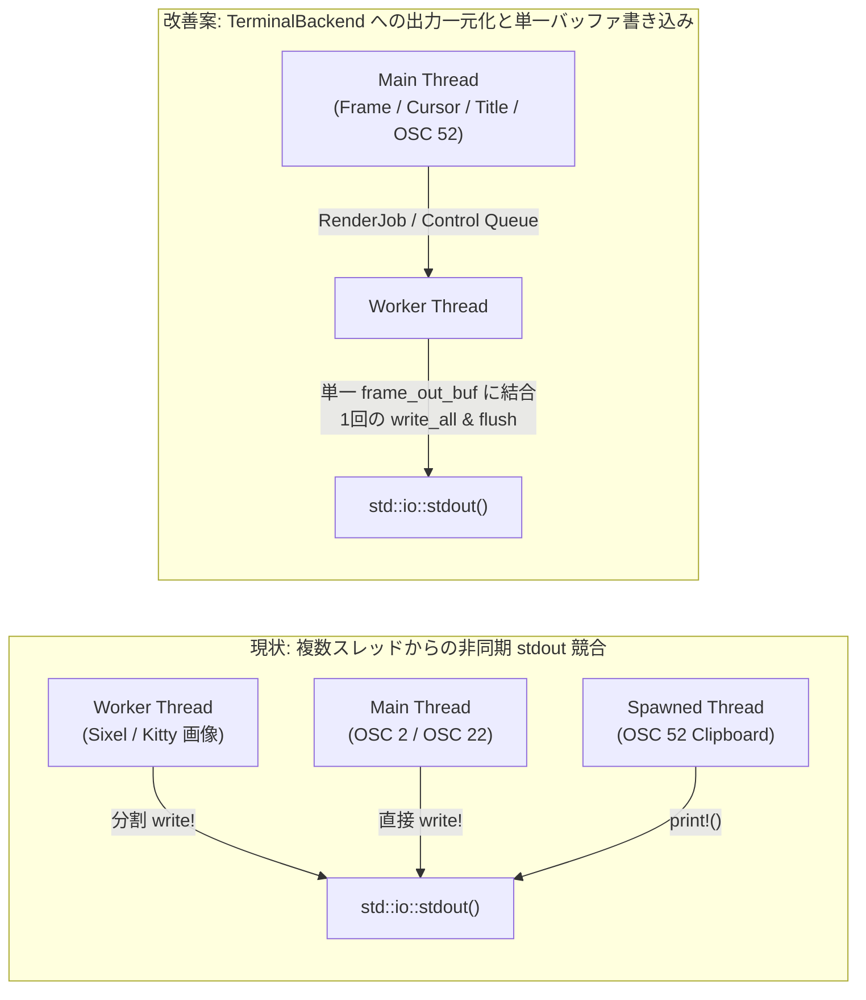

# termway アーキテクチャ・実装改善提案書 (v0.14.0 時点)

本ドキュメントは、`termway` (v0.14.0) のコードベース全体（コンポジタ・メインループ、非同期描画バックエンド、差分検出、ターミナルプロトコルエンコーダ、セッション・クリップボード管理）を精査し、現状の設計・実装上の課題と具体的な改善提案を優先度別に整理した技術提案書です。

---

## 1. エグゼクティブサマリー (Executive Summary)

`termway` は v0.14.0 までに、Smithay + XWayland の単一バイナリ統合、AVX2 / ARM NEON による SIMD ベクトル高速化、ゼロアロケーション JPEG / zlib エンコーダ、および 30fps イベントループ同期など、高度なパフォーマンス基盤を確立しています。

一方で、コードベースの詳細監査により、以下の **4 つの重要領域（P0〜P2）** においてさらなる品質・性能・安全性向上の余地が確認されました。

1. **【P0: 重大な性能劣化・競合バグ】**
   - **Polkit エージェント不在環境での毎ループ `300ms` スリープ問題**: メインループ内で `!self.session.is_polkit_running()` を毎イテレーション判定しているため、Polkit エージェント未導入環境（最小構成 Linux、WSL2、コンテナ等）で毎ループ `dbus-update-activation-environment` の起動と `300ms` のブロッキングスリープが発生し、フレームレートが最大約 3.3 fps に律速される。
   - **複数スレッドからの `stdout` 非同期書き込み競合 (Race Condition)**: 描画ワーカースレッド（`TerminalBackend`）、メインスレッド（OSC 2 タイトル更新・OSC 22 カーソル変更）、およびクリップボード転送用の一時スレッド（OSC 52）が同期なしで個別に `std::io::stdout()` へ書き込んでおり、エスケープシーケンスのインターリーブ（画面破損）が発生し得る。
2. **【P0: セキュリティ・リソース保護】**
   - **OSC 52 クリップボード転送の無制限スレッド生成と無制限メモリ読み込み**: セレクション更新のたびに `std::thread::spawn` と上限なしの `read_to_end` が実行されるため、巨大データコピー時の OOM やスレッド枯渇リスクがある。
   - **ウィンドウタイトル等の制御文字未サニタイズによるエスケープインジェクション**: クライアント由来のウィンドウタイトルをそのまま `\x1b]2;...\x07` やタスクバーへ埋め込んでいるため、悪意あるタイトル文字列によりホスト端末へ任意の ANSI/OSC シーケンスを注入可能。
3. **【P1: 差分検出・プロトコルエンコード効率】**
   - **`DamageTracker` の矩形結合 (`coalesce_rects`) における閾値とバックエンド不整合**: コメント上は「画面の 50% 以上が dirty の場合」とあるが、実装は `dirty_tiles.len() > 16` の固定値判定となっており、離散した 17 タイル（1080p で画面の約 0.8%）が変化しただけで全画面規模の単一バウンディングボックスへ膨張する。これにより Sixel の無変更バンドまで再エンコードが走るほか、Kitty 部分更新のスパース膨張検知（`is_sparse_inflated`）が阻害される。
   - **`TerminalBackend` における毎フレームの `String` アロケーションと分割 `write!`**: エンコーダ内部はゼロアロケーション化されているが、ワーカー出力段で `format!` によるヒープ確保と複数回の `write!` が行われている。
4. **【P2: アーキテクチャ責務分離・シャットダウン安全性・可観測性】**
   - タスクバーとオーバーレイの幅計算のハードコード分散（`taskbar.rs` と `terminal.rs`）、ワーカー終了時の `join()` ブロッキングリスク、およびパーセンタイル（p95/p99）メトリクスの拡充。

---

## 2. 事前メモ（ドラフト）の妥当性検証結果

前コンテキストで作成された調査メモの各仮説について、実コードと照合した妥当性判定は以下の通りです。

| 調査項目 | メモ内の仮説・指摘 | 実コード照合結果（妥当性） | 備考・真の課題 |
| :--- | :--- | :---: | :--- |
| **メインループの `poll_fd` と `clean_skip_timerfd`** | `calloop.poll_fd().max_timeout_ms()` と `clean_skip_timerfd` の二重タイマー管理によりタイムアウトが不一致になるのではないか | **誤認**<br/>（該当コードなし） | [`src/compositor/mod.rs`](../src/compositor/mod.rs#L697-L745) では `clean_skip_timerfd` は使われておらず、`last_render_time` を更新しないことでペーシング枠を保持する設計。ただし**アイドル時の固定 50ms ポーリング**や **Polkit 300ms スリープ問題**が実在する。 |
| **`DamageTracker` の矩形結合 (`> 16`)** | `dirty_tiles.len() > 16` で単一バウンディングボックスに結合すると、離散的な小更新で全画面更新になり逆効果ではないか | **極めて妥当** | [`src/display/damage.rs`](../src/display/damage.rs#L291-L319) にて確認。Sixel のバンドキャッシュ効率および Kitty の部分更新判定の双方に悪影響を与えている。 |
| **タイルハッシュの RGB565 マスクと衝突リスク** | `0xFFF8_FCF8` マスクによる下位ビット無視と 64-bit ハッシュ衝突による False Negative の懸念 | **一部妥当**<br/>（マスク自体は意図的設計） | マスクは RGB565 量子化と一致させる意図的な設計。ただし AVX2 / NEON / Scalar 間でハッシュ計算式が異なる点と、XOR 畳み込みの対称打ち消しリスクには改善余地がある。 |
| **タスクバーと下部オーバーレイの重なり** | `overlay_row = term_rows` と `taskbar_seq` が同一行に出力され、表示が競合するのではないか | **一部妥当**<br/>（マジックナンバー依存） | [`src/compositor/taskbar.rs`](../src/compositor/taskbar.rs#L35-L40) が右端 `backend_name.len() + 30` 列を空けてチップを配置するため通常は重ならないが、文字列長計算が 2 ファイルにハードコード分散しており脆弱。 |
| **`TerminalBackend` の出力分割と `Drop` 時 `join` ハング** | `write!(stdout, ...)` の分割呼び出しの非効率性と、PTY 詰まり時に `Drop` の `handle.join()` がハングする懸念 | **妥当** | [`src/backend/terminal.rs`](../src/backend/terminal.rs#L219-L226) および [`Drop`](../src/backend/terminal.rs#L379-L391) にて確認。さらに複数スレッドからの `stdout` 競合という重大な問題に繋がっている。 |
| **OSC 52 クリップボードのサイズ上限・サニタイズ** | クリップボード同期時の巨大データ送信や端末エスケープインジェクションのリスク | **極めて妥当** | [`src/compositor/handlers/seat.rs`](../src/compositor/handlers/seat.rs#L203-L219) にて無制限 `thread::spawn`・無制限 `read_to_end`・`stdout` 直接出力を確認。 |

---

## 3. 詳細課題分析と改善提案

### 3.1 【P0】Polkit エージェント未導入環境におけるメインループ 300ms ブロッキングの解消

#### 現状の課題
[`src/compositor/mod.rs`](../src/compositor/mod.rs#L455-L462) において、以下のコードがメインループの毎イテレーションで実行されています。

```rust
let xwayland_is_ready = self.state.xwayland_ready || self.x11_display.is_none();
if loop_count >= 5 && xwayland_is_ready {
    // Start Polkit Authentication Agent once Wayland and XWayland are fully ready
    if !self.session.is_polkit_running() {
        self.session.update_activation_environment(Some(&self.socket_name), self.x11_display.as_deref());
        self.session.start_polkit(Some(&self.socket_name), self.x11_display.as_deref());
        // Allow the agent to register with D-Bus and polkitd before launching the client
        std::thread::sleep(std::time::Duration::from_millis(300));
    }
```

[`SessionManager::start_polkit`](../src/session/mod.rs#L608-L627) はエージェントが見つからない場合でも `self.polkit = Some(PolkitAgent { child: None, ... })` をセットしますが、[`is_polkit_running()`](../src/session/mod.rs#L629-L631) は `child.is_some()` を返すため、エージェント未インストール環境では恒久的に `false` となります。
その結果、`loop_count >= 5` 以降の**すべてのメインループ周期で毎回 `dbus-update-activation-environment` プロセス生成と `300ms` のスリープが実行**され、入力応答と描画レートが壊滅的に低下します。

#### 改善案
- `SessionManager` に `is_polkit_initialized(&self) -> bool`（`self.polkit.is_some()`）を追加するか、Polkit の初期化処理をワンショットのフラグ（または `pending_command` 起動直前の 1 回のみ）に限定する。
- さらに、エージェントが実際に起動した場合（`self.session.is_polkit_running() == true`）のみ待機を行うようにし、エージェント不在時は `300ms` スリープ自体をスキップする。

```rust
if !self.session.is_polkit_initialized() {
    self.session.update_activation_environment(Some(&self.socket_name), self.x11_display.as_deref());
    self.session.start_polkit(Some(&self.socket_name), self.x11_display.as_deref());
    if self.session.is_polkit_running() {
        std::thread::sleep(std::time::Duration::from_millis(200));
    }
}
```

---

### 3.2 【P0】標準出力 (`stdout`) へのマルチスレッド競合排除と単一バッファ書き出し

#### 現状の課題
現在、端末の `stdout` に対して以下の **3 つの異なるコンテキスト** から非同期に書き込みが行われています：

1. **描画ワーカースレッド (`termway-async-render`)**: [`src/backend/terminal.rs`](../src/backend/terminal.rs#L219-L226) にて、Sixel / Kitty 画像データ、タスクバー、HUD を複数の `write!` / `write_all` で出力。
2. **メインスレッド (`TermwayState`)**: [`src/compositor/state.rs`](../src/compositor/state.rs#L237-L270) の `update_cursor_shape`（`\x1b]22;...\x07`）および `update_active_window_title`（`\x1b]2;...\x07`）が `std::io::stdout()` へ直接出力。
3. **クリップボード一時スレッド (`SelectionHandler`)**: [`src/compositor/handlers/seat.rs`](../src/compositor/handlers/seat.rs#L203-L219) にて `print!("\x1b]52;...\x07")` を直接出力。



`TerminalBackend` のワーカーが `write!(stdout, "\x1b[?2026h...")` と `stdout.write_all(&sixel_out)` を別々に呼び出しているため、その合間にメインスレッドやクリップボードスレッドの OSC シーケンスが割り込むと、DCS（Sixel）や APC（Kitty）シーケンスが破壊され、端末画面にゴミ文字が出力されたり描画が停止します。

#### 改善案
1. **ワーカー内の単一出力バッファ統合**:
   - `TerminalBackend` ワーカー内に再利用可能な `frame_buf: Vec<u8>` を保持し、`\x1b[?2026h` + `clear_seq` + `sixel_out / kitty_out` + `taskbar_seq` + `overlay_seq` + `hud_seq` + `\x1b[?2026l`（および保留中の OSC 2 / OSC 22 / OSC 52 シーケンス）をすべてメモリ上で結合してから、**`stdout.lock()` に対して 1 回の `write_all` + `flush` でアトミックに出力**する。
   - これにより、毎フレームの `format!` による一時 `String` アロケーションも完全にゼロ化できる。
2. **制御シーケンス（OSC 2 / OSC 22 / OSC 52）のバックエンド経由化**:
   - メインスレッドやクリップボード処理からは直接 `stdout` を触らず、`TerminalBackend` のキュー（または `Stdout` の明示的ロック共有）を経由してフレーム境界で安全に送出する。

---

### 3.3 【P0】OSC 52 クリップボード処理の安全性と端末エスケープサニタイズ

#### 現状の課題
1. **無制限の `thread::spawn` とメモリ読み込み ([`src/compositor/handlers/seat.rs`](../src/compositor/handlers/seat.rs#L203-L219))**:
   - クライアントがセレクションを更新するたびに OS スレッドを起動し、`file.read_to_end(&mut data)` でサイズ制限なく読み込んでいる。
   - パイプの書き込み側をクライアントが開いたまま放置するとスレッドがリークし、また数十MBのテキストをコピーすると Base64 化して端末へ送信してしまい PTY がフリーズする。
2. **エスケープシーケンス・インジェクション ([`src/compositor/state.rs`](../src/compositor/state.rs#L248-L270), [`src/compositor/taskbar.rs`](../src/compositor/taskbar.rs#L53-L62))**:
   - クライアントが設定したウィンドウタイトル（`w.title`）に `\x1b` (ESC)、`\x07` (BEL)、`\x9c` (ST) や改行・制御文字が含まれている場合、OSC 2 シーケンス `\x1b]2;termway: {}\x07` を早期終端させて任意の端末制御シーケンス（OSC 52 書き換えやキー入力偽装など）をホスト端末に実行させることが可能。

#### 改善案
- **OSC 52 の読み取り上限設定**:
  - `std::io::Read::take(MAX_CLIPBOARD_BYTES)`（例: `1024 * 1024` = 1MB、あるいは一般的な端末の OSC 52 上限に合わせて `100KB〜1MB`）を使用し、上限を超えるコピーは切り捨てるかスキップする。
- **制御文字サニタイズ関数の導入**:
  - ウィンドウタイトルや外部文字列を端末へ出力する前に、ASCII 制御文字（`0x00..=0x1F`, `0x7F`）および C1 制御文字（`0x80..=0x9F`）を除去・空白置換する共通ヘルパー `sanitize_terminal_text(s: &str) -> String` を適用する。

---

### 3.4 【P1】`DamageTracker` の矩形結合戦略とバックエンド別最適化

#### 現状の課題
[`src/display/damage.rs`](../src/display/damage.rs#L291-L319) の `coalesce_rects` は以下の実装になっています：

```rust
// If more than 50% of screen is dirty, coalesce into a single full update
if dirty_tiles.len() > 16 {
    // すべての dirty_tiles を囲む単一の Bounding Box を返す
}
```

32×32 タイルの場合、16 タイルはわずか $16 \times 1024 = 16,384\text{ px}^2$（1280×720 画面の **1.7%**、1920×1080 画面の **0.79%**）に過ぎません。
このため、以下のような問題が生じます：

1. **Sixel モードでの不要なバンド再エンコード**:
   - たとえば画面上部の時計（4 タイル）と画面下部のステータスやカーソル（13 タイル）が同時に変化すると、合計 17 タイルとなり**画面全体を覆う 1 つの巨大な `DamageRect`** に結合されます。
   - [`SixelStreamEncoder::encode_frame_into`](../src/protocol/sixel.rs#L946-L954) は渡された `DamageRect` の Y 範囲に含まれるすべての 6px バンドを dirty と判定するため、中央の全く変化していない数百行のバンドまで全て再量子化・再エンコードされてしまいます。
2. **Kitty 部分更新モードでの `is_sparse_inflated` 誤判定**:
   - [`KittyStreamEncoder::encode_frame_into`](../src/protocol/kitty.rs#L488-L491) は、`cand_area > step_area * 2` を用いてスパースな膨張を検知していますが、`DamageTracker` 側で先に単一バウンディングボックスへ結合してしまうと、`step_area` 自体が膨張後の面積になってしまい、スパース検知が機能しません。

#### 改善案
- `DamageTracker::track_damage` では無条件の `dirty_tiles.len() > 16` による単一バウンディングボックス化を廃止し、以下のいずれか（または組み合わせ）に改める：
  1. **水平・垂直に隣接するタイルのみを結合（行単位ランレングス結合＋上下マージ）** し、離れた領域は独立した `DamageRect` として保持する。
  2. 全画面単一バウンディングボックスへのフォールバック閾値を、固定タイル数 `16` ではなく **総タイル数の 50%（`(self.tiles_x * self.tiles_y) as usize / 2`）**、または「個別矩形の合計面積と外接矩形面積の比率」に基づいて動的に判定する。

---

### 3.5 【P1】`DamageTracker` SIMD ハッシュの一貫性と衝突耐性

#### 現状の課題
[`src/display/damage.rs`](../src/display/damage.rs#L69-L228) において：
- `hash_tile_avx2`（x86_64）、`hash_tile_neon`（aarch64）、およびスカラーフォールバック（`hash_row_words`）がそれぞれ**異なるハッシュアルゴリズム（異なる初期値・異なるミキシング演算）** を実装している。
- AVX2 / NEON 実装では `acc0 = (acc0 ^ v0)` の後にビットローテートと加算を行っているが、乗算（拡散）が最終段のレーン畳み込み時のみであるため、タイル内で同一色が偶数回反転するような対称パターン変化時にレーン内で打ち消し合う確率が FNV-1a 等より高い。

#### 改善案
- SIMD レーン更新時に奇素数定数との乗算（AVX2 では `_mm256_mullo_epi32`、あるいは行インデックス `y` をシードに混ぜる）を加えることで、位置対称なピクセル変化での衝突（False Negative）を防止する。
- 単体テストにおいて、微小な 1 ピクセル変化（RGB565 有効ビット内）や対称位置の 2 ピクセル同時変化でハッシュ衝突が起きないことを検証するプロパティテストを追加する。

---

### 3.6 【P2】タスクバーと下部ステータスオーバーレイのレイアウト責務統合

#### 現状の課題
最下行（`row == term_rows`）の左側にタスクバーチップ、右側にステータスオーバーレイ（`[Kitty-JPEG] [F12: Shot] [Ctrl-Q: Exit]`）を描画していますが：
- [`src/compositor/taskbar.rs`](../src/compositor/taskbar.rs#L35) では `let overlay_len = backend_name.len() + 30;` とハードコードして最大列数を計算。
- [`src/backend/terminal.rs`](../src/backend/terminal.rs#L160-L178) では独自に `visible_overlay` をフォーマットし、さらに毎フレーム `\x1b[{overlay_row};1H\x1b[2K` で行全体をクリアしてから `taskbar_str` と `overlay_seq` を出力している。

#### 改善案
- オーバーレイ文字列の生成（またはその表示幅計算定数）を `Taskbar` モジュール（あるいは共通の `StatusBar` 構造体）に一元化し、マジックナンバー `+ 30` の二重管理を解消する。
- マルチバイト文字（日本語ウィンドウタイトル等）がタイトルに含まれる場合、`chars().count()`（コードポイント数）と端末上の表示カラム幅（全角 2 カラム）が乖離し、タスクバーチップのクリック判定座標（`start_col..=end_col`）やオーバーレイとの重なり計算がズレるため、ASCII 以外の文字に対して東アジア文字幅（全角＝2列）を考慮した幅計算を導入する。

---

### 3.7 【P2】非同期ワーカーの Graceful Shutdown と可観測性（Observability）

#### 現状の課題
1. **終了時の `join()` ブロッキング ([`src/backend/terminal.rs`](../src/backend/terminal.rs#L379-L391))**:
   - `TerminalBackend::drop` は `shutdown = true` をセットして `handle.join()` を呼ぶが、万が一ワーカースレッドが `stdout.write_all()` または `flush()` でブロックしている場合（SSH セッション切断直後や端末側のフロー制御停止時）、`RawModeGuard` の復元処理に到達する前にデッドロックする可能性がある。
2. **メトリクスのパーセンタイル計測 ([`src/compositor/profile.rs`](../src/compositor/profile.rs))**:
   - 現在の `CompositorMetrics` および `BackendMetrics` は `avg` と `max` のみを記録しており（`ROADMAP.md` には p95 の記述があるが実装は avg/max のみ）、スパイクが単発の異常値か定常的なジッターかを判別しにくい。

#### 改善案
- **固定サイズ・ヒストグラム（またはリングバッファ）による p95 / p99 算出**:
  - ヒープ確保を伴わない固定長バケット（例: `[u64; 64]` の対数または線形マイクロ秒バケット）を `CompositorMetrics` / `BackendMetrics` に持たせ、`--profile` レポートおよび JSON 出力に `p95_encode_ms`, `p99_encode_ms`, `p95_write_ms` を追加する。

---

## 4. 非機能要件（Non-Functional Requirements）評価マトリクス

| 領域 | 目標指標 (Target) | 現状 (v0.14.0) | ギャップ・改善アクション |
| :--- | :--- | :--- | :--- |
| **フレームペーシング & レイテンシ** | 30fps 設定時に 29〜30fps 安定同期、入力遅延 < 16ms | Polkit エージェント導入環境では 29.14fps 達成。**未導入環境では 300ms スリープにより 3.3fps に低下** | **P0**: `mod.rs` の Polkit 起動判定を初回のみに修正 |
| **スレッド安全性 & I/O 整合性** | 端末出力ストリームの完全な直列化（シーケンス混入ゼロ） | ワーカー・メイン・クリップボードの 3 スレッドが個別に `stdout` へ出力 | **P0**: 単一バッファ合成＋出力チャネルの一元化 |
| **セキュリティ & リソース保護** | クライアント入力に対する OOM・エスケープ注入耐性 | OSC 52 が無制限 `read_to_end` / `thread::spawn`、OSC 2 が未サニタイズ | **P0**: 読み取りサイズ上限（1MB）と制御文字フィルタの導入 |
| **差分更新効率 (Bandwidth / CPU)** | 微小更新時に変更領域のみを最小コストで転送 | 17 タイル以上の離散更新で全画面バウンディングボックスへ膨張 | **P1**: `DamageTracker::coalesce_rects` の閾値・隣接結合アルゴリズム改善 |
| **国際化 (i18n) 表示整合性** | 日本語等の CJK ウィンドウタイトルでタスクバーが崩れないこと | `chars().count()` による幅計算のため全角文字で列位置がズレる | **P2**: 表示カラム幅（全角 2 列）に基づくチップ幅・クリック判定 |
| **可観測性 (Observability)** | avg / p95 / p99 / max の定量プロファイリング | avg / max のみ出力 | **P2**: 固定バケットヒストグラムによる p95 / p99 集計 |

---

## 5. 優先度別ロードマップと実装計画

### Phase 1: P0 緊急バグ・セキュリティ修正（即時対応推奨）
1. **Polkit 起動チェックのワンショット化 (`src/compositor/mod.rs`, `src/session/mod.rs`)**
   - `SessionManager::is_polkit_initialized()` を追加し、メインループでの毎周期 `300ms` スリープとプロセス生成を根絶。
2. **制御文字サニタイズと OSC 52 上限保護 (`src/compositor/state.rs`, `src/compositor/handlers/seat.rs`, `src/compositor/taskbar.rs`)**
   - ウィンドウタイトルの制御文字除去、および OSC 52 パイプ読み取りの `take(MAX_OSC52_BYTES)` 制限。
3. **`stdout` 書き込みのアトミック化 (`src/backend/terminal.rs`)**
   - ワーカー内の複数 `write!` を単一 `Vec<u8>` バッファへの構築＋1 回の `write_all` に統合。

### Phase 2: P1 差分検出・エンコードパイプライン改善
1. **`DamageTracker::coalesce_rects` の高度化 (`src/display/damage.rs`)**
   - 固定 `> 16` 閾値を廃止し、隣接タイルの矩形マージと画面比率ベース（50% 面積）のフォールバックへ刷新。
2. **タイルハッシュの拡散強化とプロパティテスト追加 (`src/display/damage.rs`)**
   - 行インデックスや乗算ステップの織り込みによる対称パターン衝突の排除。

### Phase 3: P2 UX・保守性・プロファイリング強化
1. **タスクバーの全角文字（CJK）カラム幅対応とオーバーレイ定数統合 (`src/compositor/taskbar.rs`, `src/backend/terminal.rs`)**
2. **`CompositorMetrics` / `BackendMetrics` への p95 / p99 ヒストグラム追加 (`src/compositor/profile.rs`)**
