# termway 要求仕様およびテスト仕様書

本書は、`termway` の開発において策定された機能要件・非機能要件と、それらを検証するためのテスト仕様およびトレーサビリティ（対応関係）をまとめたドキュメントです。

---

## 1. 要件・テスト トレーサビリティマトリクス

```mermaid
flowchart LR
    subgraph Requirements["要件定義 (Requirements)"]
        FR1["FR-1: 端末画面描画 (Kitty Graphics)"]
        FR2["FR-2: 差分更新 (Damage Tracking)"]
        FR3["FR-3: マウス入力・ホバー (SGR 1006 / 1003h)"]
        FR4["FR-4: キー入力・ノンブロッキング (Keyboard / Poll)"]
        FR5["FR-5: 端末保護・安全復元 (RAII Guard)"]
        FR6["FR-6: X11仮想管理 (Xvfb Launcher)"]
        FR7["FR-7: 端末プロトコル検証 (Capability Check)"]
        FR8["FR-8: マウスカーソル描画 (XFixes)"]
        FR9["FR-9: ウィンドウマネージャ連携 (WM Launcher)"]
        FR10["FR-10: クリップボード共有 (OSC 52)"]
        FR11["FR-11: 描画最適化 (MIT-SHM)"]
        FR12["FR-12: Sixelプロトコル対応 & ピクセルパーフェクト追従"]
        FR16["FR-16: Smithay Wayland コンポジタ & XWayland 統合"]
        FR17["FR-17: Sixel 自動フォールバック"]
        FR18["FR-18: D-Bus セッション隔離 (Single-Instance 干渉防止)"]
        FR19["FR-19: Polkit 認証エージェント連携 (特権GUI昇格)"]
        FR20["FR-20: 修飾キーナビゲーション & テキスト選択 (Shift/Ctrl Arrow)"]
        FR21["FR-21: コマンド存在性・PATH 事前検証 (Exit 127)"]
        FR22["FR-22: /tmp/.X11-unix 書込権限事前検査 (安全フォールバック)"]
        FR23["FR-23: Wayland データデバイスフォーカス & 単調増加シリアル整合性"]
    end

    subgraph Verification["テスト検証 (Verification)"]
        T_Sys["system_e2e_gui<br/>(システムE2Eテスト)"]
        T_Integ["integration_pipeline<br/>(結合テスト)"]
        T_Mouse["unit_sgr_mouse<br/>(単体テスト)"]
        T_Kitty["unit_kitty_encoder<br/>(単体テスト)"]
        T_Term["unit_terminal<br/>(単体テスト)"]
        T_Damage["unit_damage_tracker<br/>(単体テスト)"]
        T_Key["unit_keyboard<br/>(単体テスト)"]
        T_Cursor["unit_cursor & pointer<br/>(単体テスト)"]
        T_Comp["unit_compositor<br/>(単体テスト)"]
        T_Sess["unit_session<br/>(単体テスト)"]
        T_Sixel["unit_sixel_encoder<br/>(単体テスト)"]
        T_Clip["unit_clipboard<br/>(単体テスト)"]
        T_Shm["unit_shm<br/>(単体テスト)"]
    end

    FR1 --> T_Kitty
    FR1 --> T_Sys
    FR2 --> T_Damage
    FR2 --> T_Sys
    FR3 --> T_Mouse
    FR3 --> T_Integ
    FR3 --> T_Sys
    FR4 --> T_Key
    FR4 --> T_Sys
    FR5 --> T_Term
    FR6 --> T_Sys
    FR7 --> T_Term
    FR7 --> T_Sys
    FR8 --> T_Cursor
    FR9 --> T_Sys
    FR10 --> T_Clip
    FR11 --> T_Shm
    FR12 --> T_Sixel
    FR16 --> T_Comp
    FR17 --> T_Integ
    FR18 --> T_Sess
    FR19 --> T_Sess
    FR20 --> T_Key
    FR21 --> T_Sess
    FR22 --> T_Sys
    FR23 --> T_Comp
    FR24 --> T_Comp
```



---

## 2. 要件定義詳細 (Requirements Specification)

### 2.1 機能要件 (Functional Requirements)

| 要件ID | 要件名 | 詳細説明 | 対応テスト | 結果 |
| :--- | :--- | :--- | :--- | :--- |
| **FR-1** | 端末グラフィックス描画 | X11仮想フレームバッファの RGBA データを Kitty Graphics Protocol にエンコードし、端末 stdout に出力して画面表示すること。応答抑制フラグ（`q=2`）およびカーソル移動抑制（`C=1`）を指定して端末の自律応答・チラつきを防止すること。 | `tests/unit_kitty_encoder.rs`<br/>`tests/system_e2e_gui.rs` | **PASS** |
| **FR-2** | 差分検出・更新 (Damage) | 画面全体を毎フレーム転送するのではなく、変化のあった矩形領域（汚損領域）のみを切り出して端末へ部分更新描画すること。 | `tests/unit_damage_tracker.rs`<br/>`tests/system_e2e_gui.rs` | **PASS** |
| **FR-3** | マウス入力・ホバー変換 | 端末からの xterm SGR 1006 マウスシーケンス（クリック、ドラッグ、リリース、ホバー移動、ホイール）を Any-event モード（`1003h`）で検知し、端末の文字セル座標から各モードのピクセル座標へマッピングして入力イベントとして送出すること。X11/Xvfb モードでは XTest 仮想マウスイベントとして送出し、Wayland コンポジタモード（`--wayland`）では Smithay Seat の Wayland ポインタイベント経由で送出すること。 | `tests/unit_sgr_mouse.rs`<br/>`tests/integration_pipeline.rs`<br/>`tests/system_e2e_gui.rs` | **PASS** |
| **FR-4** | キー入力・非同期送出 | 端末 stdin からの文字・特殊キー（矢印、Enter、BackSpace、Esc、Ctrlキー等）をノンブロッキング（`nix::poll` タイムアウト0）で解析し、フレーム描画を停止させることなくX11キーイベントとしてGUIアプリに即時ディスパッチすること。 | `tests/unit_keyboard.rs`<br/>`tests/system_e2e_gui.rs` | **PASS** |
| **FR-5** | 端末制御と安全復元 | 起動時に `TIOCGWINSZ` で端末サイズを取得し、端末を Raw モードおよび Alternate Screen に切り替えること。プログラム終了時や `SIGINT` / パニック発生時には、`Drop` トレイトにより確実に通常画面・通常モードに復元すること。 | `tests/unit_terminal.rs` | **PASS** |
| **FR-6** | X11仮想ディスプレイ管理 | `termway` 自体が内部で `Xvfb` を自律管理（DISPLAY環境変数を自動割り当て）し、子プロセスとしてGUIアプリケーションを起動・監視・終了可能なランチャー機能を持つこと。 | `tests/system_e2e_gui.rs` | **PASS** |
| **FR-7** | 端末プロトコル適合性検証 | 起動時に環境変数（`TERM`, `TERM_PROGRAM` 等）およびターミナルへの直接クエリ（`\x1b_G...` エスケープシーケンス）を用いて Kitty Graphics Protocol の対応可否を事前検証し、非対応環境ではわかりやすいエラーメッセージを出力して安全に終了すること。 | `tests/unit_terminal.rs`<br/>`tests/system_e2e_gui.rs` | **PASS** |
| **FR-8** | マウスカーソル描画 | XFixes 拡張を用いて X11 のハードウェアカーソル画像（Iビームやポインタ等）と絶対座標を取得し、フレームバッファにアルファブレンド合成して画面出力すること。 | `tests/unit_cursor.rs`<br/>`tests/unit_pointer.rs` | **PASS** |
| **FR-9** | 軽量WM自動連携 | `--wm` オプション指定時、Xvfb起動直後に軽量ウィンドウマネージャ（`openbox` 等）を背後で自動起動し、GUIアプリのタイトルバー表示やドラッグ移動、マルチウィンドウ化をサポートすること。 | `tests/system_e2e_gui.rs` | **PASS** |
| **FR-10** | クリップボード同期 | XFixesSelectionNotify イベントを購読し、ターミナル内（Xvfb内）のGUIアプリでテキストがコピーされた際、即座に X11 CLIPBOARD セレクションを取得し、OSC 52 エスケープシーケンス（`\x1b]52;c;...`）に変換してホスト端末に送信することで、手元のPCのクリップボードへ同期すること。 | `tests/unit_clipboard.rs` | **PASS** |
| **FR-11** | 描画最適化 (MIT-SHM) | X11 共有メモリ拡張 (MIT-SHM) を用いて、Xvfbからの画面キャプチャをゼロコピー化し、プロセス間通信のオーバーヘッドを削減してCPU使用率を極小化すること。SHMが利用できない場合は従来の `XGetImage` にフォールバックすること。 | `tests/unit_shm.rs` | **PASS** |
| **FR-12** | Sixel対応＆ピクセル追従 | Sixelプロトコルでのフォールバック描画をサポート。さらに `\x1b[14t` を用いて端末の正確なピクセル解像度を動的取得し、1:1アスペクト比の維持とマウスクリック（X11ヒットボックス）のピクセルパーフェクトな同期を実現すること。 | `tests/unit_sixel_encoder.rs` | **PASS** |
| **FR-16** | Smithay Wayland コンポジタ＆XWayland 統合 | `--wayland` フラグ指定時、Smithay ベースのヘッドレス Wayland コンポジタを termway 自身として起動すること。具体的には以下を満たすこと：(1) Wayland ソケット経由でクライアントアプリを受け付けること、(2) XWayland を起動してレガシー X11 アプリ（xeyes, xclock 等）を実行可能にすること、(3) `X11Wm::start_wm()` による X11 ウィンドウマネージャを内蔵すること、(4) XWayland 接続に際し FD クローズ問題を回避するラッパースクリプト（`/tmp/termway_wrap/Xwayland`）を自動生成すること、(5) `X11Surface::wl_surface()` が `None` を返す場合に備え `unassociated_surfaces` リストへのフォールバック描画を行うこと。 | `tests/unit_compositor.rs` | **PASS** |
| **FR-17** | Sixel 自動フォールバック | 起動時に `KITTY_WINDOW_ID` 環境変数を検査し、存在しない場合（Kitty ターミナル以外の環境）は `--sixel` フラグを明示しなくても自動的に `use_sixel = true` に設定すること。`--sixel` フラグによる明示的な上書きは従来どおり有効であること。これにより GNOME Terminal や VTE 系端末でも追加オプションなしで動作すること。 | `tests/integration_pipeline.rs` | **PASS** |
| **FR-18** | D-Bus セッション分離 | `dbus-daemon --session --print-address` により Termway 専用の独立した D-Bus セッションバスを起動し、専用の `DBUS_SESSION_BUS_ADDRESS` を子プロセスに伝播すること。これにより、`gnome-terminal` などの Single-Instance デーモン機構を持つアプリがホストの既存セッション（DISPLAY :0 等）に誤接続する問題を防止し、Termway 内でウィンドウを正常描画・制御すること。終了時にはプロセスを確実に回収すること。 | `tests/unit_session.rs` | **PASS** |
| **FR-19** | Polkit 認証エージェント連携 | システム内の Polkit 認証エージェント（`lxpolkit`, `polkit-gnome`, `mate-polkit` 等）を自動検出し、Termway のセッション配下で常駐起動すること。Termway 終了時には確実にプロセスを終了・回収すること。これにより、`gparted` や `pkexec` 等の管理者権限を要求するツールにおいて、Termway 画面内にパスワード入力ダイアログを表示して正常認証・起動できること。 | `tests/unit_session.rs` | **PASS** |
| **FR-20** | 修飾キーナビゲーション＆テキスト選択 | ターミナルから送信される Shift / Ctrl 修飾キー付きカーソルシーケンス（`\x1b[1;2A`〜`D`, `\x1b[1;5C`/`D`, `\x1b[1;6C`/`D`, `\x1b[Z`, `\x1b[1;2H`/`F`, `\x1b[3;2~`, `\x1b[a`〜`d` 等）を解析し、適切な修飾キーフラグ付きキーイベントへ変換すること。これにより GUI エディタや端末内での Shift+矢印による範囲選択や単語単位スキップを可能にすること。 | `tests/unit_keyboard.rs` | **PASS** |
| **FR-21** | コマンド存在性・PATH 事前検証 | 起動時に指定されたコマンドの存在を `PATH` および絶対/相対パスから事前探索・検証し、存在しないコマンドや空コマンドに対しては仮想サーバー起動前に分かりやすいエラーメッセージを表示し、Linux 標準の終了コード 127 で即時終了すること。 | `tests/unit_session.rs` | **PASS** |
| **FR-22** | `/tmp/.X11-unix` 書込権限事前検査 | Xvfb 起動前に `/tmp/.X11-unix` ディレクトリへの書込可否をテストし、パーミッション不足やリードオンリー環境によるハングアップやエラー発生を防止すること。 | `tests/system_e2e_gui.rs` | **PASS** |
| **FR-23** | Wayland データデバイスフォーカス & シリアル整合性 | Wayland Seat においてウィンドウ・サーフェスのフォーカス切り替え時に `set_data_device_focus` を通知してクリップボード操作の整合性を保つこと。また、キー押下・解放イベント発行時に単調増加（monotonic）なシリアル番号を保証すること。 | `tests/unit_compositor.rs` | **PASS** |
| **FR-24** | Wayland XDG Popup & X11 Override-Redirect メニュー対応 | Wireshark や各種 GUI アプリケーションのドロップダウンメニュー・コンテキストメニュー等を表示・操作可能とするため、(1) Wayland `xdg_popup` を `PopupManager` で追跡・ジオメトリ計算・描画・最前面ヒットテスト・非アクティブクリック時の `send_done` 破棄を行うこと。(2) XWayland の override-redirect ウィンドウを通常ウィンドウマネージャの配置クランプからバイパスし、クライアント要求座標での表示・描画・クリック入力転送を行うこと。 | `tests/unit_compositor.rs` | **PASS** |

### 2.2 非機能要件 (Non-Functional Requirements)

| 要件ID | 項目 | 目標基準 | 検証結果 |
| :--- | :--- | :--- | :--- |
| **NFR-1** | レスポンス・低遅延 | ノンブロッキングI/Oと差分更新により、30 fps のフレームレートと即時キー・マウス追従（1キー遅延ゼロ）を実現すること。 | `nix::poll` 導入および Base64 チャンク分割転送により達成 |
| **NFR-2** | 堅牢性・端末保護 | プログラムが異常終了しても、端末のRawモードやマウストラッキングが残留してシェルが壊れる事故を100%防止すること。 | `RawModeGuard::drop` の RAII パターンにより保証 |
| **NFR-3** | 依存関係の最小化 | 追加のGUIデスクトップ環境や root 権限を一切必要とせず、ユーザー空間の単一バイナリとして動作すること。 | 外部Xサーバー不要（Xvfb自律起動）、オフラインクレートで完結 |
| **NFR-4** | モジュール構造・テスタビリティ | 各コンポーネント（プロトコル、ディスプレイ、入力、端末制御、セッション管理）が疎結合で、単体テスト・モックテストが容易であること。 | 全50テストが外部依存なく高速にパス |

---

## 3. テスト仕様と実行結果 (Test Specifications & Results)

### 3.1 単体テスト (Unit Tests)

#### `tests/unit_sgr_mouse.rs`
- `test_sgr_mouse_left_click_press`: 左クリック押下シーケンス `\x1b[<0;42;15M` の正常パース検証
- `test_sgr_mouse_left_click_release`: 左クリック解放シーケンス `\x1b[<0;42;15m` の正常パース検証
- `test_sgr_mouse_drag`: ドラッグ移動シーケンス `\x1b[<32;50;20M` の正常パース検証
- `test_sgr_mouse_wheel`: ホイール上 `64` および下 `65` のパース検証
- `test_sgr_mouse_modifiers`: Shift修飾キー押下時のビット加算パース検証
- `test_sgr_mouse_invalid_inputs`: 不正な文字列・途切れデータに対する `None` 返却（耐性）検証

#### `tests/unit_kitty_encoder.rs`
- `test_clear_all_images`: 画面全画像削除シーケンスの検証
- `test_encode_rgba_small_image`: 小画像（2x2）の Kitty プロトコルヘッダ・m=0 終了および `q=2` の検証
- `test_encode_rgba_subimage`: 部分矩形（差分領域）抽出と `X=...`, `Y=...` オフセット配置の検証
- `test_encode_fullscreen_frame`: フルスクリーン画像置換（`i=1`, `C=1`, `q=2`）のフォーマット検証
- `test_chunked_transfer_for_large_image`: 4096文字を超える大画像の分割転送（`m=1`, `m=0`）の検証

#### `tests/unit_keyboard.rs`
- `test_keyboard_characters`: 通常英数字およびマルチバイト UTF-8 文字の解析検証
- `test_keyboard_arrow_keys`: ANSI 矢印キー（`\x1b[A` 〜 `\x1b[D`）の解析検証
- `test_keyboard_special_keys`: Enter, Escape, Ctrl+C, Ctrl+V 等の制御コード解析検証
- `test_keyboard_modified_arrow_and_selection_keys`: Shift+矢印, Ctrl+矢印, Ctrl+Shift+矢印, Shift+Home/End, Shift+Tab (BackTab), Shift+Delete/PageUp/PageDown, rxvt 形式シーケンス、未知の CSI シーケンスの安全破棄検証

#### `tests/unit_terminal.rs`
- `test_terminal_size_fallback`: 端末サイズフォールバック値の計算検証
- `test_cell_to_pixel_mapping`: セル座標から端末ピクセル座標への中心点マッピング計算検証
- `test_map_cell_to_target_x11`: 端末アスペクト比からX11解像度へのスケーリング計算検証
- `test_raw_mode_guard_dummy_drop`: ガード解放時のパニックなし・安全性検証

#### `tests/unit_damage_tracker.rs`
- `test_damage_tracker_initial_frame`: 初回フレームにおける全タイル Dirty 検出検証
- `test_damage_tracker_no_change`: 変化なしフレームにおける差分ゼロ（0件）検出検証
- `test_damage_tracker_partial_change`: 特定タイルのみのピクセル変更に対する単一矩形抽出検証

#### `tests/unit_compositor.rs`
- `test_compositor_state_init`: Smithay Wayland コンポジタ状態（Compositor, XdgShell, Shm, Seat）初期化検証
- `test_compositor_renderer_buffer`: Pixman オフスクリーン描画および RGBA カラーチャンネル配置検証
- `test_xwayland_state_and_shell`: XWayland シェルおよび X11 サーフェス管理状態検証
- `test_output_and_data_device`: Smithay 出力およびデータデバイス初期化検証
- `test_window_geometry_and_decorations`: タイトルバー、閉じるボタン、リサイズハンドルのジオメトリ計算および Pixman 装飾描画検証
- `test_csd_window_no_double_decorations`: CSD（クライアントサイド装飾）ウィンドウに対する二重装飾無効化検証
- `test_state_raise_window`: ウィンドウの Z-order 最前面浮上（Raise）およびアクティブ状態切り替え検証
- `test_window_clamping_logic`: 画面解像度境界に対するウィンドウ位置・フレームのクランプ検証
- `test_data_device_focus_change`: フォーカス遷移時の DataDevice フォーカス更新処理検証
- `test_popup_and_override_redirect_handling`: Wayland XDG ポップアップ（PopupManager）および X11 override-redirect ドロップダウンメニューの追跡・描画・ジオメトリ制御検証

#### `tests/unit_session.rs`
- `test_dbus_session_lifecycle`: `dbus-daemon --session --print-address` による専用 D-Bus セッションバスの起動、アドレス取得、環境変数設定およびライフサイクル検証
- `test_polkit_agent_lookup_and_lifecycle`: Polkit 認証エージェント（`lxpolkit` 等）の自動探索と非パニック起動・安全終了ライフサイクル検証
- `test_session_manager_integration`: `SessionManager` による D-Bus 隔離と Polkit 認証エージェント起動の統合管理検証
- `test_snap_command_detection`: Snap パッケージコマンドの検出ロジック検証
- `test_find_executable`: PATH および絶対パスからの実行可能バイナリ探索検証
- `test_check_x11_unix_writability`: `/tmp/.X11-unix` ディレクトリの書き込み権限検査およびリードオンリー検出検証

#### `tests/unit_sixel_encoder.rs`
- `test_sixel_blank_image`: 空白画像の Sixel エンコード出力検証
- `test_sixel_rle`: 同色連続ピクセルの RLE（ランレングス）圧縮検証
- `test_sixel_multiple_bands`: 複数バンド（6ピクセル縦帯）にまたがる画像エンコード検証

#### `tests/unit_clipboard.rs`
- `test_osc52_clipboard_format`: クリップボード文字列の Base64 OSC 52 エスケープシーケンス生成検証

#### `tests/unit_cursor.rs` & `tests/unit_pointer.rs` & `tests/unit_shm.rs`
- `test_xfixes_cursor`: XFixes カーソルイメージ取得検証
- `test_query_pointer`: XQueryPointer によるポインタ座標取得検証
- `test_shm_image_struct`: MIT-SHM 共有メモリ構造体の初期化検証

---

### 3.2 結合テスト (Integration Tests)

#### `tests/integration_pipeline.rs`
- `test_integration_framebuffer_to_kitty_pipeline`: フレームバッファ更新 → 差分抽出 → Kitty エンコードの一連のパイプライン結合動作を検証
- `test_integration_mouse_to_target_coordinate_pipeline`: SGR 文字列受信 → セルパース → 画面スケーリング計算の統合検証
- `test_graphics_protocol_fastpath_detection`: 環境変数に基づくグラフィックスプロトコル判定の統合検証
- `test_sixel_auto_fallback_detection`: 非 Kitty ターミナル環境下での Sixel 自動フォールバック統合検証
- `test_wayland_compositor_mouse_coordinate_conversion`: Wayland コンポジタ空間におけるマウスセル座標変換統合検証

---

### 3.3 システムテスト / 受入テスト (System Acceptance Test)

#### `tests/system_e2e_gui.rs`
- `test_system_e2e_x11_gui_lifecycle_and_interaction`:
  1. `XvfbServer` を実起動し、DISPLAY環境変数を払い出す。
  2. Python Tkinter による GUI アプリケーション（初期状態で赤いキャンバスを持つボタン）を子プロセスとして起動。
  3. 初回フレームを XGetImage で取得し、赤色キャンバスが存在すること、および Kitty シーケンスが生成されることを確認。
  4. `XTestInjector` により、キャンバスの位置にマウスクリック（Press & Release）を仮想注入。
  5. Tkinter のイベントハンドラが発火し、キャンバスが緑色に変化したことを次フレームの XImage で検出。
  6. `DamageTracker` がキャンバス領域の差分矩形を正しく検知したことを確認。
  7. キーイベント（`q`）を注入し、GUIアプリおよび Xvfb が安全に終了・クリーンアップされることを検証。

---

## 4. 全テスト実行ログ

```bash
$ cargo test -- --test-threads=1
   Compiling termway v2.0.0 (/path/to/termway)
    Finished `test` profile [unoptimized + debuginfo] target(s)
     Running tests/integration_pipeline.rs (5 tests) ... ok
     Running tests/system_e2e_gui.rs (1 test) ... ok
     Running tests/unit_clipboard.rs (1 test) ... ok
     Running tests/unit_compositor.rs (10 tests) ... ok
     Running tests/unit_cursor.rs (1 test) ... ok
     Running tests/unit_damage_tracker.rs (3 tests) ... ok
     Running tests/unit_keyboard.rs (4 tests) ... ok
     Running tests/unit_kitty_encoder.rs (5 tests) ... ok
     Running tests/unit_pointer.rs (1 test) ... ok
     Running tests/unit_session.rs (6 tests) ... ok
     Running tests/unit_sgr_mouse.rs (6 tests) ... ok
     Running tests/unit_shm.rs (1 test) ... ok
     Running tests/unit_sixel_encoder.rs (3 tests) ... ok
     Running tests/unit_terminal.rs (4 tests) ... ok

test result: ok. 51 passed; 0 failed; 0 ignored; 0 measured; 0 filtered out; finished in 2.45s
```
全 51 テストが 100% 成功し、すべての要件定義項目が検証されました。

---

## 5. 今後の拡張計画 (Future Enhancements Roadmap)

現在、次期バージョンに向けて以下の追加要件の実装を検討・計画しています。

| 予定要件ID | 項目 | 概要 |
| :--- | :--- | :--- |
| **FR-13** | **動的画面リサイズ** | ターミナルのリサイズイベント（`SIGWINCH`）を捕捉し、XRandR 拡張を用いて内部 Xvfb サーバーの解像度を即座に動的追従させる。 |
| **FR-14** | **双方向クリップボード** | Bracketed Paste モード等を解釈し、ホスト端末からのテキスト入力を X11 の PRIMARY / CLIPBOARD セレクションに自動転送し、完全な双方向同期を実現する。 |
| **FR-15** | **画面キャプチャ・録画** | ショートカットキー等により、現在のフレームバッファを PNG や GIF/WebP としてホストOSのファイルシステム上に直接保存する。 |
