# termway 要求仕様およびテスト仕様書 (v0.8.0)

本書は、`termway` の開発において策定された機能要件・非機能要件と、それらを検証するためのテスト仕様およびトレーサビリティ（対応関係）をまとめたドキュメントです。

---

## 1. 要件・テスト トレーサビリティマトリクス

```mermaid
flowchart LR
    subgraph Requirements["要件定義 (Requirements)"]
        FR1["FR-1: 端末画面描画 (Kitty Graphics / zlib)"]
        FR2["FR-2: 差分更新 (Tile Damage Tracking)"]
        FR3["FR-3: マウス入力・ホバー (SGR 1006 / 1003h)"]
        FR4["FR-4: キー入力・修飾キー (Keyboard / Poll)"]
        FR5["FR-5: 端末保護・安全復元 (RAII Guard)"]
        FR7["FR-7: 端末プロトコル自動検証 (Capability Check)"]
        FR10["FR-10: 双方向クリップボード同期 (OSC 52 / Paste)"]
        FR12["FR-12: Sixelプロトコル対応 & ピクセルパーフェクト追従"]
        FR16["FR-16: Smithay Wayland コンポジタ & XWayland 統合"]
        FR18["FR-18: ハイブリッド D-Bus セッション & Secret Service 中継"]
        FR19["FR-19: Polkit 認証エージェント連携 (特権GUI昇格)"]
        FR21["FR-21: コマンド存在性・PATH 事前検証 (Exit 127)"]
        FR22["FR-22: /tmp/.X11-unix 書込権限事前検査"]
        FR23["FR-23: Wayland データデバイスフォーカス & シリアル整合性"]
        FR24["FR-24: XDG Popup & X11 Override-Redirect メニュー制御"]
        FR25["FR-25: ウィンドウ最小化・最大化・タスクバー管理 (WindowManager)"]
        FR26["FR-26: 動的ターミナルリサイズ追従 (SIGWINCH)"]
        FR27["FR-27: リアルタイムパフォーマンス HUD (--hud)"]
        FR28["FR-28: 起動時スプラッシュスクリーン (--no-splash)"]
        FR29["FR-29: パフォーマンスプロファイリング (--profile)"]
        FR30["FR-30: Sixelバンドキャッシュ & Kittyストリーミング"]
        FR31["FR-31: 統一FDポーリング & fpsフレームペーシング"]
    end

    subgraph Verification["テスト検証 (Verification)"]
        T_Sys["system_e2e_gui<br/>(システムE2Eテスト: 2件)"]
        T_Integ["integration_pipeline<br/>(結合テスト: 7件)"]
        T_Mouse["unit_sgr_mouse<br/>(単体テスト: 6件)"]
        T_Kitty["unit_kitty_encoder<br/>(単体テスト: 7件)"]
        T_Term["unit_terminal<br/>(単体テスト: 5件)"]
        T_Damage["unit_damage_tracker<br/>(単体テスト: 6件)"]
        T_Key["unit_keyboard<br/>(単体テスト: 5件)"]
        T_Comp["unit_compositor<br/>(単体テスト: 28件)"]
        T_Sess["unit_session<br/>(単体テスト: 7件)"]
        T_Secret["unit_secret_bridge<br/>(単体テスト: 4件)"]
        T_Sixel["unit_sixel_encoder<br/>(単体テスト: 7件)"]
        T_Perf["perf_pipeline<br/>(性能ベンチマーク: 1件)"]
    end

    FR1 --> T_Kitty
    FR1 --> T_Sys
    FR2 --> T_Damage
    FR2 --> T_Sys
    FR3 --> T_Mouse
    FR3 --> T_Integ
    FR3 --> T_Comp
    FR4 --> T_Key
    FR5 --> T_Term
    FR7 --> T_Integ
    FR10 --> T_Comp
    FR12 --> T_Sixel
    FR16 --> T_Comp
    FR16 --> T_Sys
    FR18 --> T_Sess
    FR18 --> T_Secret
    FR19 --> T_Sess
    FR21 --> T_Sess
    FR22 --> T_Sess
    FR23 --> T_Comp
    FR24 --> T_Comp
    FR25 --> T_Comp
    FR26 --> T_Comp
    FR27 --> T_Comp
    FR28 --> T_Comp
    FR29 --> T_Perf
    FR29 --> T_Comp
    FR30 --> T_Sixel
    FR30 --> T_Kitty
    FR31 --> T_Comp
    FR31 --> T_Integ
```



---

## 2. 要件定義詳細 (Requirements Specification)

### 2.1 機能要件 (Functional Requirements)

| 要件ID | 要件名 | 詳細説明 | 対応テスト | 結果 |
| :--- | :--- | :--- | :--- | :--- |
| **FR-1** | 端末グラフィックス描画 (Kitty) | コンポジタの RGBA フレームバッファを RFC 1950 zlib 圧縮 (`o=z`) + Base64 で Kitty Graphics Protocol にエンコードし、最背面レイヤ (`z=-2147483648`) および `rows - 1` 領域へ出力すること。応答抑制 (`q=2`)・カーソル移動抑制 (`C=1`) を指定すること。 | `tests/unit_kitty_encoder.rs`<br/>`tests/system_e2e_gui.rs` | **PASS** |
| **FR-2** | 差分検出・更新 (Damage) | 画面を 32x32 タイルに分割し、AVX2 SIMD 並列ハッシュ比較により変化のあった汚損領域のみを検出して無駄な再エンコード・転送を抑止すること。 | `tests/unit_damage_tracker.rs`<br/>`tests/system_e2e_gui.rs` | **PASS** |
| **FR-3** | マウス入力・ホバー変換 | 端末からの xterm SGR 1006 マウスシーケンス（クリック、ドラッグ、リリース、ホバー移動、ホイール）を Any-event モード（`1003h`）で検知し、セル座標からコンポジタ空間のピクセル座標へマッピングして Smithay `Seat` のポインタイベントへ送出すること。 | `tests/unit_sgr_mouse.rs`<br/>`tests/integration_pipeline.rs`<br/>`tests/unit_compositor.rs` | **PASS** |
| **FR-4** | キー入力・修飾キー解析 | 端末 stdin からの UTF-8 文字・特殊キー・Shift/Ctrl 修飾キー付きカーソルシーケンスをノンブロッキングで解析し、Smithay `Seat` のキーボードイベントとして即時ディスパッチすること。 | `tests/unit_keyboard.rs` | **PASS** |
| **FR-5** | 端末制御と安全復元 | 起動時に `TIOCGWINSZ` で端末サイズを取得し、端末を Raw モードおよび Alternate Screen に切り替えること。終了時やパニック発生時には `RawModeGuard` (`Drop`) により確実に通常画面・通常モードに復元すること。 | `tests/unit_terminal.rs` | **PASS** |
| **FR-7** | 端末プロトコル適合性検証 | 起動時に環境変数（`TERM`, `TERM_PROGRAM`, `WT_SESSION` 等）およびターミナルへのエスケープクエリを用いて Kitty / Sixel の対応可否を自動判定すること。 | `tests/integration_pipeline.rs` | **PASS** |
| **FR-10** | 双方向クリップボード同期 | Wayland (`wl_data_device`) および XWayland セレクション更新時にテキストをパイプ経由で読み取り、OSC 52 エスケープシーケンス（`\x1b]52;c;...`）でホスト端末へ同期すること。また、Bracketed Paste 等によるホストからの貼り付けを双方向サポートすること。 | `tests/unit_compositor.rs` | **PASS** |
| **FR-12** | Sixel対応＆ピクセル追従 | Sixel プロトコルでの RGB332 減色・RLE 描画をサポートし、`\x1b[16t` / `\x1b[14t` により端末の物理セルピクセル寸法を動的取得して 1:1 アスペクト比とマウス座標の完全一致を実現すること。 | `tests/unit_sixel_encoder.rs`<br/>`tests/unit_terminal.rs` | **PASS** |
| **FR-16** | Smithay Wayland コンポジタ＆XWayland 統合 | Smithay ベースのヘッドレス Wayland コンポジタおよび XWayland (`X11Wm`) を統合し、Wayland ネイティブアプリとレガシー X11 アプリの双方を単一エンジンで実行・描画できること。 | `tests/unit_compositor.rs`<br/>`tests/system_e2e_gui.rs` | **PASS** |
| **FR-18** | ハイブリッド D-Bus セッション＆Secret Service 中継 | 単一インスタンス型アプリ用の隔離 D-Bus セッションと Snap アプリ用の Ambient バス自動ルーティング（ラッパーシム含む）を両立し、さらにホストの `org.freedesktop.secrets` キーリングを隔離バスへ双方向中継すること。 | `tests/unit_session.rs`<br/>`tests/unit_secret_bridge.rs` | **PASS** |
| **FR-19** | Polkit 認証エージェント連携 | システム内の Polkit 認証エージェント（`polkit-gnome`, `lxpolkit` 等）を自動検出し、特権 GUI ツール（`gparted`, `pkexec` 等）のパスワードダイアログをターミナル内に表示すること。 | `tests/unit_session.rs` | **PASS** |
| **FR-21** | コマンド存在性・PATH 事前検証 | 起動時に指定されたコマンドの存在を `PATH` から事前検証し、存在しない場合は終了コード 127 で即時終了すること。 | `tests/unit_session.rs` | **PASS** |
| **FR-22** | `/tmp/.X11-unix` 書込権限事前検査 | XWayland 起動前に `/tmp/.X11-unix` ディレクトリへの書込可否を検証し、リードオンリー環境でのハングアップやホスト DISPLAY へのエスケープを防止すること。 | `tests/unit_session.rs` | **PASS** |
| **FR-23** | Wayland データデバイスフォーカス & シリアル整合性 | Wayland Seat においてフォーカス切り替え時に `set_data_device_focus` を通知し、単調増加シリアル番号を保証すること。 | `tests/unit_compositor.rs` | **PASS** |
| **FR-24** | Wayland XDG Popup & X11 Override-Redirect メニュー対応 | Wayland `xdg_popup` および XWayland override-redirect ウィンドウを追跡・最前面描画・優先ヒットテストし、ドロップダウンメニューやコンテキストメニューを正常操作できること。 | `tests/unit_compositor.rs` | **PASS** |
| **FR-25** | ウィンドウ最小化・最大化・タスクバー管理 (`WindowManager`) | タイトルバーの最小化 `[-]`・最大化 `[□]`・閉じる `[×]` ボタンおよび最下部タスクバーチップによるウィンドウ状態制御・80%中央サイズ復元・ドメイン独立管理（`WindowManager`）を行うこと。 | `tests/unit_compositor.rs` | **PASS** |
| **FR-26** | 動的ターミナルリサイズ追従 (`SIGWINCH`) | `SIGWINCH` シグナル検知時にコンポジタ出力・Pixman バッファ・DamageTracker・最大化/浮動ウィンドウを動的にリサイズ追従させること。 | `tests/unit_compositor.rs` | **PASS** |
| **FR-27** | リアルタイムパフォーマンス HUD (`--hud`) | `--hud` 指定時に FPS、解像度、転送帯域（KB/s）、エンコード時間（ms）を画面右上にオーバーレイ表示すること。 | `tests/unit_compositor.rs` | **PASS** |
| **FR-28** | 起動時スプラッシュスクリーン (`--no-splash`) | 最初のウィンドウが表示されるまでの間、ブルー〜シアンのグラデーションロゴ `>_ TERMWAY` とカーネル風テレメトリログを描画し、ウィンドウ表示時に自動消去すること（`--no-splash` で非表示化可能）。 | `tests/unit_compositor.rs` | **PASS** |
| **FR-29** | パフォーマンスプロファイリング (`--profile`) | `--profile` オプションまたは環境変数 `TERMWAY_PROFILE=1` 指定時に、レンダリング・エンコード・I/Oステージごとの詳細レイテンシテレメトリ（avg/max/p95）を定期出力すること。また専用ベンチマークスイートによる継続的リグレッション検知を保証すること。 | `tests/perf_pipeline.rs`<br/>`tests/unit_compositor.rs` | **PASS** |
| **FR-30** | Sixel ダーティバンドキャッシュ & Kitty ストリーミング・部分矩形プレースメント | Sixel エンコーダにおいて 6 行バンド単位の FNV-1a ハッシュキャッシュによる完全同一バンドスキップを行い、Kitty エンコーダにおいては `KittyStreamEncoder` によるゼロアロケーションバッファ再利用ストリーミングおよびセルスナップ部分矩形プレースメント転送（50%以下の汚損領域の部分配置転送と60フレーム定期統合リフレッシュ）を実現すること。 | `tests/unit_sixel_encoder.rs`<br/>`tests/unit_kitty_encoder.rs` | **PASS** |
| **FR-31** | 統一 FD ポーリング & `--fps` フレームペーシング | `calloop` イベントループにおいて stdin, Wayland display, XWayland, clipboard, signal の全記述子を単一 epoll で統一監視し、`--fps`（デフォルト 30fps）による適応型フレームペーシング制御を行うこと。 | `tests/unit_compositor.rs`<br/>`tests/integration_pipeline.rs` | **PASS** |

### 2.2 非機能要件 (Non-Functional Requirements)

| 要件ID | 項目 | 目標基準 | 検証結果 |
| :--- | :--- | :--- | :--- |
| **NFR-1** | レスポンス・低遅延 | 非同期エンコードワーカースレッド分離と最新フレーム間引きにより、高解像度でも入力遅延ゼロを実現すること。 | `TerminalBackend` 非同期ワーカー＆フレーム間引きにより達成 |
| **NFR-2** | 堅牢性・端末保護 | プログラムが異常終了しても、端末のRawモードやマウストラッキングが残留してシェルが壊れる事故を100%防止すること。 | `RawModeGuard::drop` の RAII パターンにより保証 |
| **NFR-3** | 依存関係の最小化 | C `libx11` / `Xvfb` / `openbox` への依存を排除し、Smithay + XWayland の単一バイナリとして動作すること。 | v0.6.0 にてレガシー Xvfb エンジンおよび `x11` クレート依存を完全排除 |
| **NFR-4** | モジュール構造・テスタビリティ | `WindowManager` やプロトコルハンドラ群がドメイン分割され、全テストが外部 Xvfb サーバー不要で高速に実行できること。 | 全 88 テストが約 0.35 秒で完走 |
| **NFR-5** | SIMD ベクトル高速化 | `x86_64` (AVX2) および `aarch64` (ARM NEON) 環境において、タイル差分ハッシュ計算、Sixel RGB332 減色・6行バンド走査、BGRX→RGBA ピクセル変換をベクトル高速化すること。 | 1080x720 差分スキャン約 0.20ms、Sixel エンコード約 3.78ms を達成（x86_64 AVX2 および aarch64 ARM NEON 両対応） |

---

## 3. テストスイート一覧 (Test Specifications)

| テストターゲット | テスト数 | 検証内容 |
| :--- | :---: | :--- |
| `tests/unit_compositor.rs` | 28 | `TermwayState` / `WindowManager` ドメイン操作、SSD/CSD 装飾、最大化・80%中央復元・最小化、動的リサイズ (`SIGWINCH`)、OSC 52 クリップボード送信、マウスホイール、スプラッシュ描画・消去、JSON 状態ダンプ、UTF-8 日本語入力 |
| `tests/unit_session.rs` | 7 | ハイブリッド D-Bus セッション起動、Snap コマンド判定・PATH シムルーティング、Polkit エージェント検出、コマンド存在性検証、`/tmp/.X11-unix` 書込検査 |
| `tests/unit_kitty_encoder.rs` | 10 | Kitty フルスクリーン RFC 1950 zlib 圧縮 (`o=z`)・4096B チャンク分割・ラウンドトリップ解凍検証、部分矩形プレースメント転送構造・デコード検証、大面積更新時フルフレームフォールバック、60フレーム定期統合リフレッシュ、1080x720 パフォーマンス検証 |
| `tests/unit_sixel_encoder.rs` | 7 | Sixel AVX2 / ARM NEON SIMD 減色・6行バンド走査・単色バンド高速パス・RLE 圧縮・非8倍数幅エッジケース、6行バンド差分キャッシュ (`SixelStreamEncoder`)、1080x720 パフォーマンス検証 |
| `tests/unit_damage_tracker.rs` | 6 | 32x32 タイル FNV-1a ハッシュ比較、AVX2 / ARM NEON SIMD 端数タイル一致検証、リセット・リサイズ検証 |
| `tests/unit_sgr_mouse.rs` | 6 | SGR 1006 クリック・ドラッグ・リリース・ホイール・修飾キー・不正シーケンス耐性検証 |
| `tests/integration_pipeline.rs` | 7 | Framebuffer → DamageTracker → Kitty エンコード結合検証、マウス座標変換、プロトコル自動検出、`--version` / `-V` 検証 |
| `tests/unit_keyboard.rs` | 5 | UTF-8 文字、矢印キー、Ctrl 制御文字、Shift/Ctrl 修飾キー付きカーソル・選択キー、日本語 UTF-8 複数バイト解析検証 |
| `tests/unit_secret_bridge.rs` | 4 | D-Bus Secret Service (`org.freedesktop.secrets`) メッセージエンディアン解析・双方向リレー検証 |
| `tests/unit_terminal.rs` | 5 | 端末サイズフォールバック、セル→ピクセル変換、TerminalBackend モード名検証、`RawModeGuard` RAII 安全性検証 |
| `tests/system_e2e_gui.rs` | 2 | Smithay コンポジタ描画 → DamageTracker → Kitty エンコード → SIMD BGRX 変換 E2E パイプライン検証、テストドライバ JSON ダンプ検証 |
| `tests/perf_pipeline.rs` | 1 | 1080x720 擬似ウィンドウ描画・DamageTracker 差分検出・Kitty/Sixel エンコード総合パイプラインのベースライン性能ベンチマーク検証 |

---

## 4. 全テスト実行ログ

```bash
$ cargo test --release
   Compiling termway v0.8.0 (/path/to/termway)
    Finished `release` profile [optimized] target(s)
     Running tests/integration_pipeline.rs (7 tests) ... ok
     Running tests/perf_pipeline.rs (1 test) ... ok
     Running tests/system_e2e_gui.rs (2 tests) ... ok
     Running tests/unit_compositor.rs (28 tests) ... ok
     Running tests/unit_damage_tracker.rs (6 tests) ... ok
     Running tests/unit_keyboard.rs (5 tests) ... ok
     Running tests/unit_kitty_encoder.rs (10 tests) ... ok
     Running tests/unit_secret_bridge.rs (4 tests) ... ok
     Running tests/unit_session.rs (7 tests) ... ok
     Running tests/unit_sgr_mouse.rs (6 tests) ... ok
     Running tests/unit_sixel_encoder.rs (7 tests) ... ok
     Running tests/unit_terminal.rs (5 tests) ... ok

test result: ok. 88 passed; 0 failed; 0 ignored; 0 measured; 0 filtered out; finished in 1.35s
```
全 88 テストが 100% 成功し、すべての要件定義項目が検証されました。
