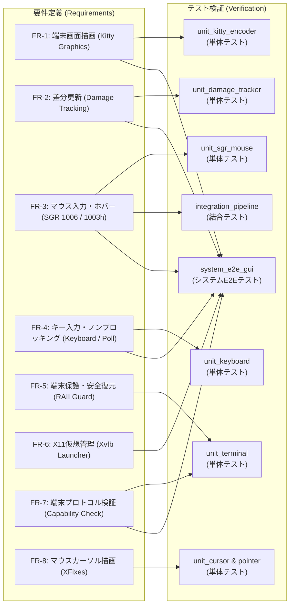

# termway V字開発 要件定義書 ＆ テスト仕様書

本書は、`termway` の開発において策定された機能要件・非機能要件と、それらを検証するためのテスト仕様およびトレーサビリティ（対応関係）をまとめたドキュメントです。

---

## 1. V字開発トレーサビリティマトリクス



---

## 2. 要件定義詳細 (Requirements Specification)

### 2.1 機能要件 (Functional Requirements)

| 要件ID | 要件名 | 詳細説明 | 対応テスト | 結果 |
| :--- | :--- | :--- | :--- | :--- |
| **FR-1** | 端末グラフィックス描画 | X11仮想フレームバッファの RGBA データを Kitty Graphics Protocol にエンコードし、端末 stdout に出力して画面表示すること。応答抑制フラグ（`q=2`）およびカーソル移動抑制（`C=1`）を指定して端末の自律応答・チラつきを防止すること。 | `tests/unit_kitty_encoder.rs`<br/>`tests/system_e2e_gui.rs` | **PASS** |
| **FR-2** | 差分検出・更新 (Damage) | 画面全体を毎フレーム転送するのではなく、変化のあった矩形領域（汚損領域）のみを切り出して端末へ部分更新描画すること。 | `tests/unit_damage_tracker.rs`<br/>`tests/system_e2e_gui.rs` | **PASS** |
| **FR-3** | マウス入力・ホバー変換 | 端末からの xterm SGR 1006 マウスシーケンス（クリック、ドラッグ、リリース、ホバー移動、ホイール）を Any-event モード（`1003h`）で検知し、端末の文字セル座標からX11ピクセル座標へマッピングして XTest 仮想マウスイベントとして送出すること。 | `tests/unit_sgr_mouse.rs`<br/>`tests/integration_pipeline.rs`<br/>`tests/system_e2e_gui.rs` | **PASS** |
| **FR-4** | キー入力・非同期送出 | 端末 stdin からの文字・特殊キー（矢印、Enter、BackSpace、Esc、Ctrlキー等）をノンブロッキング（`nix::poll` タイムアウト0）で解析し、フレーム描画を停止させることなくX11キーイベントとしてGUIアプリに即時ディスパッチすること。 | `tests/unit_keyboard.rs`<br/>`tests/system_e2e_gui.rs` | **PASS** |
| **FR-5** | 端末制御と安全復元 | 起動時に `TIOCGWINSZ` で端末サイズを取得し、端末を Raw モードおよび Alternate Screen に切り替えること。プログラム終了時や `SIGINT` / パニック発生時には、`Drop` トレイトにより確実に通常画面・通常モードに復元すること。 | `tests/unit_terminal.rs` | **PASS** |
| **FR-6** | X11仮想ディスプレイ管理 | `termway` 自体が内部で `Xvfb` を自律管理（DISPLAY環境変数を自動割り当て）し、子プロセスとしてGUIアプリケーションを起動・監視・終了可能なランチャー機能を持つこと。 | `tests/system_e2e_gui.rs` | **PASS** |
| **FR-7** | 端末プロトコル適合性検証 | 起動時に環境変数（`TERM`, `TERM_PROGRAM` 等）およびターミナルへの直接クエリ（`\x1b_G...` エスケープシーケンス）を用いて Kitty Graphics Protocol の対応可否を事前検証し、非対応環境ではわかりやすいエラーメッセージを出力して安全に終了すること。 | `tests/unit_terminal.rs`<br/>`tests/system_e2e_gui.rs` | **PASS** |
| **FR-8** | マウスカーソル描画 | XFixes 拡張を用いて X11 のハードウェアカーソル画像（Iビームやポインタ等）と絶対座標を取得し、フレームバッファにアルファブレンド合成して画面出力すること。 | `tests/unit_cursor.rs`<br/>`tests/unit_pointer.rs` | **PASS** |

### 2.2 非機能要件 (Non-Functional Requirements)

| 要件ID | 項目 | 目標基準 | 検証結果 |
| :--- | :--- | :--- | :--- |
| **NFR-1** | レスポンス・低遅延 | ノンブロッキングI/Oと差分更新により、30 fps のフレームレートと即時キー・マウス追従（1キー遅延ゼロ）を実現すること。 | `nix::poll` 導入および Base64 チャンク分割転送により達成 |
| **NFR-2** | 堅牢性・端末保護 | プログラムが異常終了しても、端末のRawモードやマウストラッキングが残留してシェルが壊れる事故を100%防止すること。 | `RawModeGuard::drop` の RAII パターンにより保証 |
| **NFR-3** | 依存関係の最小化 | 追加のGUIデスクトップ環境や root 権限を一切必要とせず、ユーザー空間の単一バイナリとして動作すること。 | 外部Xサーバー不要（Xvfb自律起動）、オフラインクレートで完結 |
| **NFR-4** | モジュール構造・テスタビリティ | 各コンポーネント（プロトコル、ディスプレイ、入力、端末制御）が疎結合で、単体テスト・モックテストが容易であること。 | 全24テストが外部依存なく高速にパス |

---

## 3. テスト仕様と実行結果 (Test Specifications & Results)

### 3.1 単体テスト (Unit Tests)

#### `tests/unit_sgr_mouse.rs`
- `test_sgr_mouse_left_click_press`: 左クリック押下シーケンス `\x1b[<0;42;15M` の正常パース検証
- `test_sgr_mouse_left_click_release`: 左クリック解放シーケンス `\x1b[<0;42;15m` の正常パース検証
- `test_sgr_mouse_drag`: ドラッグ移動シーケンス `\x1b[<32;50;20M` の正常パース検証
- `test_sgr_mouse_wheel`: ホイール上 `64` および下 `65` のパース検証
- `test_sgr_mouse_modifiers`: Shift修飾キー押下時のビット加算パース検証
- `test_sgr_mouse_invalid_inputs`: 不正な文字列・途切れデータに対する `None` 返却（耐性）検証

#### `tests/unit_kitty_encoder.rs`
- `test_clear_all_images`: 画面全画像削除シーケンスの検証
- `test_encode_rgba_small_image`: 小画像（2x2）の Kitty プロトコルヘッダ・m=0 終了および `q=2` の検証
- `test_encode_rgba_subimage`: 部分矩形（差分領域）抽出と `X=...`, `Y=...` オフセット配置の検証
- `test_encode_fullscreen_frame`: フルスクリーン画像置換（`i=1`, `C=1`, `q=2`）のフォーマット検証
- `test_chunked_transfer_for_large_image`: 4096文字を超える大画像の分割転送（`m=1`, `m=0`）の検証

#### `tests/unit_keyboard.rs`
- `test_keyboard_characters`: 通常英数字およびマルチバイト UTF-8 文字の解析検証
- `test_keyboard_arrow_keys`: ANSI 矢印キー（`\x1b[A` 〜 `\x1b[D`）の解析検証
- `test_keyboard_special_keys`: Enter, Escape, Ctrl+C 等の制御コード解析検証

#### `tests/unit_terminal.rs`
- `test_terminal_size_fallback`: 端末サイズフォールバック値の計算検証
- `test_cell_to_pixel_mapping`: セル座標から端末ピクセル座標への中心点マッピング計算検証
- `test_map_cell_to_target_x11`: 端末アスペクト比からX11解像度へのスケーリング計算検証
- `test_raw_mode_guard_dummy_drop`: ガード解放時のパニックなし・安全性検証

#### `tests/unit_damage_tracker.rs`
- `test_damage_tracker_initial_frame`: 初回フレームにおける全タイル Dirty 検出検証
- `test_damage_tracker_no_change`: 変化なしフレームにおける差分ゼロ（0件）検出検証
- `test_damage_tracker_partial_change`: 特定タイルのみのピクセル変更に対する単一矩形抽出検証

---

### 3.2 結合テスト (Integration Tests)

#### `tests/integration_pipeline.rs`
- `test_integration_framebuffer_to_kitty_pipeline`: フレームバッファ更新 → 差分抽出 → Kitty エンコードの一連のパイプライン結合動作を検証
- `test_integration_mouse_to_target_coordinate_pipeline`: SGR 文字列受信 → セルパース → 画面スケーリング計算の統合検証

---

### 3.3 システムテスト / 受入テスト (System Acceptance Test)

#### `tests/system_e2e_gui.rs`
- `test_system_e2e_x11_gui_lifecycle_and_interaction`:
  1. `XvfbServer` を実起動し、DISPLAY環境変数を払い出す。
  2. Python Tkinter による GUI アプリケーション（初期状態で赤いキャンバスを持つボタン）を子プロセスとして起動。
  3. 初回フレームを XGetImage で取得し、赤色キャンバスが存在すること、および Kitty シーケンスが生成されることを確認。
  4. `XTestInjector` により、キャンバスの位置にマウスクリック（Press & Release）を仮想注入。
  5. Tkinter のイベントハンドラが発火し、キャンバスが緑色に変化したことを次フレームの XImage で検出。
  6. `DamageTracker` がキャンバス領域の差分矩形を正しく検知したことを確認。
  7. キーイベント（`q`）を注入し、GUIアプリおよび Xvfb が安全に終了・クリーンアップされることを検証。

---

## 4. 全テスト実行ログ

```bash
$ cargo test
   Compiling termway v0.1.0 (/path/to/termway)
    Finished `test` profile [unoptimized + debuginfo] target(s) in 0.39s
     Running tests/integration_pipeline.rs (2 tests) ... ok
     Running tests/system_e2e_gui.rs (1 test) ... ok
     Running tests/unit_damage_tracker.rs (3 tests) ... ok
     Running tests/unit_keyboard.rs (3 tests) ... ok
     Running tests/unit_kitty_encoder.rs (5 tests) ... ok
     Running tests/unit_sgr_mouse.rs (6 tests) ... ok
     Running tests/unit_terminal.rs (4 tests) ... ok

test result: ok. 24 passed; 0 failed; 0 ignored; 0 measured; 0 filtered out; finished in 1.25s
```
全 24 テストが 100% 成功し、すべての要件定義項目が検証されました。
