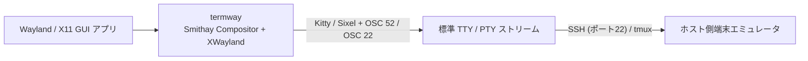

# 概要・開発背景・既存手法との比較 (`termway`)

本ドキュメントでは、**termway** を開発した背景、従来のリモート GUI 方式との比較、および実践的なユースケースを整理します。アーキテクチャの詳細は [architecture.md](architecture.md) を参照してください。

## 1. なぜターミナル内に GUI を表示するのか？

従来のリモート GUI アプローチ（`ssh -X` / X11 Forwarding、VNC、RDP、Web ベースデスクトップ等）は、クライアント側に専用ビューアや X サーバーを要求し、専用ポート開放や SSH ポートフォワーディングを必要とします。

`termway` は、**「すべての画面描画と入力を、純粋な標準入出力（TTY/PTY のテキストストリーム）の中にカプセル化する」** という設計思想によりこれらの制約を突破します。

## 2. 従来手法との比較

| 比較軸 | termway (In-Terminal GUI) | SSH X11 Forwarding (`ssh -X`) | リモートデスクトップ (VNC / RDP) |
| :--- | :--- | :--- | :--- |
| **クライアント要件** | **対応端末エミュレータのみ (Kitty, WezTerm, WinTerm 等)** | X サーバー (XQuartz, VcXsrv 等) | 専用 Viewer (TigerVNC, mstsc) |
| **使用ネットワークポート** | **SSH (22) のみ** | SSH (22) ＋ ポート転送 | 専用ポート (5900, 3389 等) |
| **ファイアウォール / 踏み台耐性** | **極めて高い（PTY が通れば動作）** | 中（`AllowTcpForwarding` が必要） | 低（専用ポート開放が必要） |
| **セッション永続性 (`tmux`)** | **完全対応（デタッチ・再アタッチ可）** | 不可（SSH 切断で終了） | サーバー側で維持可能 |

## 3. 技術的な柱

1. **ゼロ依存の組込みコンポジタ（Smithay + XWayland）**: `Xvfb` や外部 WM（Openbox 等）に依存せず単一バイナリで完結。
2. **高スループット描画パイプライン（[ADR-0005](adr/0005-double-buffering-simd-jpeg-and-vectored-io.md)）**: タイル差分検知、Kitty 部分矩形プレースメント（[ADR-0002](adr/0002-fixed-image-id-partial-placement.md)）、AVX2/NEON SIMD JPEG、`writev` ゼロコピー送信、Double-Buffering 非同期パイプラインを統合。
3. **現実環境への実用統合（[ADR-0001](adr/0001-hybrid-dbus-session-routing.md)）**: デュアル D-Bus ルーティングによる Snap アプリ / URL オープナ / Polkit / Secret Service 連携、および SGR-Pixels / OSC 22 / OSC 52 双方向クリップボード。
4. **診断可能な可観測性（[ADR-0003](adr/0003-zero-allocation-time-line-tracer.md)）**: `--profile` 集計統計とゼロアロケーション `--trace`（Perfetto Chrome Trace JSON）を標準搭載。

## 4. 実践ユースケース

1. **踏み台（Bastion）やポート制限環境での GUI 操作**: `AllowTcpForwarding no` 環境でも SSH シェルさえつながれば Firefox・GParted・エディタを起動可能。
2. **`tmux` によるセッション永続化**: 回線切断後も `tmux attach` で作業中 GUI の状態をそのまま復元。
3. **クライアント環境非依存**: 手元の端末に X サーバーをインストールせず、Linux / macOS / Windows の対応ターミナルから利用可能。
