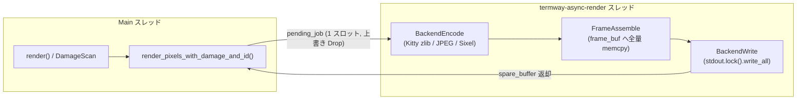
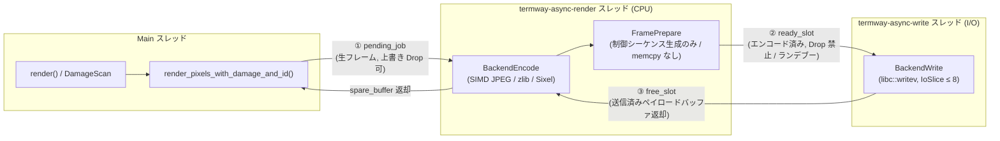
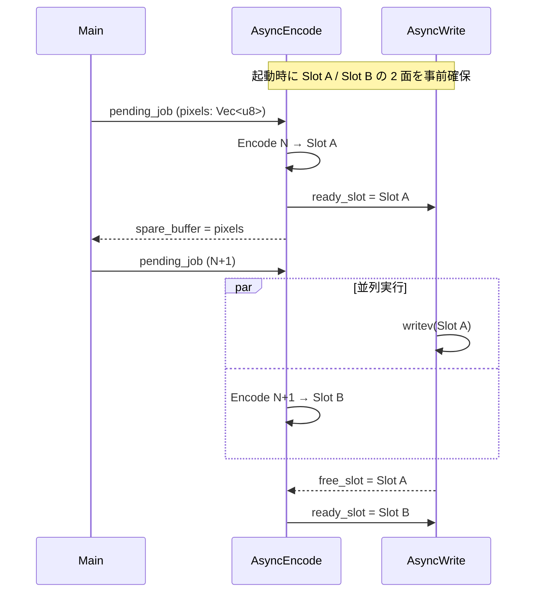
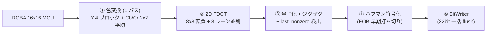

# 01. アーキテクチャ設計（Architecture）

本ドキュメントは、3 テーマ（Vectored I/O・SIMD JPEG・Double-Buffering Pipeline）の全体構造と、各テーマ間の依存関係・不変条件（Invariants）を定義します。個々の関数シグネチャや SIMD 命令の割り当ては [02-detail-design.md](02-detail-design.md) を参照してください。

---

## 1. 現行アーキテクチャ（v0.19.0）



- Main → Worker 間は `Mutex<AsyncRenderState>` + `Condvar` による **1 スロットの最新フレーム上書き方式**（`pending_job`）。
- Worker 内は `Encode → Assemble → Write` が**完全直列**。

---

## 2. 目標アーキテクチャ



### 2.1 3 段のハンドオフと Drop ポリシー

| ハンドオフ | 内容 | 容量 | 満杯時の挙動 | 理由 |
| :--- | :--- | :---: | :--- | :--- |
| ① `pending_job` | 生 RGBA フレーム + damage | 1 | **上書き Drop**（現行どおり、damage は union） | エンコード前なら間引いても差分エンコーダの状態は壊れない |
| ② `ready_slot` | エンコード済み `EncodedFrame` | 1 | **Encode スレッドがブロック待機**（Drop しない） | 差分エンコーダは「直前フレームが端末に表示済み」を前提に状態を更新済み。送信スキップすると端末表示とエンコーダ状態が乖離し、残像・欠損が生じる |
| ③ `free_slot` | 空のペイロードバッファ | 1 | — | 2 面バッファのピンポン交換（Slot A / Slot B） |

> [!IMPORTANT]
> **不変条件 INV-1（送信順序と非欠落）**: Encode スレッドがエンコードを完了した `EncodedFrame` は、生成順に **必ず 1 回だけ** PTY に書き込まれる。`ready_slot` 上での上書き・破棄は禁止する。
>
> **不変条件 INV-2（状態付きエンコーダの単一所有）**: `KittyStreamEncoder` / `SixelStreamEncoder` / `JpegEncoder` は Encode スレッドのみが所有し、Write スレッドからは一切参照しない。Write スレッドが触れるのは不変のバイト列（`EncodedFrame`）のみ。

### 2.2 バッファ所有権の流れ（ゼロアロケーション）



- 各スロット（`EncodedFrame`）は `payload: Vec<u8>`、`prefix: Vec<u8>`、`suffix: Vec<u8>` を保持し、`clear()` による容量維持再利用のみを行う。定常状態での `Vec` 再確保はゼロ。
- エンコーダ内部の出力バッファ（`kitty_out: String` / `sixel_out: Vec<u8>`）は、エンコード完了後に `std::mem::swap` でスロットの `payload` と交換する。コピーは発生しない。

### 2.3 理論スループット

| 構成 | 1 フレームの実効サイクル | Kitty-JPEG 実測値からの推定 |
| :--- | :--- | :--- |
| 現行（直列） | $T_{enc} + T_{asm} + T_{write}$ | 約 15 + 1〜2 + 18 ≈ **33〜35 ms** |
| M1 適用（writev） | $T_{enc} + T_{write}$ | 約 15 + 18 ≈ **33 ms**（`FrameAssemble` 消滅） |
| M2 適用（SIMD JPEG） | $T'_{enc} + T_{write}$ | 約 6〜8 + 18 ≈ **24〜26 ms** |
| M3 適用（2 段パイプライン） | $\max(T'_{enc}, T_{write})$ | 約 **18 ms**（PTY 帯域律速） |

> [!NOTE]
> 上表の数値は v0.18.0 の Perfetto 実測（Firefox / YouTube / Kitty-JPEG）からの概算であり、端末・回線・解像度に強く依存します。各マイルストーンの完了条件では、同一シナリオでの `--profile` / `--trace` 比較値を記録することで実効改善を確認します（[03-roadmap.md](03-roadmap.md)）。

---

## 3. テーマ別アーキテクチャ

### 3.1 Vectored I/O（`writev`）

```text
iov[0]  "\x1b[?2026h" + clear_seq          ← prefix (数十 B, EncodedFrame が保持)
iov[1]  "\x1b[H"  (Sixel のみ)              ← prefix に統合
iov[2]  kitty_out / sixel_out              ← payload (数十 KB〜1 MB, エンコーダ出力そのもの)
iov[3]  taskbar_seq + overlay_seq + hud    ← suffix (数百 B)
iov[4]  "\x1b[?2026l"                      ← suffix に統合
```

- 小さな制御シーケンスは `prefix` / `suffix` の 2 本の小バッファに集約し、**巨大な `payload` だけをコピーせずに参照**する。`iovec` は最大 3 本で済む（`IOV_MAX` 制約から十分遠い）。
- `vmsplice(2)` は採用しない（PTY では `EINVAL`、パイプでもバッファ再利用と両立しない。詳細は [00-background.md §2 課題 1](00-background.md)）。

#### 他の stdout 書き込み経路との排他（重要）

`termway` には `TerminalBackend` 以外にも stdout へ書き込む経路が存在します。

| 経路 | ファイル | スレッド |
| :--- | :--- | :--- |
| OSC 22 カーソル形状 | `src/compositor/state.rs` `update_cursor_shape` | Main |
| OSC 2 タイトル | `src/compositor/state.rs` `update_active_window_title` | Main |
| OSC 52 クリップボード | `src/compositor/handlers/seat.rs` `new_selection` | 使い捨てスレッド |
| 端末復元 | `src/terminal/raw.rs` | Main / panic hook |

> [!WARNING]
> `libc::writev(STDOUT_FILENO, ...)` は Rust の `Stdout` 内部バッファ（`LineWriter`）を経由しないため、そのまま発行すると **他経路が `Stdout` に溜めたまま未フラッシュのバイト列との順序が逆転**したり、フレームの途中に OSC シーケンスが割り込む恐れがあります。
>
> **不変条件 INV-3（stdout 排他）**: `writev` 発行時は必ず `std::io::stdout().lock()` を保持し、ロック獲得直後に `flush()` で `LineWriter` を空にしてから `writev` ループを実行する。ロックは全 `iovec` の書き込み完了まで解放しない。これにより、v0.15.0 で達成した「単一バッファアトミック `write_all`」と同等のフレーム原子性を保証する。

### 3.2 SIMD JPEG エンコーダ



| 段 | スカラー（現行） | AVX2 (`x86_64`) | NEON (`aarch64`) |
| :--- | :--- | :--- | :--- |
| ① 色変換 | 1px ずつ、RGBA を 2 回読む | 8px 同時、1 回読み | 4px × 2 同時、1 回読み |
| ② FDCT | `fdct_1d` × 16 回 | 8 行を 8 レーンで同時に 1D 変換 → 転置 → 再変換 | 4 レーン × 2 |
| ③ 量子化 | 64 回スカラー | 8 係数同時（逆数乗算） | 4 係数 × 2 |
| ④ ハフマン | 63 回固定ループ | スカラー（`last_nonzero` で打ち切り） | 同左 |
| ⑤ BitWriter | 1 バイトずつ | スカラー（32bit 一括） | 同左 |

> [!IMPORTANT]
> **不変条件 INV-4（ビット完全一致）**: SIMD 経路は、同一入力・同一品質に対してスカラー経路と **バイト単位で完全に同一の JPEG ビットストリーム**を出力しなければならない。すべての演算は現行と同じ `i32` 固定小数点・同じ丸め（`+ (1 << 10)) >> 11` 等）で行い、浮動小数点や近似（`mulhrs` 等の丸め挙動が異なる命令）は使用しない。これによりデコーダ互換性（Noctty / WezTerm / Ghostty 等）の再検証を不要にし、差分テストで正しさを機械的に保証する。

- ディスパッチは既存の `display/damage.rs` / `protocol/sixel.rs` と同じ規約（`#[cfg(target_arch)]` + `is_x86_feature_detected!("avx2")` + `#[target_feature(enable = "avx2")] unsafe fn`）に揃える。判定結果は `JpegEncoder::new` で 1 回だけ評価して関数ポインタ（または `enum Backend`）として保持し、MCU ごとの再判定は行わない。
- 端数境界ブロック（`extract_*` のクランプ経路）はスカラーのまま維持し、SIMD は in-bounds 高速パスのみに適用する（全ブロックの 95% 超をカバー）。

### 3.3 Double-Buffering Pipeline

- 新設する `termway-async-write` スレッドは、`ready_slot` を待ち受けて `writev` を実行し、完了したスロットを `free_slot` へ返すだけの単純なループとする。エンコーダ・メトリクス計算・HUD 文字列生成は一切行わない。
- HUD の `fps` / `KB/s` / `last_encode_ms` は Encode スレッド側で計算し、`suffix` に焼き込む（Write スレッドはバイト列を流すのみ）。
- `last_write_ms` を HUD に出す場合は、Write スレッドが `AtomicU64` に書き、Encode スレッドが次フレームの HUD 生成時に読む（1 フレーム遅れの値で許容）。

#### シャットダウン順序

```mermaid
stateDiagram-v2
    [*] --> Running
    Running --> DrainEncode: TerminalBackend::drop()<br/>shutdown = true
    DrainEncode --> DrainWrite: Encode スレッド終了<br/>(pending_job 処理後)
    DrainWrite --> Joined: Write スレッドが ready_slot を<br/>書き切ってから終了
    Joined --> [*]: RawModeGuard による端末復元
```

> [!CAUTION]
> **不変条件 INV-5（終了時の端末保護）**: `TerminalBackend::drop` は Encode → Write の順で `join` し、**Write スレッドが送信途中のフレーム（`\x1b[?2026h` 送出済み・`\x1b[?2026l` 未送出）を残したまま終了してはならない**。`RawModeGuard` の端末復元は両スレッドの `join` 完了後に実行される（既存の drop 順序を維持）。panic 経路では既存の `?2026l` 強制送出（v0.16.0）がこれを補償する。

### 3.4 トレーシングとの統合

| 項目 | 変更 |
| :--- | :--- |
| `ThreadRole` | `AsyncWrite = 2` を追加（Perfetto 上で独立レーン表示） |
| リング | `WRITE_RING` を追加（スレッド独立リングの原則を維持） |
| `BackendWrite` | 記録スレッドを `AsyncRender` → `AsyncWrite` へ移動。`arg1 = bytes`、`arg2 = TIOCOUTQ`、`arg3 = iovcnt` |
| `FrameAssemble` | 廃止し、`FramePrepare`（制御シーケンス生成のみ）に置換 |
| 新規 `EncodeStall` | Encode スレッドが `ready_slot` の空きを待った時間（`ph:"X"`）。**PTY バックプレッシャーの直接指標** |
| 新規 `WriteIdle` | Write スレッドが次フレームを待った時間。**エンコード律速の直接指標** |
| `FrameComplete` | `AsyncWrite` レーンで `flow_end` を発行し、`Main → AsyncRender → AsyncWrite` の 3 レーン flow を形成 |

`EncodeStall` と `WriteIdle` のどちらが長いかを見るだけで、そのセッションが **I/O 律速か CPU 律速か** を即座に判定できるようになります。
