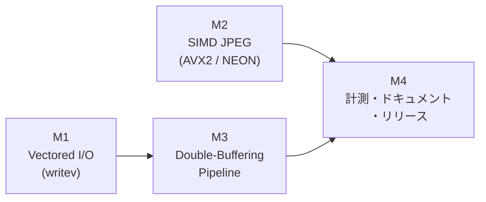

# 03. 実装ロードマップ（Roadmap）

3 テーマは依存関係の少ない順に **M1（Vectored I/O）→ M2（SIMD JPEG）→ M3（2 段パイプライン）→ M4（仕上げ）** で実装します。各マイルストーンは独立したコミット（必要に応じて複数）とし、マイルストーン完了時点で `cargo test` 全件パスと既存挙動の後方互換を保証します。



> [!TIP]
> M2 は M1 / M3 と独立しているため、並行して別ブランチで進めて構いません。M3 は M1 で導入する `EncodedFrame`（prefix / payload / suffix 分割）を前提とするため、必ず M1 の後に着手してください。

---

## 共通の進め方

1. **着手前にベースラインを取得する**:
   同一マシン・同一端末・同一コンテンツ（推奨: Firefox で YouTube 1080p 再生 60 秒、および `xeyes` + ウィンドウドラッグ 30 秒）で以下を保存する。
   ```bash
   termway --profile --trace --trace-file /tmp/base.json.gz -- firefox
   ```
   - `--profile` の JSON レポート（Encode / Write の avg / p95 / p99、Dropped、KB/s）
   - Perfetto トレース（`BackendEncode` / `FrameAssemble` / `BackendWrite` の分布）
2. **各マイルストーン完了時に同条件で再計測**し、コミットメッセージ本文に Before / After を記録する。
3. 既存テスト（現在 128 件超）を 1 件も壊さない。テスト件数の変化は `docs/SPECIFICATION.md` に反映する。

---

## M1 — PTY 送信の Vectored I/O 化（`writev`）

**目的**: `FrameAssemble` における payload 全量 `memcpy` を撤廃し、`prefix / payload / suffix` の 3 本の `IoSlice` を 1 回の `writev(2)` で送出する。

**変更点**:
- `src/backend/vectored.rs` を新設し、`writev_all`（部分書き込み・`EINTR`・`EAGAIN` 対応）を実装。
- `EncodedFrame` を導入し、`src/backend/terminal.rs` の `frame_buf` 組み立てを置換（[02 §1.3](02-detail-design.md)）。
- `KittyStreamEncoder::encode_frame_into` の出力型を `&mut String` → `&mut Vec<u8>` に変更（[02 §1.2 案 C](02-detail-design.md)）。
- stdout ロック獲得 → `flush()` → `writev_all` の順序を厳守（INV-3）。
- トレース: `FrameAssemble` の記録を停止し、`FramePrepare`（`EventId` 末尾追加）を記録。

**テスト**:
- `PIP-001`（`tests/unit_vectored.rs`）:
  - `pipe(2)` に対して 3 本のスライスを `writev_all` し、読み出し結果が単純連結と完全一致すること。
  - 空スライスを含む場合・1 本のみの場合・合計 1MB 超（パイプ容量 64KB を超え部分書き込みが必ず発生する）の場合に、別スレッドで読み出しながら全バイトが順序どおり届くこと。
  - `O_NONBLOCK` を設定したパイプで `EAGAIN` が発生しても全量が届き、`eagain_waits > 0` が記録されること。
- `tests/unit_kitty_encoder.rs` の型変更追随（期待値のバイト列は不変）。

**完了条件**:
- 全テストパス。Perfetto 上で `FrameAssemble` が消え、`FramePrepare` が 0.1ms 未満であること。
- Kitty-JPEG / Kitty-zlib / Sixel の 3 モードで目視上の描画差異（残像・欠損・HUD 崩れ）がないこと。
- OSC 22（カーソル形状）・OSC 2（タイトル）・OSC 52（クリップボード）の同時発生時にフレームが破損しないこと（ウィンドウドラッグ中にテキストコピーを繰り返して確認）。

**コミット**: `perf(backend): replace frame assembly memcpy with writev scatter-gather output`

---

## M2 — 純粋 Rust JPEG エンコーダの AVX2 / NEON ベクトル化

**目的**: `BackendEncode`（Kitty-JPEG）を約 15ms → 5〜8ms（1080p）へ短縮する。

M2 は段階ごとにさらに分割してコミットすることを推奨します。各段階で INV-4（ビット完全一致）の差分テストを必ず通過させてください。

| サブステップ | 内容 | 対象 |
| :--- | :--- | :--- |
| M2-a | スカラーのアルゴリズム改善（`last_nonzero` + EOB 早期打ち切り、`BitWriter` 32bit 一括、raster 順量子化テーブル） | 全アーキテクチャ |
| M2-b | `JpegBackend` ディスパッチ基盤と `TERMWAY_JPEG_SIMD=0` | 全アーキテクチャ |
| M2-c | AVX2: 融合色変換 + FDCT + 量子化 | `x86_64` |
| M2-d | NEON: 融合色変換 + FDCT + 量子化 | `aarch64` |

**テスト**:
- `PIP-002`（`tests/unit_jpeg_simd.rs`）**ビット完全一致差分テスト**:
  - 入力パターン: 単色 / グラデーション / 擬似乱数ノイズ / 実 GUI 風（文字＋平坦部）/ 高エントロピー（自然画像相当）。
  - 解像度: 1x1、7x5、15x17、16x16、17x31、640x480、1920x1080、および任意ストライドの部分矩形（`encode_subimage_into` の `rect_x/rect_y` 非ゼロ）。
  - 品質: 1, 50, 75, 90, 100。
  - 判定: `Scalar` と `Avx2`（または `Neon`）の出力 `Vec<u8>` が **`assert_eq!` で完全一致**すること。
  - FDCT / 色変換 / 量子化の各段単体でも、ランダム入力 10,000 ブロックでスカラーと一致すること。
- M2-a 単独で、改修前後のスカラー出力がビット完全一致すること（アルゴリズム改善が出力を変えないことの証明）。
- CI: 既存の QEMU aarch64 テスト（フェーズ 9）で NEON 経路の差分テストを実行する。
- `tests/perf_pipeline.rs`: JPEG 1080p エンコード時間をスカラー / SIMD で併記出力。

**完了条件**:
- 全テストパス（x86_64 実機 + aarch64 QEMU）。
- 1080p JPEG エンコードがスカラー比 **2 倍以上**高速（`perf_pipeline` の release ビルド計測）。
- `TERMWAY_JPEG_SIMD=0` でスカラー経路に切り替わること。

**コミット（例）**:
- `perf(jpeg): add early EOB, 32-bit bit flushing, and raster-order quant tables`
- `perf(jpeg): add AVX2 fused color conversion, FDCT, and quantization`
- `perf(jpeg): add ARM NEON fused color conversion, FDCT, and quantization`

---

## M3 — エンコード・PTY 送信の 2 段ダブルバッファ・パイプライン化

**目的**: `BackendEncode` と `BackendWrite` を別スレッドに分離し、実効サイクルを $T_{enc} + T_{write}$ から $\max(T_{enc}, T_{write})$ へ短縮する。

**変更点**:
- `termway-async-write` スレッドと `WriteHandoff`（`ready` 容量 1・`free` 2 面）を新設（[02 §3](02-detail-design.md)）。
- `EncodedFrame` を `Box` 化してスロットとして循環させ、`payload` とエンコーダ出力を `std::mem::swap` で交換。
- `BackendMetrics` に `frames_written` / `encode_stall` / `write_idle` を追加し、`print_summary` と JSON に反映（既存キー不変）。
- トレース: `ThreadRole::AsyncWrite`、`WRITE_RING`、`EncodeStall`、`WriteIdle` を追加し、`BackendWrite` / `FrameComplete` を AsyncWrite レーンへ移動。
- `TERMWAY_PIPELINE=serial` で M1 の直列経路にフォールバック可能にする。
- `TerminalBackend::drop` で Encode → Write の順に `join`（INV-5）。

**テスト**:
- `PIP-003`（`tests/unit_pipeline.rs`）**順序保証と非欠落（INV-1）**:
  - stdout の代わりにパイプへ出力できるよう、書き込み先 FD を注入可能なテスト用コンストラクタ（`TerminalBackend::with_output_fd`、`#[doc(hidden)]`）を用意する。
  - 意図的に遅い読み出し側（各フレーム読み出し後に sleep）で 200 フレームを投入し、①出力側で観測される `frame_id` 列が狭義単調増加であること、②`jobs_rendered == frames_written` であること、③Drop は `pending_job`（エンコード前）でのみ発生していること（`frames_dropped + jobs_rendered == jobs_submitted`）を検証。
- `PIP-004` **並列性**:
  - エンコード側・書き込み側の双方に人工遅延（各 20ms）を注入できるテストフックを設け、100 フレームの総処理時間が直列（約 4.0 秒）ではなく並列（約 2.0〜2.4 秒）に近いことを検証（CI の揺らぎを考慮し閾値は 3.0 秒未満とする）。
- `PIP-005` **シャットダウン安全性（INV-5）**:
  - 書き込み途中で `TerminalBackend` を drop し、出力ストリーム中の `\x1b[?2026h` と `\x1b[?2026l` の出現回数が一致すること、およびデッドロックせず 1 秒以内に `join` が完了すること。
- `tests/unit_trace.rs`: 3 リングの drain、`AsyncWrite` スレッドメタデータ、`EncodeStall` / `WriteIdle` の出力を検証（`TRC-002` を拡張）。

**完了条件**:
- 全テストパス。
- Kitty-JPEG ベースラインシナリオで、Perfetto 上で `BackendEncode`（AsyncRender レーン）と `BackendWrite`（AsyncWrite レーン）が**時間的に重なって**表示されること。
- 同シナリオで実効描画 FPS が M2 完了時比で向上し、`--profile` の Dropped 率が悪化しないこと。
- `TERMWAY_PIPELINE=serial` で M1 相当の挙動に戻ること。

**コミット**: `perf(backend): split encode and PTY write into double-buffered pipeline threads`

---

## M4 — 計測・ドキュメント・リリース

**変更点**:
- ベースライン → M1 → M2 → M3 の Before / After 計測結果を `docs/pipeline/04-results.md` として追加（Perfetto スクリーンショットと `--profile` JSON の要点）。
- 設計判断（`vmsplice` 不採用、エンコード後 Drop 禁止のランデブー方式、ビット完全一致契約）を **ADR-0005** として `docs/adr/` に記録。
- `docs/ARCHITECTURE.md`（スレッド構成図・§4 計測）、`docs/SPECIFICATION.md`（新規 FR / `PIP-001`〜`PIP-005` / テスト件数）、`docs/ROADMAP.md`（§16 から完了マイルストーンへ移動）、`docs/trace/`（`AsyncWrite` レーン追記）、`README.md` / `README.ja.md`（`TERMWAY_JPEG_SIMD` / `TERMWAY_PIPELINE`）を更新。
- バージョンを上げてタグを付与（マイナーバージョンアップ想定）。

**コミット**: `docs: document double-buffered pipeline, SIMD JPEG, and writev results`

---

## 検証シナリオ ↔ テスト ID 対応表

| ID | シナリオ | 検証内容 | 不変条件 | ステップ |
| :--- | :--- | :--- | :--- | :--- |
| PIP-001 | Vectored I/O の完全性 | 部分書き込み・`EAGAIN`・1MB 超での全バイト順序一致 | INV-3 | M1 |
| PIP-002 | SIMD JPEG ビット完全一致 | Scalar と AVX2 / NEON の出力バイト列完全一致（多解像度・多品質・部分矩形） | INV-4 | M2 |
| PIP-003 | パイプライン順序保証 | `frame_id` 単調増加、`jobs_rendered == frames_written`、Drop はエンコード前のみ | INV-1, INV-2 | M3 |
| PIP-004 | パイプライン並列性 | 人工遅延下で総処理時間が $\max$ 側に近いこと | — | M3 |
| PIP-005 | シャットダウン安全性 | `?2026h` / `?2026l` の対応一致、デッドロックなし | INV-5 | M3 |

---

## リスクと対策

| リスク | 影響 | 対策 |
| :--- | :--- | :--- |
| 端末エミュレータが `writev` による複数セグメント到着で同期描画（`?2026`）を誤処理する | 描画の一瞬の欠け | カーネル側で PTY に連結されるため端末からは単一ストリームとして見え、理論上影響なし。M1 完了条件の 3 モード目視確認で担保 |
| SIMD 化でビット不一致が混入 | デコード結果の微差・端末互換性の再検証が必要に | PIP-002 の差分テストを CI 必須化。不一致時はスカラーへ自動フォールバックせず**テスト失敗**とする |
| 2 スレッド化によるデッドロック | 終了不能・端末が壊れる | Condvar 1 本・ロック 1 段のみの単純設計、PIP-005、`TERMWAY_PIPELINE=serial` 退避路 |
| Encode が先行しすぎて表示遅延（レイテンシ）が増える | 入力応答の悪化 | `ready` 容量 1 + `free` 2 面で、先行は最大 1 フレームに制限される。M3 完了条件で入力→表示の体感を確認し、必要なら `EncodeStall` 時に `pending_job` を最新へ差し替えてからエンコード開始する（既存の上書き Drop で自然に実現） |
| メモリ使用量の増加 | 2 面分の payload（1080p zlib で最大数 MB） | 許容範囲。M4 で `/usr/bin/time -v` によりピーク RSS を計測・記録する |
