# テスト方針・仕様およびトレーサビリティ (`termway`)

本ドキュメントは `termway` のテスト方針、実行方法、テストスイート仕様一覧、および [requirements.md](requirements.md) との要件・テストトレーサビリティを定義します。直近のテスト実行ログは [reports/test-results.md](reports/test-results.md) を参照してください。

---

## 1. テスト実行手順

```bash
# 全テストスイート実行（単体・結合・ベンチマーク・E2E）
cargo test

# リリース最適化有効での全テスト・ベンチマーク実行
cargo test --release

# 特定スイートの実行例（例: aarch64 QEMU / CI 向けユニットサブセット）
cargo test --test unit_damage_tracker --test unit_compositor --test unit_sixel_encoder \
  --test unit_keyboard --test unit_terminal --test unit_sgr_mouse
```

---

## 2. 要件・テスト トレーサビリティマトリクス

```mermaid
flowchart LR
    subgraph Requirements["要件定義 (Requirements)"]
        FR1["FR-1: 端末画面描画 (Kitty Graphics / zlib)"]
        FR2["FR-2: 差分更新 (Tile Damage Tracking)"]
        FR3["FR-3: マウス入力・ホバー (SGR 1006 / 1003h)"]
        FR4["FR-4: キー入力・修飾キー (Keyboard / Poll)"]
        FR5["FR-5: 端末保護・安全復元 (RAII Guard)"]
        FR7["FR-7: 端末プロトコル自動検証 (Capability Check)"]
        FR10["FR-10: 双方向クリップボード同期 (OSC 52 / Paste)"]
        FR12["FR-12: Sixelプロトコル対応 & ピクセルパーフェクト追従"]
        FR16["FR16: Smithay Wayland コンポジタ & XWayland 統合"]
        FR18["FR-18: ハイブリッド D-Bus セッション & Secret Service 中継"]
        FR19["FR-19: Polkit 認証エージェント連携 (特権GUI昇格)"]
        FR21["FR-21: コマンド存在性・PATH 事前検証 (Exit 127)"]
        FR22["FR-22: /tmp/.X11-unix 書込権限事前検査"]
        FR23["FR-23: Wayland データデバイスフォーカス & シリアル整合性"]
        FR24["FR-24: XDG Popup & X11 Override-Redirect メニュー制御"]
        FR25["FR-25: ウィンドウ最小化・最大化・タスクバー管理 (WindowManager)"]
        FR26["FR-26: 動的ターミナルリサイズ追従 (SIGWINCH)"]
        FR27["FR-27: リアルタイムパフォーマンス HUD (--hud)"]
        FR28["FR-28: 起動時スプラッシュスクリーン (--no-splash)"]
        FR29["FR-29: パフォーマンスプロファイリング (--profile)"]
        FR30["FR-30: Sixelバンドキャッシュ & Kittyストリーミング"]
        FR31["FR-31: 統一FDポーリング & fpsフレームペーシング"]
        FR34["FR-34: Wayland Fractional Scale & HiDPI 制御"]
        FR35["FR-35: OSC 22 マウスカーソル形状同期"]
        FR36["FR-36: Kitty Keyboard Protocol (CSI u)"]
        FR37["FR-37: Wayland Primary Selection & 中クリックペースト"]
        FR38["FR-38: OSC 2 端末タブタイトル動的同期"]
        FR39["FR-39: Kitty Graphics JPEG 拡張 (f=101) & 30fps 即時フレームフラッシュ"]
        FR40["FR-40: SGR-Pixels 高精度 1px マウストラッキング (DECSET 1016h)"]
        FR43["FR-43: ゼロアロケーション・タイムライントレーシング (--trace)"]
        FR44["FR-44: Wayland ポインタフレーム分離 & 水平スクロール (GTK/Tauri 互換)"]
    end

    subgraph Verification["テスト検証 (Verification)"]
        T_Sys["system_e2e_gui<br/>(システムE2Eテスト: 2件)"]
        T_Integ["integration_pipeline<br/>(結合テスト: 11件)"]
        T_Mouse["unit_sgr_mouse<br/>(単体テスト: 7件)"]
        T_Kitty["unit_kitty_encoder<br/>(単体テスト: 20件)"]
        T_Term["unit_terminal<br/>(単体テスト: 6件)"]
        T_Damage["unit_damage_tracker<br/>(単体テスト: 9件)"]
        T_Key["unit_keyboard<br/>(単体テスト: 6件)"]
        T_Comp["unit_compositor<br/>(単体テスト: 44件)"]
        T_Sess["unit_session<br/>(単体テスト: 7件)"]
        T_Secret["unit_secret_bridge<br/>(単体テスト: 6件)"]
        T_Sixel["unit_sixel_encoder<br/>(単体テスト: 7件)"]
        T_Trace["unit_trace<br/>(単体テスト: 8件)"]
        T_Vectored["unit_vectored<br/>(単体テスト: 4件)"]
        T_JpegSimd["unit_jpeg_simd<br/>(単体テスト: 5件)"]
        T_Pipeline["unit_pipeline<br/>(単体テスト: 4件)"]
        T_Perf["perf_pipeline<br/>(性能ベンチマーク: 2件)"]
    end

    FR1 --> T_Kitty
    FR1 --> T_Sys
    FR2 --> T_Damage
    FR2 --> T_Sys
    FR3 --> T_Mouse
    FR3 --> T_Integ
    FR3 --> T_Comp
    FR4 --> T_Key
    FR5 --> T_Term
    FR7 --> T_Integ
    FR10 --> T_Comp
    FR12 --> T_Sixel
    FR16 --> T_Comp
    FR16 --> T_Sys
    FR18 --> T_Sess
    FR18 --> T_Secret
    FR19 --> T_Sess
    FR21 --> T_Sess
    FR22 --> T_Sess
    FR23 --> T_Comp
    FR24 --> T_Comp
    FR25 --> T_Comp
    FR26 --> T_Comp
    FR27 --> T_Comp
    FR28 --> T_Comp
    FR29 --> T_Perf
    FR29 --> T_Comp
    FR30 --> T_Sixel
    FR30 --> T_Kitty
    FR31 --> T_Comp
    FR31 --> T_Integ
    FR34 --> T_Comp
    FR35 --> T_Comp
    FR36 --> T_Key
    FR37 --> T_Comp
    FR38 --> T_Comp
    FR39 --> T_Kitty
    FR39 --> T_Integ
    FR39 --> T_Comp
    FR40 --> T_Mouse
    FR40 --> T_Comp
    FR40 --> T_Integ
    FR44 --> T_Mouse
    FR44 --> T_Comp
```



---

## 3. テストスイート一覧 (Test Specifications)

| テストターゲット | テスト数 | 検証内容 |
| :--- | :---: | :--- |
| `src/lib.rs` | 8 | 純粋 Rust Baseline JPEG (YCbCr 4:2:0) エンコーダ（SOF0, DQT, DHT, SOS）、任意ストライド部分矩形抽出、奇数解像度、1x1〜1080p 色再現性・高解像度ベンチマーク、固定小数点逆数乗算テーブル、端末テキストサニタイズ、CJK 文字カラム幅計算 |
| `tests/unit_compositor.rs` | 44 | `TermwayState` / `WindowManager` ドメイン操作、SSD/CSD 装飾、最大化・80%中央復元・最小化、8方向リサイズ（4辺・4隅）・安全画面外ドラッグ移動、動的リサイズ (`SIGWINCH`)、OSC 52 クリップボード送信、マウスホイール（上下・左右ディスパッチ、Wayland ポインタフレーム分離）、スプラッシュ描画・消去、JSON 状態ダンプ、UTF-8 日本語入力、Fractional Scale / Viewporter / HiDPI スケールレンダリング、OSC 22 カーソル形状同期、Wayland Primary Selection、OSC 2 端末タブタイトル同期、SGR-Pixels (1016h) 1px 精度マウスディスパッチ、`TERMWAY_NO_CURSOR_SHAPE` オプトアウト、`TERMWAY_FPS`、`LatencyHistogram` p95/p99 レイテンシ検証 |
| `tests/unit_session.rs` | 7 | ハイブリッド D-Bus セッション起動、Snap コマンド判定・PATH シムルーティング、Polkit エージェント検出、コマンド存在性検証、`/tmp/.X11-unix` 書込検査 |
| `tests/unit_kitty_encoder.rs` | 20 | Kitty フルスクリーン RFC 1950 zlib 圧縮 (`o=z`)・4096B チャンク分割・ラウンドトリップ解凍検証、累積バウンディングボックス部分矩形プレースメント転送・デコード検証、大面積更新時フルフレームフォールバック、定点動画の無制限連続部分転送、解像度変更ガード、端末合成シミュレータによるピクセルレベル残像完全ゼロ検証、Kitty-JPEG (`f=101`) フルスクリーン/部分プレースメント/透過ダミー保護検証、品質設定検証、1080x720 パフォーマンス検証 |
| `tests/unit_sixel_encoder.rs` | 7 | Sixel AVX2 / ARM NEON SIMD 減色・6行バンド走査・単色バンド高速パス・RLE 圧縮・非8倍数幅エッジケース、6行バンド差分キャッシュ (`SixelStreamEncoder`)、1080x720 パフォーマンス検証 |
| `tests/unit_damage_tracker.rs` | 9 | 32x32 タイル FNV-1a ハッシュ比較、AVX2 / ARM NEON SIMD 端数タイル一致検証、RGB565 量子化マスクノイズ除去検証、リセット・リサイズ検証、2D 隣接タイル結合 & 50% 閾値、SIMD タイルハッシュ拡散強化検証 |
| `tests/unit_sgr_mouse.rs` | 7 | SGR 1006 クリック・ドラッグ・リリース・垂直/水平ホイール（Up/Down/Left/Right）・修飾キー・高値座標パース・不正シーケンス耐性検証 |
| `tests/integration_pipeline.rs` | 11 | Framebuffer → DamageTracker → Kitty エンコード結合検証、マウス座標変換、プロトコル自動検出、Kitty-JPEG 自動プローブおよびフォールバック検証、SGR-Pixels (1016h) 端末サポート検出、`--version` / `-V` 検証、CLI 引数バリデーション検証、`--query` 診断レポート出力検証 |
| `tests/unit_keyboard.rs` | 6 | UTF-8 文字、矢印キー、Ctrl 制御文字、Shift/Ctrl 修飾キー付きカーソル・選択キー、日本語 UTF-8 複数バイト解析、Kitty Keyboard Protocol (CSI u) 解析検証 |
| `tests/unit_secret_bridge.rs` | 6 | D-Bus Secret Service (`org.freedesktop.secrets`) メッセージエンディアン解析・境界安全性・Allow-list ポリシー・双方向リレー検証 |
| `tests/unit_terminal.rs` | 6 | 端末サイズフォールバック、セル→ピクセル変換、TerminalBackend モード名検証、`RawModeGuard` RAII 安全性検証、シグナル終了フラグ & 生端末復元検証 |
| `tests/unit_trace.rs` | 8 | 32B 固定長構造体検証 (TRC-001)、リングバッファ overflow & drop-oldest 順序検証 (TRC-001)、Chrome Trace Event JSON および `.gz` 圧縮出力 (TRC-001)、`frame_id` 跨スレッド非同期フロー & `BackendDrop` 原因追跡 (TRC-002)、高頻度マウスインプレース共結成 & `--trace-no-input` ゲート (TRC-003)、連番スナップショットローテーション & CLI パース (TRC-004)、WM 状態遷移カウンタトラック (`win_{id}_state`: 1→2→0→1) およびライフサイクルイベント (TRC-005) |
| `tests/system_e2e_gui.rs` | 2 | Smithay コンポジタ描画 → DamageTracker → Kitty エンコード → SIMD BGRX 変換 E2E パイプライン検証、テストドライバ JSON ダンプ検証 |
| `tests/unit_vectored.rs` | 4 | `writev_all` によるゼロコピー scatter-gather 出力検証 (PIP-001): 複数スライス結合完全性、空/単一スライス、1MB 超大容量ペイロード、ノンブロッキング `EAGAIN` / `EINTR` リカバリ |
| `tests/unit_jpeg_simd.rs` | 5 | SIMD JPEG ビット完全一致差分検証 (PIP-002 / INV-4): 多解像度 (1x1 〜 1080p)・任意部分矩形・全品質 (1..100)・10,000 ランダムブロック単体での 2D FDCT & 量子化一致、`TERMWAY_JPEG_SIMD=0` 環境変数検証 |
| `tests/unit_pipeline.rs` | 4 | Double-Buffering パイプライン検証 (PIP-003〜005): 順序保証・エンコード後非欠落 (INV-1)、人工遅延下でのパイプライン並列性 (PIP-004)、シャットダウン安全性・同期描画ブラケット `?2026` 整合性 (INV-5)、`TERMWAY_PIPELINE=serial` フォールバック |
| `tests/perf_pipeline.rs` | 2 | パイプライン段別ベンチマーク検証、JPEG 1080p スカラー vs AVX2/NEON SIMD 速度比 (3.29x) ベンチマーク |
